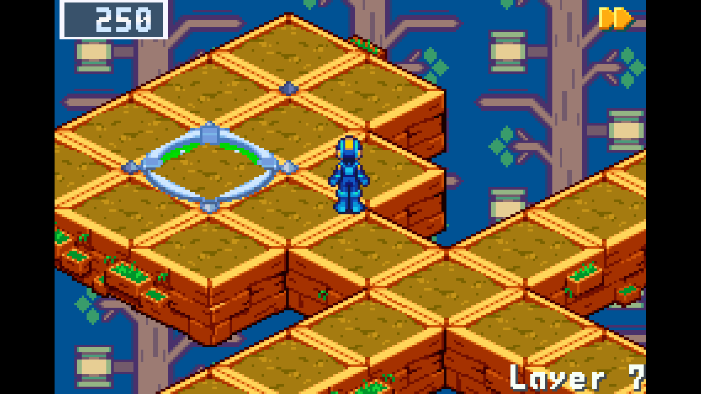

# The issues' forms

Two forms, each with an example as it was filed. A section with nothing
to say is left out; none is filled to look complete.

## A fault

```markdown
Reported on Discord by HANDLE, DATE: MESSAGE_LINK

> the player's words for this fault, and only this one

**Version, system, ROMs:** as said, or "not said (assumed X; the picture is 1920x1080)".

## What the picture shows


The picture read closely: the place, the layer, what is wrong and where,
what else the frame tells (a mark, a menu, a number).

## Leads

- The concept that owns it and its section, the files that draw or decide it.
- What could cause it, as places to look; what an earlier issue changed there.
- What is not known.

## To reproduce

The command or the play that should show it (a `build.py shot` route, a
`tools/cw.py play`), or "not tried".

## Not in the report

What the fix's author would want and the player did not say: the version,
the seed, whether it happens again after CONTINUE.

## Checks for the fix

The row of AGENTS.md's table the change falls under, and what of it applies.
```

The fields follow `.github/ISSUE_TEMPLATE/bug.yml` (version, system,
device, other ROMs, where, layer and area, what happened, in a battle,
again after CONTINUE, the save, media): what the player gave goes in,
what he did not goes under "Not in the report".

**As filed** (issue 913, `bug`, `P3`, `needs info`, `area: layers`):

```markdown
Reported on Discord by Agergo100, 25 November 2026: https://discord.com/channels/1572977737558265896/1572978701002350633/1575227189664677960

> Judge Tree Comp covers the portal

**Version, system, ROMs:** not said (assumed 0.24.0 or 0.23.0; the picture is 1920x1080).

## What the picture shows



Layer 7, an area drawn with the Judge Tree Comp's tiles. A warp pad lies
on a panel of the floor. Its ring is drawn, but the pad's lit inside is
not there: the floor's texture runs through the ring. Fast forward is on
(the mark at the top right).

## Leads

- A pad's parts: docs/rom/net-maps.md, "Teleports and the pads' centrepieces"; pasted by `src/map/netmap_paste.c`.
- The Judge Tree Comp is a comp, not a surface area: its tile set may lack the pad's inside or hold it at other tile numbers.
- The owner's rule for such faults: the layouts stay, the drawing adapts, judged by eye.

## To reproduce

`python3 build.py shot --scene emu --net-biome N` with the Judge Tree's area's number, a layer with a warp pad on screen; or `build.py tiles` for that area.

## Not in the report

The version; the seed; whether the pad still works; whether other comps' pads look the same.

## Checks for the fix

Layer generation or maps' row of AGENTS.md's table: `build.py tiles` no worse than the baseline, captures of a pad in every area.
```

## An idea

```markdown
**The idea** (HANDLE, Discord's ideas, DATE): the idea in a sentence or
two, the player's reason with it where he gave one.

The owner's answer there: what he said, in his words where they decide
something. Or: "Still in discussion there", and who said what.

## What to build            <- a clear idea (`ready`)

- What the player sees and does, a line each.
- Where it does not apply.

## Open                      <- a rough one (`needs design`), or what is left of a clear one

- **The question**, and what hangs on it.
- The standing call or the design doc it meets.

Through the game-design skill first, where it decides how the game plays
(balance, rewards, progression, a menu or screen).

## Leads

- The files and concepts where it would land; an issue that built something alike.
- A scenario or check that would show it works.

From: THREAD_LINK
```

**A clear one, as filed** (issue 916, `enhancement`, `ready`,
`area: platform`):

```markdown
**The idea** (BlockMan, Discord's ideas, 26 November 2026): start a run with auto-run. He already holds B to charge the buster in battle and does not want to keep a button of his 3DS pressed on the field as well.

The owner's answer there: yes, as a settings toggle.

## What to build

- A line in Options, and its key in `settings.ini`: Run, **Hold B** (BN6's way, the default) or **Always**.
- On Always, MegaMan and Lan run without a button held; B held walks instead.
- Only where the player walks: not in a battle (B stays the buster), a menu, a chat box or the PET.

## Note

AGENTS.md's rule stands: MegaMan walks as BN6 walks him, no movement assist. This changes which button is held for BN6's own run, not how he moves; docs/game/fidelity.md gets a line saying so.

## Leads

- Input is read once a frame in `platform_poll`; the key the game sees on the field is where B is turned round.
- Options' lines and their notes: `src/core/options_text.c`, `src/core/startup.c`, as `fast_music` was added for issue 839.
- A scenario: on Always, a walk of N frames covers a run's distance, and B in a chat box still closes it.

From: https://discord.com/channels/1572977737558265896/1575366637887029358
```

**A rough one, as filed** (issue 918, `enhancement`, `needs design`,
`area: run`):

```markdown
**The idea** (Agergo100, Discord's ideas, 25 November 2026): a chip starter pack. A run starts with one or more random standard chips, by how many kinds of chip the profile has donated. To donate a kind, the player gives one of it in every code; it is then marked donated. "More like a Pokedex challenge."

The owner's answer there: sounds really fun, a good addition; others' feedback welcome.

## Open

- **Where chips are donated**, and from what: a run's Pack is gone at its end.
- **What the pack gives**: how many chips for how many kinds, and from which pool.
- **Power across runs.** The meta layer's rule is variety, not power (docs/game/meta/design.md), and act 1 is kept scarce on purpose (docs/game/economy/opening-plan.md).

Through the game-design skill, then `build.py economy` for what a start with the pack hands out.

From: https://discord.com/channels/1572977737558265896/1575240702122524693
```

## A report added to an issue that exists

```markdown
Also reported on Discord by HANDLE, DATE: MESSAGE_LINK

> the player's words

What this report adds: the system, a second place it happens, a picture.
```
