# The player's guide

The [README](../README.md) shows the game on one page. This guide holds the
rest: what you need, the install on each system, the controls, a run in
full, saving, online play in the Net Square, the screen, the anonymous
statistics, troubleshooting and building the game yourself.

[What you need](#what-you-need) · [Install](#install) · [Playing](#playing) ·
[A run](#a-run) · [Getting stronger](#getting-stronger) ·
[What carries over](#what-carries-over) · [Saving and losing](#saving-and-losing) ·
[Moving saves between devices](#moving-saves-between-devices) · [Online](#online-the-net-square) · [Screen](#screen) · [Anonymous statistics](#anonymous-statistics) ·
[Troubleshooting](#troubleshooting) · [Building](#building)

## What you need

- A handheld with PortMaster installed (AmberELEC, ArkOS, Knulli, muOS,
  ROCKNIX and others), a Steam Deck, an
  x86-64 Linux PC (glibc 2.34 or newer: Ubuntu 22.04, Debian 12, Fedora 35
  and later), a 64-bit Windows 10 or 11 PC, a Mac with macOS 11 or newer
  (Apple silicon or Intel), an Android 5 or newer phone, tablet or
  handheld, a New 3DS, New 3DS XL or New 2DS XL with custom firmware
  (Luma3DS) and FBI, a Switch with custom firmware (Atmosphère), a
  PlayStation Vita or PlayStation TV with custom firmware (HENkaku or
  h-encore) and VitaShell, a PS4 with GoldHEN or a PS5 with etaHEN, or a
  current browser.
- **Mega Man Battle Network 6: Cybeast Gregar (USA)** as an unmodified `.gba`
  file, dumped from your own cartridge. Its SHA-1 is
  `89fe0bac4fd3d2ab1d2ca35e87ef8b1294a84cd6`. Cybeast Falzar, other regions
  and the Legacy Collection version do not work yet.
- Optional: **Mega Man Battle Network 5: Team Colonel (USA)**, unmodified,
  in the same folder as your BN6 ROM (SHA-1
  `5f472f78d8de2df01d5039e045c043cb40969a39`). Its net areas then turn up
  in runs, in place of the BN6 areas they resemble (ACDC Area, Oran
  Area, SciLab, End Area, its Undernet and Nebula Area), each in about
  half the runs that come there, in BN5's own tiles, music and
  bystanders, their random battles BN5's own, fought in BN6's engine
  (every Cross and chip of the run works there). In half the runs a Navi
  of BN5's guards such an area (KnightMan, ShadowMan, NumberMan,
  TomahawkMan, ToadMan, Colonel), and the Undernet's and the Graveyard's
  acts draw their guardians from both games' Navis; beaten, he gives his
  Soul, which MegaMan can UNITE with in every battle after. From the
  second act BN5's viruses and BN6's meet in battles, the Undernet's and
  the Graveyard's acts draw on both, half the chips their shops and
  Mystery Data hold are BN5's, which the Library counts apart, and its
  flames of darkness hold BN5's DarkChips. Its songs join the
  [Jukebox](#the-jukebox). Online, it completes the
  [NetPass](#the-netpass): NetBattles, trades and the week's DeepNet. A note in
  the title's top right corner says "BN5 found" as the game starts. On
  Linux, macOS, Windows, the Steam Deck, PortMaster handhelds, Android,
  iPhones and iPads, a New 3DS, a Switch, a PS Vita and in the browser. Added later, it
  is found at the next start beside BN6 (on Android, an iPhone or an
  iPad, in the folder you chose); on a PC, a Mac, a phone or a tablet, R
  on the title also opens the [ROMs screen](#the-roms-screen) to add it,
  and in the browser its slot on the player's screen does.

No download and no page contains Capcom data. Without the ROM there is no
game.

## Install

Every system has its own download on the [releases page](https://github.com/saschb2b/Mega-Man-Battle-Network-Cyberworld-Endless/releases): pick
yours from the table. The project's
[download page](https://saschb2b.github.io/Mega-Man-Battle-Network-Cyberworld-Endless/download/)
leads with the system you visit it with, and lists every other. Each needs your own
ROM ([What you need](#what-you-need)); none contains game data.

| You play on | Download | Steps |
| --- | --- | --- |
| Windows 10 or 11, 64-bit | `cyberworld-endless-windows-x64-setup.exe` (an installer) or `cyberworld-endless-windows-x64.zip` (a folder, nothing installed) | [On Windows](#on-windows) |
| A Mac, macOS 11 or newer | `cyberworld-endless-macos.dmg` | [On a Mac](#on-a-mac) |
| A Linux PC, x86-64 | `cyberworld-endless-x86_64.AppImage`, `cyberworld-endless.flatpak`, `cyberworld-endless_amd64.deb` or `cyberworld-endless-linux-x86_64.tar.gz` | [On a Linux PC](#on-a-linux-pc) |
| A Steam Deck | `cyberworld-endless.flatpak` | [On a Steam Deck](#on-a-steam-deck) |
| An Android phone, tablet or handheld | `cyberworld-endless.apk` | [On Android](#on-android) |
| An iPhone or iPad, iOS 14 or newer | through SideStore or AltStore Classic: its source, `altstore-source.json`; or `cyberworld-endless.ipa` | [On an iPhone or iPad](#on-an-iphone-or-ipad) |
| A handheld with PortMaster | `cyberworld-endless-portmaster.zip` | [On a PortMaster handheld](#on-a-portmaster-handheld) |
| A New 3DS, New 3DS XL or New 2DS XL | `cyberworld-endless.cia` (HOME Menu) or `cyberworld-endless.3dsx` (Homebrew Launcher) | [On a New 3DS](#on-a-new-3ds) |
| A Switch with custom firmware | `cyberworld-endless.nro` (Homebrew Menu) | [On a Switch](#on-a-switch) |
| A PS Vita or PS TV with custom firmware | `cyberworld-endless.vpk` (VitaShell) | [On a PS Vita](#on-a-ps-vita) |
| A PS4 with GoldHEN, or a PS5 with etaHEN | `cyberworld-endless.pkg` (the Package Installer) | [On a PS4 or PS5](#on-a-ps4-or-ps5) |
| A browser, a phone's too | nothing: [the player](https://saschb2b.github.io/Mega-Man-Battle-Network-Cyberworld-Endless/play/) | [In a browser](#in-a-browser) |

Releases up to 0.6.0 named the PortMaster port
`cyberworld-endless-rocknix-portmaster.zip`; up to 0.4.0 it was
`cyberworld.zip`, the Windows installer `cyberworld-endless-setup-x64.exe`
and the website's files `cyberworld-endless-web.zip`.

### The ROMs screen

On a PC, a Mac, an Android device, an iPhone or an iPad the game first
opens on its ROMs screen: two cartridge slots, BN6 Cybeast Gregar
(needed) and BN5 Team Colonel (optional), each an open spot until its
ROM is in. Choose a slot (a tap, a click, or A) and pick the file in the
system's own file chooser (on Linux, `zenity` or `kdialog`), or drop it
on the window; on a phone or tablet, pick the folder your ROMs are in. A
ROM the game finds by itself (in Downloads, EmuDeck's or RetroDECK's
folders) is in its slot already. Each file is checked by its SHA-1, and
one that is not right is named with the reason ("BN6 Cybeast Falzar, not
Gregar"). Where there is no file chooser (a Steam Deck's Gaming Mode, a
Linux PC without `zenity` or `kdialog`, such as the Flatpak's sandbox),
put the file in Downloads: the screen finds it within a few seconds. A
cartridge in shows its game's face on its label, drawn from
your ROM as the screen opens; the cartridge around it is the project's
own drawing. **PLAY** starts the game as soon as BN6 is in.

Later starts go straight to the game: the screen comes back by itself
only when BN6 is missing or BN5 has gone. To add BN5 later, press R on
the title (the small line by its menu names the key) and choose it; **DONE**
goes back to the title.

The screen also says where your saves are kept. On a PC or a Mac that is
the data folder, which uninstalling leaves alone. On a phone or tablet,
where uninstalling the app deletes its files, it names the folder that
keeps a copy for a reinstall: the ROM folder you chose, or another chosen
with **SAVES › FOLDER** ([Moving saves between devices](#moving-saves-between-devices)).
ROMs chosen as files leave no folder for the copy until you choose one.

### On Windows

From the [releases](https://github.com/saschb2b/Mega-Man-Battle-Network-Cyberworld-Endless/releases), for 64-bit Windows 10 and 11:

- **Installer:** `cyberworld-endless-windows-x64-setup.exe` installs the game for
  you alone (no administrator), adds it to the Start menu and, if you like,
  the desktop; Settings > Apps removes it again.
- **Zip:** `cyberworld-endless-windows-x64.zip` holds the same game in a
  folder: unpack it anywhere and run `cyberworld-endless.exe`.

The game is not signed, so Windows may say "Windows protected your PC" the
first time: **More info**, then **Run anyway**. The first start opens the
[ROMs screen](#the-roms-screen): a ROM in Downloads is in already, else
choose the file in Windows' file dialog or drop it on the window. The game
keeps a copy in `%LOCALAPPDATA%\cyberworld-endless\rom\`, where the saves
live too (uninstalling leaves them). It opens in a window at the largest whole
scale that fits; F11, Alt+Enter or Options' **Display** switches to
fullscreen, and the game opens as you left it. Keyboards and
controllers (Xbox, PlayStation, Switch) work as on Linux. Steam's own **Add
a Non-Steam Game** takes `cyberworld-endless.exe`.

### On a Mac

`cyberworld-endless-macos.dmg` from the [releases](https://github.com/saschb2b/Mega-Man-Battle-Network-Cyberworld-Endless/releases) holds one app for Apple
silicon and Intel Macs, macOS 11 and newer: drag **Cyberworld Endless** into
Applications. Apple has not notarized it (that takes a paid developer
account), so the first start is refused: open **System Settings > Privacy &
Security**, choose **Open Anyway** beside Cyberworld Endless and confirm (on
macOS 14 and older, Control-click the app and choose **Open**). The first
start opens the [ROMs screen](#the-roms-screen) (a ROM in Downloads is in
already); the ROM's copy, the saves and `keys.ini` live in
`~/Library/Application Support/cyberworld-endless/`.

### On a Linux PC

Three ways from the [releases](https://github.com/saschb2b/Mega-Man-Battle-Network-Cyberworld-Endless/releases), each with a menu entry and an icon you
can pin to the dock:

- **AppImage** (any distribution): download
  `cyberworld-endless-x86_64.AppImage`, make it executable (`chmod +x`, or
  the file's Properties) and start it. On the first start it offers to add
  itself to the application menu. It does not need libfuse2.
- **.deb** (Debian, Ubuntu, Mint, Pop!_OS): download
  `cyberworld-endless_amd64.deb` and open it with your software centre, or
  `sudo apt install ./cyberworld-endless_amd64.deb`. It appears in the menu
  as **Cyberworld Endless**; remove it like any other package.
- **Flatpak** (any distribution with Flatpak): download
  `cyberworld-endless.flatpak` and open it with your software centre, or
  `flatpak install --user cyberworld-endless.flatpak`.

The first start opens the [ROMs screen](#the-roms-screen): a ROM in
Downloads or in EmuDeck's and RetroDECK's folders is in already; else
choose the file (a file chooser when `zenity` or `kdialog` is installed)
or drop it on the window. The game keeps a copy in
`~/.local/share/cyberworld-endless/rom/` (the Flatpak's in
`~/.var/app/io.github.saschb2b.Mega-Man-Battle-Network-Cyberworld-Endless/data/`), where your saves
also live. It opens in a window at the largest whole scale that fits; F11,
Alt+Enter or Options' **Display** switches to fullscreen, and the game
opens as you left it.

With Steam installed, the first start from the desktop offers to add the
game to Steam as well, with its library artwork; `--add-to-steam` does it
later (the AppImage: `./cyberworld-endless-x86_64.AppImage --add-to-steam`;
the Flatpak: see the Steam Deck steps below).

`cyberworld-endless-linux-x86_64.tar.gz` is the same game as a plain folder:
unpack it anywhere and run `./cyberworld-endless`; `./install.sh` adds it
to the menu. Its `README.md` has the keyboard keys.

### On a Steam Deck

The Deck runs the Linux build, best as a Flatpak, the way SteamOS installs
software:

1. In Desktop Mode, download `cyberworld-endless.flatpak` from the
   [releases](https://github.com/saschb2b/Mega-Man-Battle-Network-Cyberworld-Endless/releases)
   and open it: Discover installs it (and the runtime it needs from
   Flathub).
2. Add it to Steam with its library artwork (the capsules, the banner, the
   logo and the icon): open **Konsole** and paste

   ```bash
   python3 "$(flatpak info --show-location io.github.saschb2b.Mega-Man-Battle-Network-Cyberworld-Endless)/files/share/cyberworld-endless/steam/add-to-steam.py"
   ```

   It asks to close Steam for a moment (Steam reads its games only when it
   starts), adds the game and opens Steam again; run it again after
   reinstalling, add `--remove` to take the entry away. Without the
   artwork: right-click **Cyberworld Endless** in the application menu and
   choose **Add to Steam**.
3. Return to Gaming Mode: the game is in your library under **Non-Steam**,
   and Steam hands the Deck's controls to it as a gamepad.
4. The ROM: with EmuDeck or RetroDECK there is nothing to do. The game looks
   in `Emulation/roms/gba` and `retrodeck/roms/gba`, on the Deck and on its
   SD card, finds the ROM by its contents and keeps a copy of its own.
   Otherwise put the `.gba` file (unzipped) into Downloads: the ROMs screen
   finds it within a few seconds, in Gaming Mode too, which has no file
   chooser. Or choose it there in Desktop Mode.

The AppImage works too: right-click it, **Properties**, **Permissions**,
**Is executable**, and start it once in Desktop Mode. It offers to add
itself to the application menu and to Steam, with the artwork.

In Gaming Mode it fills the screen, at 5x (1200x800) on the Deck's 1280x800.
On a Deck OLED, set the game's refresh rate to 60 Hz (the **...** button,
**Performance**, **Refresh Rate**, with the per-game profile on): the game
runs at the GBA's 60 frames a second, which the OLED's 90 Hz shows for one
refresh or two in turn, a slight judder. Or keep 90 Hz and turn on
smooth motion ([Screen](#screen)).
The Deck's A, B, L1 and R1 are the GBA's A, B, L and R, the Menu button (☰)
is Start and the View button (⧉) is Select. To quit, hold View and Menu
for a second, then again; or use the Steam button's **Exit Game**. Saves
live in `~/.var/app/io.github.saschb2b.Mega-Man-Battle-Network-Cyberworld-Endless/data/cyberworld-endless/`
(the AppImage's in `~/.local/share/cyberworld-endless/`) and survive
SteamOS updates.

### On Android

Download `cyberworld-endless.apk` from the
[releases](https://github.com/saschb2b/Mega-Man-Battle-Network-Cyberworld-Endless/releases)
on the phone, tablet or handheld and open it (Android asks once to allow
installs from your browser or file manager). The first start opens the
[ROMs screen](#the-roms-screen): tap BN6's slot and choose the folder your
ROMs are in, with Android's own folder picker. The app opens only the
`.gba` files there and keeps copies of BN6's and, if it is there, BN5's
in its own storage, beside your saves. It names any `.gba` it refuses,
and why ("BN6 Cybeast Falzar, not Gregar"). Android 11 and later keep apps
out of Download itself: put the ROMs in a folder in it, such as
Download/ROMs, or tap **FILES INSTEAD** and pick BN6 and BN5 together
(hold one to select both). The folder is looked in again at each start,
so BN5 put there later comes in by itself; R on the title, or holding the
app's icon and tapping **ROMs** (Android 7.1 and later), opens the ROMs
screen again. A handheld's own controls, a Bluetooth or USB
controller (two Joy-Cons as one) and the touch screen all work: the game
draws touch controls round the picture until a controller's button is
pressed, and Back asks before it quits. On a handheld with a second
screen, such as the AYN Thor, the lower one is the PET beside the game, as
on a 3DS ([android/README.md](../android/README.md#the-second-screen)).

Uninstalling the app deletes its own files, the saves among them. The
game keeps a copy, `cyberworld-endless.cwsave`, in your ROM folder or a
folder chosen with **SAVES › FOLDER**; after a reinstall, choose that
folder again and the game offers the copy back
([Moving saves between devices](#moving-saves-between-devices)).
Android's own backup, where it is turned on, keeps the saves and settings
too, never the ROMs.

### On an iPhone or iPad

Apple's App Store has no place for a game that runs on a ROM, so the app
comes through [SideStore](https://sidestore.io), which installs apps with
your own Apple ID and keeps them up to date. Not AltStore PAL, the EU's App
Marketplace edition: it installs only apps Apple has notarized ("missing a
marketplaceID").

1. Set up SideStore once, with a computer: [iloader](https://iloader.app)
   (Windows, macOS or Linux) installs it over a USB cable, then the
   LocalDevVPN app on the phone lets SideStore install and renew apps by
   itself ([SideStore's guide](https://docs.sidestore.io/docs/installation/install)).
   On iOS 16 and newer, turn on Developer Mode too. AltStore Classic works
   the same way, with AltServer on a Windows PC or a Mac.
2. In SideStore, open **Sources**, tap **+** and add
   `https://github.com/saschb2b/Mega-Man-Battle-Network-Cyberworld-Endless/releases/latest/download/altstore-source.json`
   (the [download page](https://saschb2b.github.io/Mega-Man-Battle-Network-Cyberworld-Endless/download/#ios)
   has a button that does it on the phone).
3. Install **Cyberworld Endless** from the source. With a free Apple ID an
   app lasts seven days: SideStore renews it, and offers each new version.
4. Start it: the [ROMs screen](#the-roms-screen) opens. Tap BN6's slot
   and pick the folder your ROMs are in, in Files. The app opens only the
   `.gba` files there, copies BN6's and, if it is there, BN5's in, and
   looks in the folder again at each start, so BN5 put there later comes
   in by itself. A file in iCloud Drive that is not on the phone yet is
   downloaded first (in a big folder, download BN6's in Files yourself).
   Or tap **FILES INSTEAD** and pick the ROMs, or put them in Files, **On
   My iPhone › Cyberworld**, where the app keeps your saves too and looks
   at every start. Deleting the app deletes that folder with it. The
   game keeps a copy of the saves, `cyberworld-endless.cwsave`, in your
   ROM folder or a folder chosen with **SAVES › FOLDER**; after a
   reinstall, choose that folder again and the game offers the copy back.

Touch controls round the picture, or a controller (MFi, Xbox,
PlayStation). `cyberworld-endless.ipa` on the releases page is the app
alone, for another installer. The app was built and started in the iOS
Simulator, not yet on an iPhone: reports are welcome.
[ios/README.md](../ios/README.md) has the rest.

### On a PortMaster handheld

For a handheld whose firmware runs PortMaster: AmberELEC, ArkOS, Knulli,
muOS, ROCKNIX and others (the game was made on a Retroid Nova and a
Retroid Pocket Flip 2). On a PC, a Mac or an
Android device, take that system's download from the table above.

1. Download `cyberworld-endless-portmaster.zip` from the
   [releases](https://github.com/saschb2b/Mega-Man-Battle-Network-Cyberworld-Endless/releases) and unpack it (or build it with
   `python3 build.py package`, which writes it to `build/release/`, see
   [Building](#building)).
2. Copy `cyberworld/` and `Cyberworld Endless.sh` into the handheld's
   `ports` folder, where PortMaster keeps its ports (on ROCKNIX:
   `/storage/roms/ports/`).
3. Copy your ROM into `ports/cyberworld/rom/`. The file name does not matter;
   the game checks the contents.
4. Refresh the game list and start **Cyberworld Endless**.

The first start records the game's boot once, which takes a few seconds.
After that the game starts straight away.

### On a New 3DS

On a New 3DS, New 3DS XL or New 2DS XL with custom firmware (Luma3DS),
open **FBI**, choose **Remote Install**, then **Scan QR Code**, and scan the
code on the
[download page's 3DS entry](https://saschb2b.github.io/Mega-Man-Battle-Network-Cyberworld-Endless/download/#3ds):
FBI downloads `cyberworld-endless.cia` from the newest release and installs
it on the HOME Menu, with its icon and banner. Or copy the CIA to the SD
card and install it from FBI's SD browser. `cyberworld-endless.3dsx` is the
same game for the Homebrew Launcher (`sdmc:/3ds/`).

Put your ROM in `sdmc:/3ds/cyberworld-endless/rom/`, or leave it where you
keep GBA games (`sdmc:/roms/gba/`, `sdmc:/roms/`, `sdmc:/gba/`): any file
name works. BN5 Team Colonel's goes beside it, or in any of those folders.
The first NEW GAME boots BN6 once, about 15 seconds of black
screen. The bottom screen is the PET beside the game, framed like BN6's
own PET screens, with HP, Zenny and BugFrags; on the net it shows the
layer's map, always open, in the folder editor the whole folder, in a
battle the Custom screen's chip and the fight, in the NaviCustomizer the
program under the cursor and what RUN would bring, in the Library the
chip under the cursor, in E-Mail the mail's sender, in a shop the entry
under the cursor, and in the town and on the title the PET at home with
MegaMan's face.
The older 3DS and 2DS are too slow for it.
[3ds/README.md](../3ds/README.md) has the rest.

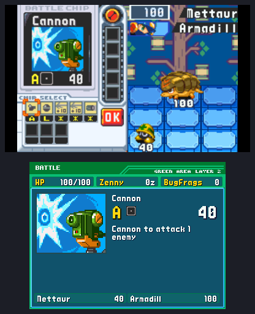
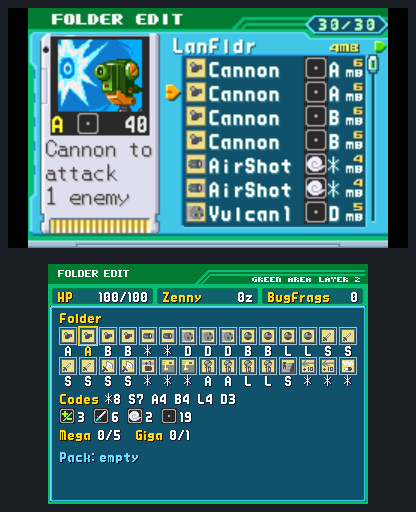
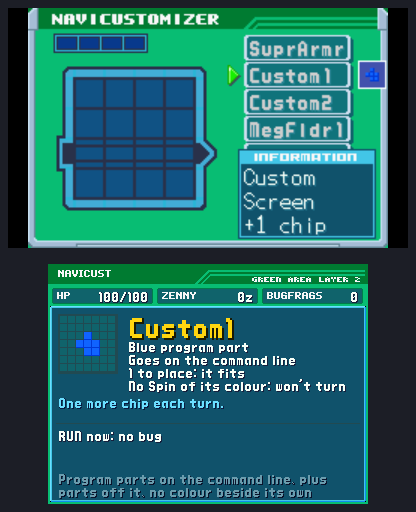

### On a Switch

On a Switch with custom firmware (Atmosphère), copy
`cyberworld-endless.nro` into `sdmc:/switch/cyberworld-endless/` on the SD
card and start it from the Homebrew Menu. Open the Menu by holding R while
you start a game, which gives the game a title's whole memory; from the
Album it runs with less.

Put your ROM in `sdmc:/switch/cyberworld-endless/rom/`, or leave it where
you keep GBA games (`sdmc:/roms/gba/`, `sdmc:/roms/`, `sdmc:/gba/`): any
file name works. BN5 Team Colonel's goes beside it, or in any of those
folders. The GBA's buttons are on the Switch's buttons of the same names,
Plus for START and Minus for SELECT. Online is as everywhere, NetBattles
included. [switch/README.md](../switch/README.md) has the rest.

### On a PS Vita

On a PlayStation Vita or PlayStation TV with custom firmware (HENkaku or
h-encore), copy `cyberworld-endless.vpk` to the memory card and install it
from VitaShell; the game gets its bubble on the home screen.

Put your ROM in `ux0:data/cyberworld-endless/rom/`, or leave it where you
keep GBA games (`ux0:roms/gba/`, `ux0:roms/`, `ux0:data/gba/`): any file
name works. BN5 Team Colonel's goes beside it, or in any of those folders.
Cross is the GBA's A and Circle its B; a touch on the front screen shows
the touch controls. Closing the game from the LiveArea ends it at once, so
a run goes on from its last checkpoint. Online is as everywhere.
[vita/README.md](../vita/README.md) has the rest.

### On a PS4 or PS5

On a PS4 with GoldHEN, install `cyberworld-endless.pkg` from its Package
Installer; a PS5 that installs PS4 packages (etaHEN) takes the same
package. The game gets its tile on the home screen.

Put your ROM in `/data/cyberworld-endless/rom/` on the internal drive
(GoldHEN's FTP reaches it), or leave it on a USB drive (`roms/gba/`,
`gba/` or the drive's top): any file name works. BN5 Team Colonel's goes
beside it, or in any of those folders. Cross is the GBA's A and Circle
its B. Online is as everywhere; this build sends no statistics and never
asks. [ps4/README.md](../ps4/README.md) has the rest.

### In a browser

Open **[the player](https://saschb2b.github.io/Mega-Man-Battle-Network-Cyberworld-Endless/play/)**: the two cartridge slots on its screen,
BN6 and BN5, take your ROM files (tap one to choose them, or drop them on
the page); Battle Network 5: Team Colonel's beside BN6's if you have it
(both at once, or BN5 later in its slot). The page checks each file by
its SHA-1, says why it refuses one, shows each game's face on its
cartridge, and keeps them, with your saves, in the browser's own storage
(IndexedDB); they are never uploaded. Next time **Play** starts straight
away, the game at the largest whole scale the window holds. **Menu** over
the screen (or F1) pauses the game and holds the rest: Fullscreen, Smooth
motion, the controls, **Save backup** and **Load backup**, which open the
game's **SAVES** screen over the title ([Moving saves between devices](#moving-saves-between-devices)),
and **Forget all**, which removes the ROMs and saves. SAVES exports one
`cyberworld-endless.cwsave` file or imports one through the browser's own
file chooser; the same file works on the other systems. BN5's areas,
viruses, Navis and chips run in the same emulator as BN6's: nothing more to
start up, and the page's memory BN6's and BN5's ROM file.

On a phone or tablet the game fills the screen and draws its own buttons
round the picture, sized for a thumb: a D-pad, A, B, L, R, Start and
Select, under the picture when the phone is upright and beside it when it
lies on its side, and a MENU button that sizes and moves them (see
[Playing](#playing)). A controller or a keyboard puts them away until the
screen is touched again.
Added to the home screen (the browser's *Add to Home screen* or *Install*),
it opens full screen like an app.

`cyberworld-endless-website.zip` on the releases page is this site and its
player as files, for hosting them yourself; playing needs none of it.

## Playing

Each start opens with the developer's boot screen and a note from MegaMan
on where to report bugs and ideas: the project's GitHub page, with a QR
code for a phone's camera. Any button skips them.

On the title screen, press Start and choose **NEW GAME** or **CONTINUE**.
CONTINUE shows how deep your saved run is; the corner shows your best depth.

In the net, the buttons are the Game Boy Advance's and BN6 plays as it always
has. On a keyboard the layout is the one Capcom's PC version (the Legacy
Collection) uses: the left hand moves and opens the Custom screen, the right
hand uses chips and the buster.

| Button | Keyboard | Also |
| --- | --- | --- |
| D-Pad | W A S D | Arrow keys |
| A | J | X |
| B | K | Z |
| L / R | Q / E | |
| Start | Enter | Keypad Enter |
| Select | R | Backspace |
| [Fast forward](#fast-forward) | Tab | Space |

Keys are positions, so on an AZERTY keyboard you move with Z Q S D. F11 or
Alt+Enter switches to fullscreen (kept for the next start); Escape twice
quits. A controller's D-pad
and left stick move, its A and B are A and B (on a Nintendo pad the buttons
marked so), its shoulders L and R and its left trigger L too, its right
trigger and a press of its right stick fast forward, Start is Start and
Back (Minus) is Select; holding Back and Start for a second, twice, quits,
whatever they are set to. Two Joy-Cons are one controller, on a phone too;
one alone is a small one held sideways.

**Soft reset:** **A+B+Select+Start** together, as mapped, returns to the
title, in a battle too. **CONTINUE** takes the run up at its last
checkpoint; what came after it is lost.

**Options** holds the game's settings, a press away wherever you are: the
title's menu has an **OPTIONS** line under NEW GAME and CONTINUE (Select
there opens it too), and in a run the PET's menu (START on the map) has
**Options** in the place BN6 gives Comm, which a run never used; the game
waits under it, and B brings you back to the PET where you were. On a
phone or tablet the touch controls' menu has **OPTIONS** as well. Its
**Controls** opens the controls screen (not on the 3DS, whose
buttons are its own), **Display** the picture ([Screen](#screen)),
**Audio** the music, the sound effects and the sound ([Sound](#sound)),
**Fast forward** its speed ([Fast forward](#fast-forward)), and
**Statistics** your answer to the statistics' question, where the game can
send them; B goes back (on a phone, the touch controls' B).

**The controls screen** sets the buttons, laid out as big games lay theirs.
Options' **Controls** opens it. It has a tab for
the controller and, on a PC or in a browser, one for the keyboard: L and R
(Tab on a keyboard) switch them. Each GBA button has a row with a **MAIN**
and an **ALSO** slot: choose a slot and press the button (or key) you want
there. One another GBA button had moves over, the two swapping where that
one would be left with none, and the line under the rows says what moved.
X (Backspace or Delete on a keyboard) clears a slot, though every GBA button
keeps one. **D-PAD** sets its four directions in turn, each a button, a
stick, a hat or a key. **A and B** has presets: as labeled; **B on X**, left
of A as on the GBA (Square on a PlayStation pad; a Nintendo pad has its B
there already); and A and B swapped. The dot at each row's end lights when
its button is pressed, so a map can be tried before it is kept. **Set all**
asks for every button in turn, for a pad laid out its own way (waiting
skips one). **Defaults** brings the tab's device back as it came, and
**Done**, or Back after a change, asks you to press the new A to keep them:
if you do not within ten seconds, the old ones stay. The screen itself
always takes the controller's own A, B and D-pad, the keyboard and taps,
whatever the buttons are set to. Nintendo's pads keep their buttons apart
from the others', as their A sits where the others' B does.

A controller SDL has no layout for (an 8BitDo Micro on a PC, or a pad a
browser does not know) is read as it is: its hat and first stick move,
its first two buttons are A and B, and the screen names its buttons by
number (**Btn 1**), so each can be given its GBA button there. Its D-pad,
whatever it sends, is set with **D-PAD**, and **Set all** sets everything.

The screen writes `pad.ini` and `keys.ini` in the save folder
(`~/.local/share/cyberworld-endless/` on Linux, `savedata/` on the
handheld), made with these defaults on the first start; by hand they set
the sticks too. `pad.ini` names a controller's buttons as SDL does (`a`,
`leftshoulder`, `lefttrigger`, `-lefty`), and those of one read as it is
under `[joystick]` as SDL's mappings name a joystick's: `b0`, `h0.1` (its
hat up), `-a1` (its second axis one way).

A touch screen shows the buttons on it from its first touch (a Steam
Deck's too), until a key or a controller is used again. The D-pad takes
diagonals where MegaMan walks (the net's walkways run along them) and four
directions in battles and menus. Their **MENU** button pauses the game and
opens their menu: **SIZE** and **OPACITY** of them all, **HAPTICS** (a tick
under the thumb, on Android and in browsers that can), **OPTIONS** (the
controls screen, the sound) and **EDIT LAYOUT**: tap
a button to choose it, drag it where your thumb wants it, pinch it or drag
a corner to size it, give it its own opacity, or take a preset
(**DEFAULT**, **LEFT-HANDED**, **COMPACT**, and **LARGE** where the screen
has room); **DONE** keeps them, **CANCEL** leaves them as they were. Their
**▶▶** is [fast forward](#fast-forward)'s. The
phone upright and on its side keep an arrangement each (`touch.ini` in the
save folder).

| Button | In the net | In battle |
| --- | --- | --- |
| A | Talk, open Mystery Data | Use a chip |
| B | Run; in a chat, hold to fast-forward the text | Fire the buster |
| L | Ask MegaMan where you are and what's ahead; the layer's Mystery Data counters show at the top right for a few seconds | Open the Custom screen; on it, try to run (never from a guardian) |
| R | Jack in (at Lan's PC); in Lan's HP, jack out | Open the Custom screen; on it, describe the chip or Cross under the cursor |
| Start | Open the PET | Pause |
| Select | Hold for the map of the layer so far: where you have been, the services (those MegaMan senses but you have not reached as rings where they stand, or arrowheads on the frame pointing their way), the way to the exit or guardian, and the Mystery Data MegaMan knows of by colour: taken, of those seen or sensed behind a set piece (dim once all are taken; there may be more out there), each one seen and not yet taken marked where it stands (and, while you hold an Unlocker, every purple one); let go, and the arrow shows the way on | On the Custom screen, hide it to see the field; again to bring it back |

In the net MegaMan walks as in BN6: a single direction goes straight across
the screen, and two together (like DOWN+LEFT) go along a walkway. A turns
him to the navi or Mystery Data beside him, or walks him up to one a step
or two before him.

### Fast forward

Fast forward runs the game faster where nothing is decided against the
clock: walking a layer, the town and its places, chats, fades and warps,
a battle's opening up to its first Custom screen, and its results from
the last deletion on. The fight itself always runs at BN6's speed, from
its first Custom screen to its end, the pause with it; so do BN6's own
menus (the PET, shops, traders, mail), and online it never runs. The one
fight it runs in is a Virus Battler's (below), whose viruses fight on
their own: his VIRUS LIST and the placing stay at BN6's pace.

Press its button to turn it on and again to turn it off: **Tab** or
**Space** on a keyboard, a controller's right trigger or a press of its
right stick, **▶▶** on the touch controls (beside MENU upright, beside
START on its side). Held instead, it runs only while held; held while it
is on, the game slows to BN6's pace until you let go, for a careful walk
along a walkway. The controls screen sets its button as it sets the GBA's
(its **FAST** row; it may have none). Where it cannot run, its button does
nothing and the touch controls' **▶▶** is not there: in a fight, on BN6's
menus, online, on the title, and everywhere with Options' line at
**Off**. Turned on before a battle, it waits through the fight and runs
again as the results show. While it runs, two orange arrows, the PET's
cursor, show in the picture's top right corner.

Options' **Fast forward** line sets how fast: **2x**, **3x** (the default)
or **4x**, or **Off**, where its button does nothing (`fast_forward` in
`settings.ini`). The music keeps its pitch as it plays faster. A machine
that cannot run the game that fast runs it as fast as it can (the New 3DS
gains little). The run's rules do not change with it: random battles come
as often per step, every reward is the same, and the run's minutes count
the game's own time, so the week's DeepNet ranks a dive alike with it or
without.

### Rumble and triggers

A controller rumbles on the beats of a fight: when MegaMan is hit (harder
the more of his HP it takes), when his buster's charge is full and when
the charged shot fires, on a counter's Full Synchro, when a virus is
deleted (a Navi longer), as he takes Beast Out or a Cross, at his own
deletion, and as he jacks in. His own attacks are felt as they sound:
the rumble follows BN6's sound of each one as it plays, so a buster shot
is a short tick, every bullet of a Vulcan its own, a sword a swing and a
Cannon a blast with its rumbling tail, and his hits landing a knock. The
buster's charge hums, rising as it fills, clicks once it is full, throbs
while you hold it, and the charged shot kicks back as it leaves the
buster. The
enemies' attacks are felt only when they hit him. Each one comes with
what the screen and the sound already show, so turning it off loses
nothing. Nothing rumbles while fast forward runs or online.

On a PS5 DualSense the adaptive triggers click where a pull does
something. Once the Custom gauge is full, the trigger that is L or R
resists and gives way halfway, as the press opens the Custom screen.
Where fast forward can run, FAST's trigger has a lighter click like a
switch. Elsewhere both triggers pull free. By default L2 is L and R2 is
FAST; the controls screen moves them, and the clicks follow.

Options' **Audio** sets them: **Vibration** (**Strong**, **Medium**, the
default, **Weak** or **Off**; `vibration` in `settings.ini`) and, while
a DualSense is the controller in use, **Trigger effects** (**On** or
**Off**; `trigger_effects`).

- **Where:** the Linux builds (a Steam Deck's own controls too), Windows,
  macOS and iOS rumble a controller, iOS without the trigger effects. A
  PortMaster handheld and the Switch rumble where their SDL drives the
  motor (untested). Android, the browser and the 3DS don't yet; the PS
  Vita has no motor.
- **Bluetooth or USB:** a DualSense rumbles and clicks either way. Over
  Bluetooth the game asks SDL for the controller's full reports, which it
  keeps until it is turned off. On Windows, a game reading it through
  DirectInput afterwards may need the controller turned off and on again.
- **Steam:** with Steam Input on for the game's shortcut, the game sees
  Steam's own controller in the DualSense's place. Rumble still gets
  through, but the trigger effects don't. Turn Steam Input off for the
  shortcut (its Properties, Controller) or start the game outside Steam
  to feel the triggers.

### A run

A new stretch of net has opened under the town: the Endless Net. Its
paths change every time someone jacks in, it only goes down, and
everything in it is copied from the real net, the guardians too, built
from every battle MegaMan has fought. Something at the bottom keeps
copying. Dad calls the first time; after that Lan and MegaMan talk it
over as they go, and L asks MegaMan where they are.

A run begins at home, in Lan's room in Central Town. Step up to his PC
and press R: Lan jacks MegaMan in to their homepage, Lan's HP, and its
pink pad leads into the net. Lan's HP is home on the net: after every
act MegaMan comes back to it, and its pink pad and link squares light up
as the ways on, the next act's areas. MegaMan has not been through them
yet, so beside one he only says what he reads through it, the data's
feel and a strong Navi's signal, naming the Navi once he has battled
him. Two more links lead back to the areas already won: a layer of an
old area to stock up in, each once a visit. But while MegaMan goes back,
the Net keeps copying: every trip moves the Net's clock a notch, and each
guardian after it has a tenth more HP. R there asks to jack out, back to
Lan's PC; down the stairs and out of the front door is Central Town,
Capcom's own, home between the acts. The day goes on with the run:
morning as it begins, afternoon after the first act, evening after the
second, night before the Nest. The town remembers: the plaza's Mr.Prog
calls the Net's news (the guardian MegaMan just deleted, or how the last
run ended), Lan's classmate, the neighbor and the man from the lab speak
of the run, and the crowd stands somewhere new at each visit. AsterLand
and the Cyber Academy are open. At AsterLand's counter the Order Service
sells any chip the Library holds, in your folder's codes, one order a
visit. Its list sorts as the folder editor's does: START goes on to the
next of BN6's seven sorts (ID, ABCDE, Code, Attack, Element, No. for the
copies you hold, MB), SELECT turns the order around, and the clerk says
which it is; the list opens in the last one again. Beside the counter the
SubChip seller stocks the keys the act ahead asks for, and its Chip
Trader trades as in BN6, START sorting your Pack there.

At each visit three people post a request for the act ahead: the
NetBattler at AsterLand's request board, the NetBattle club in class 6-1
and the man from the lab in the town. Win battles without a scratch or
in ten seconds each, search every Mystery Data of a layer, hand over a
chip of an element from the Pack, or vow to take no Mr.Prog's patch
until the guardian falls. Lan takes one or none, as BN6's Request BBS
has it, and the one who asked pays at the next visit. On a second
screen, the PET at home names the hour, the request held and how far
along it is, and the ways on.

<p align="center">
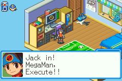
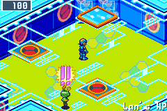
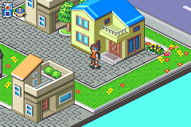
</p>

<p align="center">
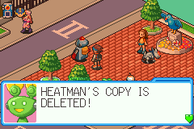
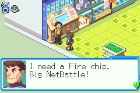
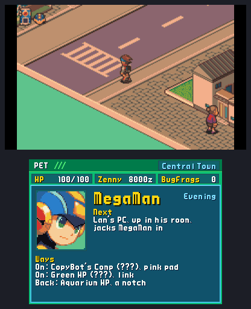
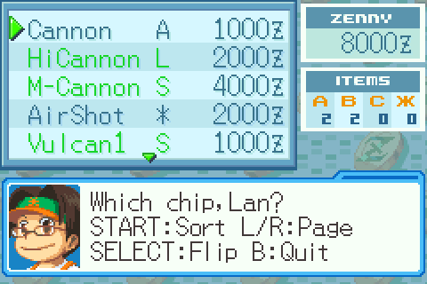
</p>

<p align="center">
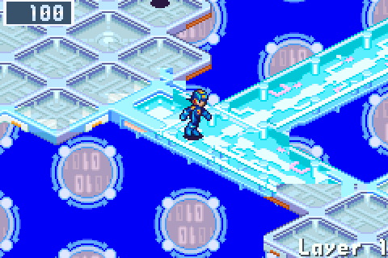
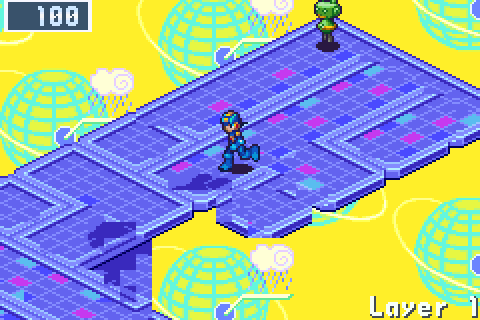
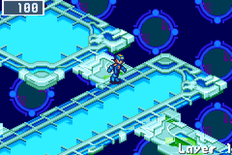
</p>

Each layer is a new layout of platforms and walkways in the style of one of
the game's areas. Find the exit pad to go one layer deeper. On the way, the
game's own random battles come up, with the viruses of that area. How hard
a battle is depends on how deep you are, not on the area: the viruses grow
stronger (V2, V3, SP) act by act, and a battle never holds more than MegaMan
can be expected to handle at that point. The first battles of a run, and
the first after each guardian, are gentler. Rewards follow the Busting
Level as in BN6. The battlefields are the area's own too: its panels
(grass, ice, holes), and where BN6 set them, rocks and cubes. Now and then
(a battle in forty or so) a green Mystery Data sits on the enemies' side:
it breaks at the first hit, yours or theirs, but still there when the
battle ends, it gives a rare find besides the battle's reward: most often
a chip a tier above a blue Mystery Data's, in your folder's codes where
it comes in one.

Three layers make an act. The second layer of every act always has the Net
Dealer and a Recovery Mr. Prog. The third ends in a guardian's arena, and
the room before it again has a heal and the Net Dealer. The card at the
start of each act shows the guardian waiting at its end, so you can set
your folder for it, once MegaMan knows him. A guardian he has never
battled is "???", a strong signal he doesn't recognize, until the Navis
on the net talk: a bystander on the act's first layer has heard who it
is, and every Net Dealer keeps two of a chip that answers the act (the
guardian's weakness, or a hard hitter when it has none) and says so.
Step into the arena and the Navi logs in for the game's own boss
battle. Once MegaMan has battled a guardian, in any run, he knows it:
the card names it, and on its layer he warns you of its way of
fighting from his battle data. Guardians remember how your earlier
battles went. Their Guardian Data takes MegaMan home to Lan's HP,
where two portals lead to the next act's areas; beside each he reads
its data and its guardian's signal, naming him where he has battled
him, so you choose the fight your folder answers, and what he senses on
its first layer: a strong virus signal (a Server), someone selling
programs, a trader's call.
In the short net, once the Secret Area has been cleared in any run, act
2's also offers a dark way: act 3 in the Undernet, with one of its own
Navis, harder battles and richer data.

With BN5 Team Colonel's ROM beside BN6's, one of the two ways at a fork
from the second act can lead to a layer gone dark (MegaMan says so at the
way, and the act's card names it): a Liberation Mission of BN5's, its
board of dark panels, DarkHoles and their guardians, and a Darkloid at the
far end. The Navis whose Souls you hold come along, as many as BN5's team
of that stage has room for (two at act 2, up to five later). Each takes
his turn every PLAYER PHASE: walk him beside a dark panel and press A for
Liberation, his own command (Colonel's ScrenDiv, TomahawkMan's
TomahawkSwing, NumberMan's NumberCheck, ShadowMan's SneakAttack, ToadMan's
LifeMelody, MegaMan's LongSwrd; KnightMan has none, and nothing on the
board hurts him or a Navi beside him) or Pass to rest; R hands play to
the next Navi yet to act. A teammate's battles are MegaMan's in that
Navi's Soul from the first turn, on that Navi's own HP: if it runs out,
he leaves the board, not the run.

A run is **the short net**: three acts, then the Cybeast Nest on layer 10,
about an hour. When the Nest's guardian falls, the run is won, and that
opens **the endless net**: the long dive described below, repeating
harder after its own Nest.

The endless net's first four acts visit four of Central, Seaside, Sky and Green Area, the
Robot Control, Aquarium, Judge Tree, Mr. Weather and CopyBot comps, two home
computers and the Aquarium, ACDC, Green and Sky homepages. The order is
random, but the gentler areas come first (Central or a home computer) and
the hardest last (Sky, Mr. Weather,
ACDC HP, CopyBot's comp). Then come the Undernet and the Graveyard, and
layer 19 is the Underground, the Cybeast's den: no copied guardian waits
at its end but Gregar itself, in BN6's own final battle, and Gregar SP
at the bottom of every Net after the first. After that the cycle starts
again, harder.

Once the Secret Area has been cleared in any run, Bass waits there in
every run after: BN6's dormant stone in its arena, then Bass himself, in
the form his record with you has made him (Bass, Bass SP once beaten,
Bass BX once he has fallen twice and the Cybeast once). MegaMan senses
him at the golden gate before it opens, so the fight is yours to choose;
it pays one of BN6's GigaChips.

### Getting stronger

- **A gift to start.** On the first layer a Mr. Prog lets you pick one: two
  HPMemory, a ★3 chip or a NaviCust program. If your last run ended before
  its first guardian, he adds an HPMemory.
- **Guardian Data.** Every guardian leaves five HPMemory (+100 max HP), its
  own Navi chip at the version you beat (in `*` where BN6 has one and your
  folder doesn't use its letter), and its Cross where it has one.
  Taking it also restores MegaMan's HP.
- **The NaviCust.** Guardian Data also offers three NaviCust programs, one
  from each of three builds (buster, hand, guard, field, HP), or BugFrags
  if you take none. BugFrags are what the NaviCust vendor takes, and a
  battle won with bugs on the board pays a BugFrag a bug level, five at
  most. A program you already hold shows how many beside its
  name ("Held 1"), and one a copy would add nothing to (a second UnderSht
  or SuperArmor, SuperArmor beside BodyPack, Attack+1 beside AttckMAX) is
  not offered. The second and fourth acts' guardians grow the board
  from 4x4 to 5x4, then 5x5. A layout that breaks BN6's rules runs bugged,
  and MegaMan says what the bug does. A program turns with L and R only
  with its colour's Spin: each run hides one, a colour you don't have yet,
  in a blue Mystery Data deeper in, and you keep it for every run after.
  A program's compression code, once you enter it (hold RIGHT on the
  program in the NaviCust and press its ten buttons), is kept: in every run
  after, the program comes compressed, and Dad's Compression mail lists its
  code. Entered again, the code undoes it for that run, as in BN6.
- **Reg memory.** Each layer before a guardian hides a RegUp, behind a
  lock or at a detour's end: Reg memory grows from 4 MB to about 20 by the
  third act, and a Regular Chip that fits (the folder's EDIT, SELECT)
  starts every battle in your hand. Winning a duel against ProtoMan earns
  Chaud's TagChip system for good: two chips tagged come to your hand
  together.
- **Crosses.** Deleting HeatMan, ElecMan, SlashMan, EraseMan or ChargeMan
  gives MegaMan their Cross for the rest of the run, chosen in the Custom
  screen as in BN6.
- **BeastOut.** Beat the Cybeast at the endless net's own Nest, and
  BeastOut joins the Custom screen for the rest of the run; the
  Graveyard's guardian only stirs the beast. Once the Cybeast has fallen
  in any run, the setup's Help row can bring BeastOut from the first
  battle instead, in either net.
- **Chips.** Mystery Data, shops and traders draw from the whole chip
  library by rarity: Megas deeper down and, rarely, a Giga. Green Mystery
  Data holds chips, zenny and BugFrags; in deep layers a blue one may hold
  ScrtData.

### Places to find

| Place | What it does |
| --- | --- |
| Net Dealer (a green Normal Navi) | The game's shop: chips, an HP Memory and SubChips |
| NaviCust vendor (a pink navi), on every act's middle layer | NaviCust programs and a rare chip, for BugFrags |
| Chip Trader | Three chips in, one out |
| BugFrag Trader | The game's BugFrag trades |
| Recovery Mr. Prog | Restores HP |
| Server | A strong virus signal: an optional harder battle that pays your pick of three better chips, named before you fight. From the fourth act it may hold an SP Navi. Never on the first layer |
| Dark flame | Enters the Undernet: tougher viruses, and an exit one layer deeper. MegaMan says whether a strong virus signal waits in there; by the exit pad beside it, what he senses past the pad |
| Golden gate | Three ScrtData open the Secret Area in Undernet Zero; once it has been cleared, Bass waits behind it |
| Sealed gate | From the third act: sealed with a Navi's code, which deleting him twice as a guardian earns, in any runs. Once earned, every such gate opens to his SP, whose chip is the prize |
| Collector's vault | From the second act: its lock opens for a Library of 30 chips (60 in act 3, 90 later), and it holds three rare chips, one to take |
| Virus Battler (a Mr.Prog of his own colour) | BN6's Virus Battler, at a side path's end on an act's first layer in about half the acts from the second. Your stored viruses fight his pair on their own. Entry costs zenny (500 to 3000 by act), each win adds that much to the pot, and after each win you take the pot or fight on; a loss or a draw loses it. A whole series won pays the pot, and once a run his BN6 prize. The first one you meet gives you the BtlrCard |

### What carries over

MegaMan starts every run as strong as the first time: what runs leave
behind is options. From the second run, NEW GAME opens a setup:

- **Net:** the short net, or the endless net once a short one is won.
- **Folder:** BN6's starting folder, or one opened in any run: Blade
  (swords in S for LifeSword), once any guardian falls, and Storm (Elec
  chips), once an Aqua guardian does. Chips the net gives lean to the
  codes the folder holds most: the chip comes as it rolled, in one of
  those codes where it can.
- **Cross:** a Cross MegaMan has from the first battle, once its Navi
  (HeatMan, ElecMan, SlashMan, EraseMan, ChargeMan) has fallen as a
  guardian. It is the run's only Cross: guardians' Cross data won't fit
  beside it.
- **Threat:** ten rungs that each add one constraint (stronger viruses
  from act 2, fewer heals, dearer dealers, EX guardians, SP Navis in
  Servers, Mystery Data of chips only, half the Chip Traders, drafts of two
  programs, four HPMemory a guardian, a second guardian below the short
  net's Nest), each opened by winning on the one below.
- **Help:** A on the row opens the helpers, each on or off: two more
  HPMemory at the start, a heal on every layer, gentler battles, and All *: every chip of the run in *, the wildcard, so any five
  go in a hand and every Program Advance forms from its chips in order.
  Once the endless net's own Nest has fallen, a fifth: BeastOut from the
  first battle. Helped runs count for everything.

The BtlrCard carries over too: the viruses on it (Mettaur and Gunner, and
each Rare virus deleted in any run, BN6's "You got new Virus Data") are
yours in every run, for the Virus Battlers alone.

Every chip MegaMan holds joins the Library, BN6's own, which every run's
PET shows whole: a Chip Trader's prize is new to it first, and the summary
counts what a run added. The NaviCust programs MegaMan has run with come
back too: a later run's program vendor lists two of them first, and the
Spins found, one a run, turn their colour's programs in every run after. The run's
summary, two PET screens as BN6's RESULT (A turns from RESULT to RECORDS,
and A again leaves), names how it ended, what it opened (marked NEW), the
closest goal and the helpers it had. Milestones put BN6's
own marks on the title: Gregar's head for a won short net, Bass for the
endless net's Nest, the S for the Secret Area, the green disc for a win on
the top threat rung, STD, MEGA and GIGA COMP for a class of the Library
complete.

### Saving and losing

The run is saved each time you arrive on a layer and as a guardian's
Guardian Data appears ("Run saved" shows in the corner), and again when
you quit while MegaMan is free to move on a layer (not in a battle, a
talk or a guardian's scene; the quit prompt says which); CONTINUE brings
you back to where it was saved. The PET's Save saves the run where
MegaMan stands; its E-Mail keeps Dad's mails: the dive's report, your
records against every guardian, and the battle data on each one you have
met. When MegaMan is
deleted the run is over: the title screen shows how deep you got, how many
viruses and Navis you deleted, and your best depth. When the short net's
Nest falls, the run is won.

Saves live in `savedata/` in the data folder: `ports/cyberworld/` on a
PortMaster handheld, `~/.local/share/cyberworld-endless/` on Linux
(the Flatpak's under `~/.var/app/`), `%LOCALAPPDATA%\cyberworld-endless\`
on Windows and `~/Library/Application Support/cyberworld-endless/` on a
Mac, where uninstalling leaves them. A phone or tablet keeps a copy in its
ROM folder or a folder you choose, and **SAVES** on the title exports one
file on every system ([Moving saves between devices](#moving-saves-between-devices)). To
give up a run without playing it out, delete `savedata/run.sav`; your
best depth is kept in `profile.sav`.

### Moving saves between devices

Press L on the title (Q on a keyboard) to open **SAVES**. **EXPORT**
writes your progress, unlocks, Library, records and the current run's
checkpoint to one file, `cyberworld-endless.cwsave` (no ROM in it). Copy
it to the other device, start the game there with your own ROM and
choose **SAVES › IMPORT**: both saves are shown side by side, yours are
kept unless you choose **USE THE FILE'S**, and **UNDO IMPORT** brings
back what an import replaced. Runs from two devices are never merged;
controls, screen settings, volumes and your statistics answer stay on
each. In the browser, **Save backup** in the player's menu opens SAVES
over the title, and **Load backup** opens it with the file chooser.

On Android, an iPhone or an iPad the game keeps that file in your ROM
folder, or one you choose with **FOLDER**, a few seconds after each save.
After a reinstall, choose that folder again: the game finds the copy and
offers it back. It never writes over a file another device left there,
and asks once which saves to keep. **AUTO-COPY** turns the copy on or
off; elsewhere it starts off and goes to Downloads (a PC or a Mac) or
the data folder (a PortMaster handheld, the 3DS).

A file from a newer version of the game, a damaged one, or a run that
needs BN5 where **BN5 Team Colonel (USA)** is missing (always on the 3DS)
is refused, and your saves stay as they were.

### Online: the Net Square

Other players' MegaMen meet in a **Net Square**, a net of its own on a
server: up to eight in a channel, who walk, say a phrase, read each
other's cards, trade a spare chip, NetBattle and watch each other's
NetBattles, and dive the same net each week. Every system goes online,
the browser too. Nothing there changes your run: no battles of the net,
no heal, no shop, no saves. The one thing that comes home is a chip you
traded.

<p align="center">
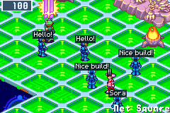
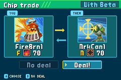
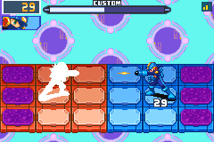
</p>

#### Going online

The way there is the great white gate at the front of Lan's HP, where
every run begins after the jack-in and where MegaMan comes home after
each act. Step on it. The first time, the Mr.Prog who keeps it asks for
the name other players will see, says what the server learns (your
PET's address, that name, and MegaMan as he is) and asks before you go,
the cursor on **No**. After that MegaMan asks each time. Yes saves the
run right there, and you go; the gate flickers while the server answers,
and B calls it off.

**R**, or the pad you arrived by (step on it, or A facing it), takes you
home. MegaMan is back on the
gate exactly as he left it; if the game was closed in the Square, the
next CONTINUE puts him there.

The keeper changes your name or the server: the official Square (he
asks first, the cursor on **No**), or another one's address (`host` or
`host:port`, as its owner gives it). A Square on your own network needs
its address alone, `192.168.1.20` say: the server says it as it starts,
and an address that can only be on your network is taken as a Square
started there with nothing set (`ws://`, port 8765).
He also moves you to the next or the last channel.

#### Finding your way

You arrive in the **welcome plaza**: the Square's landmark in its
middle, the pad home beside you, the greeter, the keeper and the Board
close by. Everyone arrives here, and everyone comes back here. Off three
of its sides stand warps, BN6's gem pads, each with its part's name over
it in gold and who is there now ("ARENA: Mira"):

- **Trade Central**, to the upper left: the trade desk, its board of
  offers beside the warp.
- **The Arena**, to the upper right: the ring and its stands, the referee
  at its foot.
- **The stage**, to the lower left: step up and be seen.

Step on a warp and MegaMan beams across; the warp back to the plaza is
right where he lands. Press **L** and pick **Look around**: MegaMan says
which way each warp lies and who is in which part.

#### If your connection drops

A hiccup doesn't send you home. When the Square stops answering for a
couple of seconds the game holds still, MegaMan right where he stood, and
**Reconnecting...** shows over the Square while it tries again, for up to
30 seconds (a bar shows the time left after the first five). The server
keeps your spot meanwhile: the others still see your MegaMan standing
there. When the link is back, **Back online!** flashes and you play on.
**B** on that screen gives up and takes you home at once; past the 30
seconds you go home too, and MegaMan says the link broke.

What was under way when the link dropped ends as if you had left: a
NetBattle stops with no result for either of you, watching one stops, and
a trade that wasn't done yet is off (nothing changes hands). A trade both
of you had already agreed to still comes home with you.

If the gate says **a newer version is out**, the server runs a newer
version of the game than yours: update from the game's download page. If
it says the Square's server is behind, its host has to update it. If it
says the Square is **under maintenance**, its host has closed it for a
while, and the sign on the gate says until when.

#### The NetPass

The NetPass says what your games open online, as four stamps:

| Stamp | What it opens | What it needs |
| --- | --- | --- |
| **Square** | Walking, phrases and emotes, cheering, cards, the referee's calls, the board and its posts, reading the trade offers, the week's ranking | BN6 Cybeast Gregar (USA): everyone has it |
| **Arena** | NetBattles, and watching them | The full set |
| **Trade** | Trading at Trade Central, and posting or answering a trade offer | The full set |
| **DeepNet** | The week's DeepNet dive | The full set |

The full set is every game this version supports online: BN6 Cybeast
Gregar (USA) and BN5 Team Colonel (USA). With BN5's ROM beside BN6's,
all four stamps are yours, and the greeter Mr.Prog stamps them on your
next visit. With BN6's alone you hold the Square stamp: the whole Square
but NetBattles, trades and the dive. If a later version supports another
game online, the stamps that need it open again until you add that game;
the release notes and the project's site say so ahead of time.

It is a key item: **KeyItem** in the PET, then A on **NetPass**; A or B
closes it. In the Square, where the PET stays shut, **START** opens it.
It also shows across the top of the screen while MegaMan asks about
going, and on a second screen (the 3DS's bottom screen, an Android
handheld's second display) while you are in the Square.

#### In the Square

The welcome plaza with a landmark in its middle (a statue, a monument or
a giant cybertree, by the server), its board and the pad home, and warps
to Trade Central, the Arena's ring with its stands, and a stage up a
stair. A greeter Mr.Prog calls out who logs in, two Navis stroll about
(one round the landmark, one before the stage) and chat about who's here
and what just happened, and every three
minutes they parade round the landmark: walk with them. A on a tree, the
landmark, the sign or the board says what it is; the board lists who's
here, the last trade and NetBattle, the trade offers up and this week's
DeepNet.

- **SELECT** opens the emote strip: MegaMan's twelve emotes in two
  rows, the one under the cursor played by MegaMan in the window above
  with its name and whom it goes to ("AT ALPHA" when you face him). **A**
  sends it and closes the strip; **L** and **R** turn to the phrases and
  back; **B** or SELECT closes it. MegaMan performs each emote himself,
  with BN6's own poses and sounds, the same on every screen; a phrase
  goes over his head. Phrases and emotes come from fixed lists: there is
  no free text, and no one can type at you. The strip opens on the last
  one you sent, so SELECT, A sends it again. On a phone, SELECT's touch
  button opens it, and a tap on an emote or a phrase sends it; a tap on
  the window closes it.
- **Hold L and press a direction** for one of four favourites at once:
  up Wave, right Cheer, down Bow, left Laugh at first. To change one,
  **hold SELECT on the strip and press a direction**: the emote or phrase
  under the cursor goes on L and that direction (kept in `network.ini`).
  A Wave, Cheer or Bow facing another MegaMan is aimed at him; a hand
  blinks over the name of a player who waved at you, and your next one
  answers him: within five seconds, a "!!" and a sparkle between you on
  every screen. Emote together with other players round the landmark or
  on the stage, and the Square cheers, the louder the more join.
- **On a second screen** (the 3DS's bottom screen, an Android handheld's
  lower one), every emote and phrase is a button: one tap sends it. Its
  **NETPASS** tab shows your NetPass.
- **L** tapped holds **Look around**, where MegaMan says which way Trade
  Central and the Arena are from where you stand (both off the plaza,
  Trade Central to its upper left and the Arena to its lower left), and
  **Quiet please**, which hides everyone else's phrases and emotes until
  **Let them talk**.
- **A** facing another player's MegaMan shows his card (HP, act and
  layer, Crosses and Souls), and lets you ask him for a NetBattle, wave,
  mute or block him. Blocked players are gone from your Square.

#### Trades

**Trade Central**, a desk in a wing off the plaza, trades one of your
spare chips (copies beyond those in your folders) for another player's.
Pick the player, then your chip on the spares list, each chip's card
beside it; he picks one back, and the chip trade shows both. When you
both say **Deal!**, the cards swap, and the chips change hands as you
come home. BN5's chips trade like BN6's. One trade a visit: the chip
comes home with you before the next.

**The trade board**, at the same desk: put one spare up with what you
want for it (anything, a chip of an element, a Sword, Wind, Break or
Cursor chip, or a Mega), and everyone in your channel reads it, there
and on the welcome plaza's board, until you take it down, leave or trade.
To answer an offer, pick it at the desk: the list shows only your spares
that fit its want. Reading the offers is everyone's; trading, posting
and answering take the Trade stamp, on both sides.

#### NetBattles

**Battle** on a player's card, there when you both hold the Arena
stamp, asks him for a Practice NetBattle. You fight with your MegaMen as
they are (HP, NaviCust, buster, Crosses, BN5's chips in your folder) and
with your Souls: UNITE on the Custom screen as in a run, and the other
player sees your Soul too. Where more than one of your folders holds
chips, MegaMan asks which goes. Win or lose, you are back in the Square
where you stood, and nothing is won or lost. The result card asks
whether to go again with the same player, the cursor on **No**: when you
both say Yes, you are back on the Custom screen in about a second, with
new hands, and the set's score keeps counting. No, B, or no Yes from the
other within half a minute, and you stay in the Square.

Before you ask, the Square shows who is free: a small mark over a
player's name says he is in a NetBattle, watching one, or at a trade,
and three bars beside his card show the link between you (bars only;
more is better). Once you ask, a strip at the top of your screen shows
his PET ringing, then his half minute to answer running down once he
reads your challenge; **Call off** on his card takes it back. When
someone asks you, your PET rings, a "!" stands over his name, and
MegaMan reads you his card before asking whether to take it; your half
minute starts only when the question is up.

**Team up** on a player's card asks him to be your partner; **Split up**
on your partner's card ends it. A Battle between two teams is a Team
NetBattle, and MegaMan asks how to fight: **One by one** or **Side by
side**; the other team hears which before it answers. One by one is a
relay: the one who asked to team up picks who goes first, without seeing
the other team's pick, then both orders are shown. The leads fight; the
winner stays on with the HP he has left and the loser's partner comes
in, until both of one team's MegaMen are deleted. Whoever waits watches
the bout from the stands. Between bouts the result card shows the
MegaMen standing and who is next. Side by side, all four MegaMen fight
on one field, two a side: the one who asked to team up leads on each
team, and his partner picks his own chips on his own Custom screen while
the leads wait for him; once anyone has pressed OK, whoever is still
picking has 30 seconds, then his picks so far are taken; the team whose MegaMen are
both deleted loses. A partner fights as his whole MegaMan: his folder,
HP and buster, his NaviCust's programs, his Crosses and Beast Out on
his own Custom screen, his Program Advances, and UNITE with his own
Souls. If a player leaves, the match breaks off with no result for
either team.

The battle answers your presses with rollback: each game runs it at
once, guessing the other player's buttons, and when his real presses
come in otherwise it rewinds the frames that guessed wrong and plays
them again. On a good connection that is 2 frames of input delay. Each
system measures how far it can rewind, and asks the server for the
delay its connection still needs.

NetBattles run on computers, phones and tablets, PortMaster handhelds,
the Steam Deck, the Switch, the PS Vita, the PS4 and PS5 and in the browser. The New 3DS has none: running both
players' GBAs takes it half again a frame's time. There a full pass
trades and dives, and the pass says so.

#### Watching

The Mr.Prog by the Arena's ring tells how a NetBattle is asked for.
Once you have fought, he calls each bout as you come back and keeps the
count while you go again with the same player. While two others fight he
calls their NetBattle too (their HP, the last chips they used, the
winner), and with the Arena stamp he asks whether to watch: you see the
battle itself, a moment behind the players, from its start however late
you came. **R** shows the other side, **L** cheers, **B** takes you
back. The players hear the cheers from him after their battle. Without
the stamp, and on the New 3DS, you get his calls and the board's post.

#### The week's DeepNet

Every Monday (00:00 UTC) each server opens a net of its own for the
week, and everyone on that server who dives it dives the same net, from
the same start: the short net, the Standard folder, threat 0, no helpers
and no Cross, nothing your other runs unlocked. The greeter Mr.Prog in
the welcome plaza offers it to a pass with the DeepNet stamp; say Yes
(the cursor starts on No), and the dive begins in Lan's room, as a new
game does.

Your run in progress waits in its own save, untouched: the title's
CONTINUE is always that run, and when the dive ends, won or deleted, you
are back with it. To go on with an unfinished dive, visit the Square
and talk to the greeter: Keep diving, Start over or Not now. Divers
don't trade.

How deep you got goes up on the board at your next visit: the week's
eight deepest dives, your own best and its place, and last week's
three. Dive as often as you like; your best counts. The board says the
layers are as players report them, and nothing is won for one. A dive
unlocks nothing and counts in none of your records.

#### Servers

Anyone can run a Net Square: the server is a small program of its own,
in Python, with ready builds for Linux, Windows and macOS and a Docker
image, and it never needs a ROM or sees a save. For a LAN party, unzip
it on one computer and start it: nothing needs setting, and it names the
address the others type at the gate. For a Square always up, with HTTPS
for the browser and the 3DS, three commands on a server with Docker and
a domain ([server/README.md, Host your own Net
Square](../server/README.md#host-your-own-net-square) says how, both
ways and the ones between). Each server has its own channels, moderators
and week's DeepNet. Give its address to the gate's keeper to go there.

The official server asks for no account and no e-mail. It sees the
address your game connects from, the name you chose, where MegaMan
stands and his public card while you are there; your identity on it is
a key your game makes for that server alone. It keeps its trades and
the week's board, by that identity and your name, and no log of who came
and went. There is no free text, so there is nothing to report: block a
name from his card. Its rules, who moderates it, how long it keeps what
and how to have your data removed are in
[its policy](../server/README.md#the-official-server).

## Screen

The game's 240x160 picture is scaled by a whole number so it stays sharp: 5x
on the Nova's 1280x960 screen and 6x on the Flip 2's 1920x1080 screen, with
black borders around it. Where a whole number would leave it a quarter
smaller or more than the screen allows, it fills the screen instead, each
pixel's edge a little soft: on a 640x480 screen (an RG35XX Pro, an RG35XX
Plus) it is 640x427 rather than 480x320. That is **Auto**, the default.
Options' **Display** (on the title's menu, or the PET's in a run) has the
other ways on its **Scale** line, changed at once and
kept:

- **Integer**: whole pixels everywhere, every pixel the same size.
- **Fill**: as big as the screen holds, its shape kept. On a wide screen
  that is the screen's whole height, with no border above and below: a
  1920x1080 screen shows it 1620x1080 rather than 1440x960.
- **Stretch**: the whole screen, no border at all, the picture pulled from
  the GBA's 3:2 to the screen's shape (on a 16:9 screen, about a fifth
  wider than the game drew it).

`screen = auto`, `whole` (or `integer`), `fill` or `stretch` in
`settings.ini` in the data folder sets it as well. On a PC the window keeps
the same rules as it is resized. A phone held upright shows the picture as
wide as its screen the same way, over the touch controls (1080x720 on a
1080-wide phone, rather than 960x640), wherever the controls keep their
size; on its side the picture keeps its whole scale beside them. While the
touch controls are shown they keep their room, so Fill and Stretch take the
screen once they are away (a controller in hand). The 3DS fills its top
screen's height (Fill, 1.5x) unless Integer shows it at 1x, or Stretch over
the top screen's whole width. The browser player sizes the picture itself,
at the largest whole scale its window holds.

On a PC, Display's **Fullscreen** puts the game borderless over the whole
screen, as F11 or Alt+Enter do, and the game opens as you last left it
(`fullscreen = on` or `off` in `settings.ini`; `--fullscreen` or `--window`
on the command line come first).

The game runs at the GBA's 60 frames a second. A 60 or 120 Hz screen shows
every frame for the same time; a 90, 144 or 165 Hz one (a Steam Deck OLED,
many PC monitors) shows them for one refresh or two in turn, which reads as
a slight judder. **Smooth motion** mixes the two latest frames at each
refresh instead: motion is even, a little blurred, and a frame later. Turn
it on in Options' **Display** (not on the 3DS, whose screen keeps the GBA's
pace), in the browser player's menu (the two keep in step), or with
`smooth_motion = on` in `settings.ini` in the data folder (made on the first
start). A screen at 60 or 120 Hz, or one that follows the game (FreeSync,
G-Sync), needs neither.

## Sound

The music and sounds are BN6's own, played by its own sound engine as a
GBA plays them: in a run by the game itself, and on the title and the
screens around it by the same engine's rules, followed note for note
([The engine's own sound](engine/emulation/engine-sound.md)). The Legacy Collection's are not: it plays recordings from
the soundtrack CDs in their place, mixed its own way, BN6's more muffled
than the cartridge (The Rockman EXE Zone's wiki). So the same song can
sound brighter here. BN6 mixes its music 10512 times a second, and what
the GBA makes of that mix carries a bright hiss above the music.
**Soft** gives the sound the Legacy Collection's balance, measured from a
recording of it on the same songs: the highs from 5 kHz up taken down as it
has them (-4.5 dB at 8 kHz, -10 at 10 kHz, -18 at 13 kHz) and the deepest
bass a little (-3 dB around 100 Hz). **GBA**, the default, leaves it as the
cartridge plays it. Choose in Options' **Audio** (on the title's menu, or
the PET's in a run): Left, Right or A on
**Sound** changes it at once, so you hear it, and it is kept. The browser
player's menu has a **Sound** button too, and `sound = soft` or
`sound = gba` in `settings.ini` in the data folder sets it as well.

To play your own music over the game, turn **Music** off in Options'
**Audio**: the game's songs fall silent and its sound effects play on, the
menus', the chips' and the battles'. **Effects** turns those off and on in
the same way; with both off the game makes no sound at all. Each applies
at once and is kept (`music = off` and `effects = off` in `settings.ini`).
The Jukebox still plays the song you choose with the music off. In a
NetBattle the music plays on unless the effects are off too: both GBAs of
a NetBattle run alike on both players' systems, and the music is part of
what they run.

## The Jukebox

Every song of the game, and of BN5 with its ROM beside BN6's, to listen
to whenever you like: **KeyItem** in the PET, then A on **Jukebox**. The
game holds still while it is open, its music too, and goes on where it
was when you close it.

The songs are in sections by game and by where they play (Towns, The
Net, Battles, Story, Screens; BN5's songs whose place is not known yet
are in **More**, by their number). **L** and **R** (or Left and Right)
turn the sections, Up and Down pick a song, **A** plays it, **START**
turns the mode and **B** closes it. On a phone a song's row plays it, the
green arrows turn the sections and the mode on the band turns the mode.

| Mode | Plays |
| --- | --- |
| **Repeat** | the song, over and over |
| **In order** | the section from the song on, each song that loops twice round, then the next |
| **Shuffle** | the section in any order, each song that loops twice round |

The lights under the song are its eight tracks, lit as they sound. The
last song and mode are kept for the next time (`jukebox.ini` in the data
folder).

## Anonymous statistics

At its first start the game asks once whether it may send anonymous play
statistics. Nothing is sent before you say yes: the cursor starts on
**No**, and B or Escape answers no as well. A yes helps a free game: the
statistics show which systems it runs on, which setups runs take, how far
they get and which guardians stop them, so the hard spots are known rather
than guessed. They go to the game's own site on the developer's
[Umami](https://umami.is) (`umami.saschb2b.com`), kept apart from the
project page's:

| When | What is sent |
| --- | --- |
| The game starts | the system (Linux, Windows, Steam Deck, Android, 3DS, Switch, PS Vita, the browser...), the version and the screen's size |
| A run begins | its setup (net, folder, Cross, threat, helpers), whether BN5 joins, and how many runs you finished before |
| A guardian's battle ends | the guardian, won, lost or left, the layer, net and threat, MegaMan's HP left in percent, the battle's seconds, and how many times you have met him |
| A run ends | won or lost, the layer and area, who deleted MegaMan (a guardian, ProtoMan or viruses), the minutes played, its setup, and what it found: how many chips and how many of them good ones (3 stars or more, Mega or Giga), how many Mystery Data opened and how much zenny earned, in the whole run and in its first act |
| ... and beside it, what the run chose | won or lost, the layer, net and threat, the trips back home, how many requests were taken, kept and vowed, the orders made at AsterLand, the NaviCust drafts left for their BugFrags, the Undernet's and dark layers entered, ProtoMan's duels and netbattles taken and won, the folder's edits between layers, the Virus Battlers' series begun, rounds fought on after a win and pots taken, and the seconds on the net's maps against those in battle |

### Online

Online play's statistics go under the same answer (issue #156): counts
and settings only, so that the Square's servers and the NetBattles'
rollback are tuned on real networks.

| When | What is sent |
| --- | --- |
| A visit to a Net Square ends | the system, your NetPass (the Square's or the full set), how it ended (left, called off, no answer, another version, another ROM, the name refused, full, barred, removed, the connection lost, gone to dive, under maintenance, an older server, another Square after the connection came back, the game closed), the minutes in the Square, and whether the server was the official one (never its address) |
| A NetBattle ends | the system, which side of the cable you were, the input delay and rollback window, the rollbacks and the deepest, the longest tick in milliseconds, the stalls waiting for the other's keys, its seconds, and how it ended (won, lost, disconnected, the two games apart, stopped, left) |
| A trade is done | that one was, and whether it began with a trade board's offer |
| You stop watching a battle | how (its end, left, too slow, stopped, the connection lost) and its seconds |
| The week's dive is posted | its layer and act, and whether it reached the end |

Never sent from the Square: your name or another's, your identity on a
server, the server's address, the chips, phrases or anything typed.

Never sent: names, accounts, an ID of you, your install or your device,
the ROMs or their hashes, file paths, saves or controls. Umami sets no
cookies. Its server sees the internet address each request comes from, as
any website does: it turns it into a country (and a region or city where
its location database knows one) and counts one player's events together
by a one-way hash that changes every month, and does not keep the address.

To change your answer, open **Options** (on the title's menu, or the PET's
in a run), whose **Statistics** line shows it; A on the line asks again,
on the 3DS too. `statistics = on`
or `off` in `settings.ini` in the data folder sets it too; without the
line the game asks. Each request goes out once, beside the game's frames,
never in their way; with no network it is dropped, and after three
failures in a row nothing more is sent until the next start. A system that
cannot send never asks: a handheld without libcurl, or the Flatpak with
its network taken away (`flatpak override --unshare=network`), which it
has for this alone.

## Troubleshooting

- **"Put your Mega Man Battle Network 6: Cybeast Gregar (USA) ROM in ..."**:
  the game found no ROM. Check that the `.gba` file is in
  `ports/cyberworld/rom/`.
- **"... is not a supported ROM"** or **"... is not an 8 MB GBA ROM"**: the
  file is a different game, version or region, or it is patched or
  compressed. Only the unmodified US Cybeast Gregar works.
- **Anything else**: the last start's output is in `ports/cyberworld/log.txt`.
  Please attach it when you report a problem.

## Building

For developers. Builds run in Docker:

```bash
python3 build.py
```

```bash
python3 build.py test
```

```bash
python3 build.py package
```

```bash
python3 build.py run
```

`run` builds the Linux desktop binary and plays it on this machine in a
window, with the ROM from `~/.cache/mmbn-ref/roms` (or `CYBERWORLD_ROM_DIR`)
and saves in `.build/desktop`. `python3 build.py serve` builds the project
site and the browser version and serves them on `http://localhost:8080`;
`python3 build.py screenshots` retakes the screenshots in
`docs/screenshots` from scripted headless runs, and `python3 build.py clips`
records the site's short videos (WebM and MP4, `docs/clips`, and a GIF of
the README's clips) the same way. Those of online play (`online-*`) need
other players, so they come from several games at once in a Square of their
own on a local server (`tools/online_pictures.py`: the Linux build and the
server, built first; `--keep` reuses the scenes captured). `python3 build.py release`
writes the release files to `build/release/`, each named for its system:
`cyberworld-endless-portmaster.zip` for PortMaster; for Linux the
AppImage (with its `.zsync` for updates), the `.deb` and the tar.gz; and
`cyberworld-endless-website.zip`, the site and the player to host
elsewhere. Each target builds in its own Docker image
(`docker/`): the handheld on Debian bullseye, whose glibc is older than
any firmware PortMaster serves, with the firmware's own SDL2; the Linux desktop on
bookworm with SDL2 built to load X11, Wayland and the sound servers at run
time, the browser with Emscripten.

GitHub Actions (`.github/workflows/`) builds every target on each push and
pull request, runs the ROM-free tests under the sanitizers and lints the
scripts. A push to `main` publishes the browser build on GitHub Pages; a
tag such as `v1.0.0` publishes a release with all three archives.

`build.py shot` runs the game headlessly for scripted screenshots and soak
tests, `build.py atlas` draws every area's layers and `build.py tour` has the
game show every room of them. In the game, Select+R opens a dev menu (no
random battles, can't die, one-hit enemies, speed, skip to the next layer or
guardian). See [Dev tools](devtools/overview.md) for the tools,
[AGENTS.md](../AGENTS.md) for the development workflow,
[Level design](world/level-design/overview.md) for how layers are laid out and
[ROM data](rom/overview.md) for where the ROM data comes from.

## Follow updates

- **On GitHub:** on this repository, **Watch → Custom → Releases**, and
  GitHub tells you when a new version is out.
- **Without an account:** add the [release feed](https://github.com/saschb2b/Mega-Man-Battle-Network-Cyberworld-Endless/releases.atom) to any
  RSS reader.
- **Talk:** the [Discussions](https://github.com/saschb2b/Mega-Man-Battle-Network-Cyberworld-Endless/discussions) have the announcements,
  questions and answers, ideas and players' runs.
