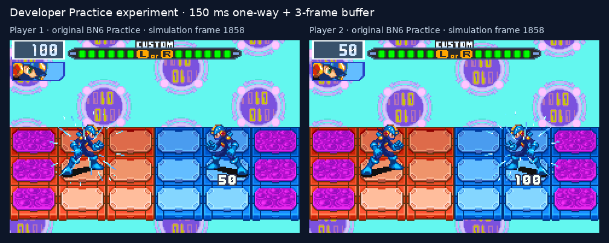

# Frame-input Practice experiment

This is an isolated developer experiment for epic #120. The production
Arena remains disabled. It runs BN6's original Practice battle from a
pre-director boot state, using the player's verified Gregar USA ROM.
It does not borrow a run loadout or connect the game client to an Arena.

The separately reviewed [acceptance contract](re/arena-frame-goal.md)
pins the original harness, input script and comparator. Its live oracle
is the existing plain-ROM local cable experiment in [ONLINE_LINK.md](ONLINE_LINK.md).
The comparator runs that original twice before testing frame replication.
No Tango implementation code was consulted.

## Measured result

The full contract passed on 2026-10-18 in
`.build/online-frame/run-n9xzykwm`. The committed
[numerical evidence](re/arena-frame-evidence.json) records source, binary,
ROM and boot-state hashes without distributing those private files.

| Configured one-way delay | Measured delivery range | Replica frames | Original active timers | Wall time |
| --- | --- | --- | --- | --- |
| 0 ms | 0.004–3.277 ms | 2,822 | 1,433 | 47.282 s |
| 50 ms | 50.007–51.245 ms | 2,822 | 1,433 | 47.330 s |
| 100 ms | 100.006–101.397 ms | 2,822 | 1,433 | 47.380 s |
| 150 ms | 150.007–151.461 ms | 2,822 | 1,433 | 47.430 s |

Every case finished the scripted Practice battle at 100/0 HP with
win/loss results 1/2 and returned to the Comm menu. Each delivered all
5,644 controller samples. The independent original control repeated
the same 1,433 active timer observations. The 50 ms corruption case
diverged first at simulation frame 1,400 and stopped after 107.47 ms;
the killed-peer case stopped after 0.57 ms. All source ROM and boot-state
hashes remained unchanged.



These are both players' complete game pictures at simulation frame
1,858 of the accepted 150 ms case, enlarged 2× without cropping. They
show the standalone experiment, not a shipped Arena screen. The source
PPM and composed PNG hashes are in the numerical evidence.

## Reproduce

```sh
python3 tools/online_frame_proof.py \
  --rom /path/to/bn6g.gba --state /path/to/boot-3.state
```

The command builds a Linux/POSIX worker in the pinned host image and
keeps its reports, numerical traces and full-frame pictures in a new
`.build/online-frame/run-*/` directory. The ROM and state are mounted
read-only. Each core's flash-save file is memory-only. SHA-256 checks
cover the source files after every completed and interrupted case.
Neither ROM data, save states nor flash contents cross a socket.

The manifest records the ROM, boot state, linked mGBA library, worker,
original binary and source hashes. An edited comparator, controller
script, original harness or acceptance contract is refused until its
pin is updated in a separately reviewed change. `--delays` and
`--no-faults` can narrow a research run; its report marks that it does
not complete the whole contract.

## What runs

Two independent worker processes each own two local linked mGBA cores.
The local cable scheduler runs entirely inside each worker. Worker 0
supplies player 0's controller input; worker 1 supplies player 1's. A
local relay samples the scripted controllers at the pinned GBA video
cadence and queues each peer input for 0, 50, 100 or 150 ms before
delivery. The delay is one-way, not a round trip or an Internet model.
Inputs carry explicit frame numbers. Fixed-size messages, sequential
input streams and a bounded queue prevent stale, duplicate or unlimited
future input from being accepted.

Each worker waits for both owners' input and keeps three future input
frames buffered, adding about 50 ms of controller latency. That buffer
is needed because the linked cores cross video boundaries at different
times: during this battle a core can lead its cable partner by two
frames. Each core receives the input for its own frame clock, as the
unchanged local oracle does. The entry's menu-step boundaries are also
preserved. Assuming one shared frame boundary initially moved the first
charge-shot damage from original battle timer 117 to 116; the guarded
comparator rejected that implementation. Correcting the input clock
restored the original timer sequence without adding a mask.

This design pipelines controller delivery. It does not wait once per
serial word, as the earlier delayed-serial experiment did. It has no
prediction or rollback, and the three-frame buffer is additional to
the configured delay. Its cost is two executing cores per client; no
device is qualified for this design by a desktop result.

## What the checks mean

The game comparison aligns observations by `BN6_BATTLE_TIMER`. It
requires the same complete active timer range, both players' HP and
panel positions, the final win/loss results and the return menu as the
live original. Where the original records a timer repeatedly, the last
sample is compared. This can miss an earlier within-timer difference;
it does not prove every original video frame or every byte of game RAM.

Separately, every simulation frame of one worker is compared with the
same frame of the other worker. The checksum covers both zero-filled
raw state buffers, both entire in-memory flash devices, and numeric
cable/scheduler state. It is a 64-bit FNV-1a repeatability checksum,
not an authenticity check. No masks are applied. A pair of identically
wrong workers still fails the independent original comparison.

Controller corruption flips one delivered Right-button bit during
active play. The comparator requires the actual altered delivery,
the first differing replica frame and bounded termination. Peer loss
kills one worker; the comparator requires its process exit, active
battle evidence and a matching prefix before the other worker stops.
Both fault checks read the numerical evidence independently of the
relay's verdict. Target-free mutation tests reject false results,
missing frames, changed hashes, wrong delay evidence, incomplete input
logs and claimed faults without the corresponding observations.

## Not reached

This unit does not cover carried run loadouts, selected chips, forms,
Souls, RNG-heavy attacks, rematches, transplanted ROM content, rollback,
network jitter/reordering/loss recovery, physical-device budgets or
production integration. The complete-state equality is between worker
replicas; full subsystem-memory comparison against the original remains
a separate next unit. The existing game's save guard is not exercised
by this standalone worker: its protection is read-only source files and
memory-only flash, rather than an online visit followed by restoration.
