

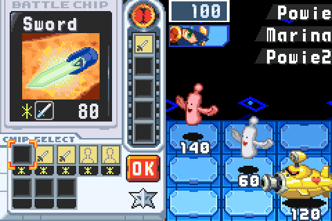

<h2 align="center">One Battle Network.</h2>

<b>The eighth beta:</b> with BN5 Team Colonel's ROM beside BN6's, its net is no longer a second game run beside this one. BN5's viruses, guardians, chips, Souls and DarkChips fight in BN6's own battle engine, by their own code from your ROM, with BN6's HUD, Custom screen, Crosses and Beast Out around them. Plus saves that move between systems, a soft reset that stays in the game, a smoother New 3DS, and the site in Japanese.

---

## ⚔️ One Battle Network

### BN5's net, fought in BN6's engine

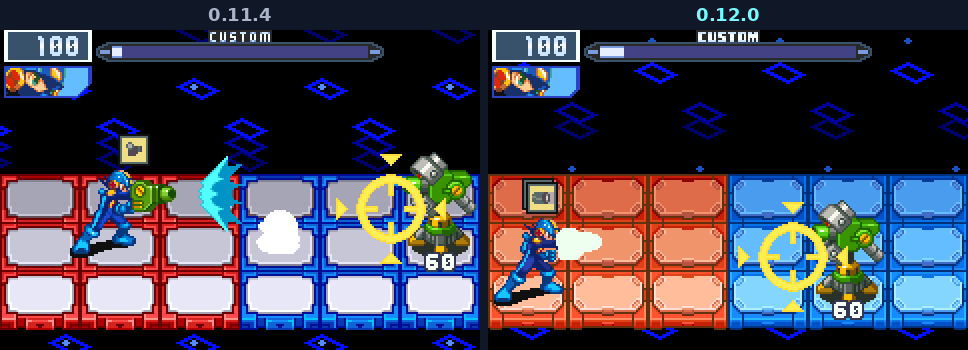

In 0.11, a battle in one of BN5's areas handed the screen to a second emulator running BN5 itself, with its own rules, its own HUD and no Crosses. Now every battle is BN6's. BN5's 25 virus families that BN6 lacks are moved from your BN5 ROM into BN6's battle engine by their own code, and each was checked frame by frame against BN5's own battles before it shipped. They fight beside BN6's HUD and Custom screen, and everything MegaMan carries works against them.

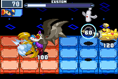

Where BN5's ROM sits beside BN6's, each of its areas takes the place of a BN6 area in about half the runs: ACDC for Central, Oran for Green, SciLab for Sky, End Area for Seaside, its Undernet for the Undernet, and Nebula for the Graveyard. ([#82](https://github.com/saschb2b/Mega-Man-Battle-Network-Cyberworld-Endless/issues/82))

### BN5's guardians

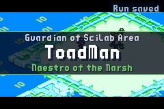 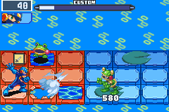

ToadMan, KnightMan, ShadowMan, NumberMan, TomahawkMan and Colonel guard acts in BN5's areas, fought in BN6's engine at BN6's guardians' strength, no longer three quarters of it. So does the Dark Soul.

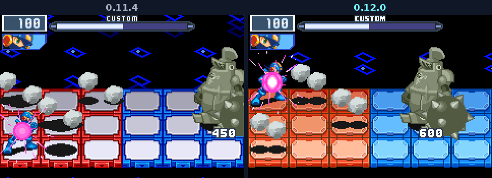

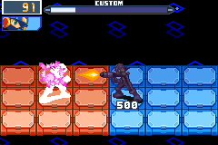

### Souls, in every battle

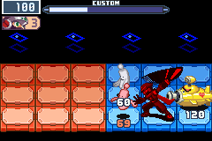 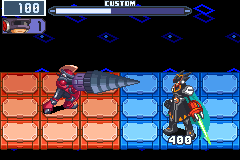

A BN5 guardian deleted gives his Soul for the run. UNITE on the Custom screen, giving up a chip of the Soul's kind, makes MegaMan that Soul for three turns, in any battle, BN6's areas too: its look, its charged shot and its passive, as BN5 has them. One form at a time: UNITE and Beast Out share the emblem's slot. Chaos Unison goes as BN5's does: a DarkChip comes while MegaMan worries, and UNITE stays dark while he does, so keep it, calm him with a chip that lands, and give it up on the next Custom screen. A DarkChip given up for Chaos Unison costs no max HP.

### DarkChips from the flames

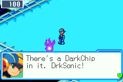 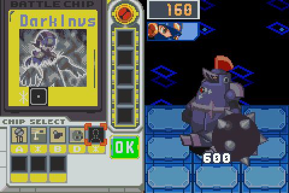

BN5's flames of darkness stand on its areas' layers, and their DarkChips come by BN5's rule: dealt while MegaMan is worried, at a quarter of his HP or hit again and again. Every battle a DarkChip runs in costs 20 max HP for the rest of the dive, and MegaMan says so before you take one. DarkInvs hands MegaMan to the game for ten seconds, grey and untouchable, as BN5's does. DarkPlus adds 50 to the next chip.

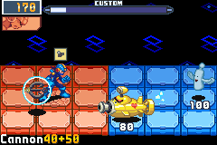

### Lava and sea

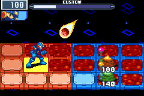 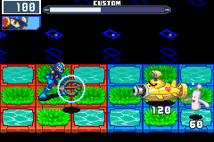

BN5's lava and sea panels work in BN6's battles as they do in BN5: lava burns what stands on it unless it is Fire, and the sea holds back whatever is not Aqua.

### Where the nets meet

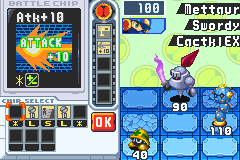

From act 2, a battle in four may bring a visitor from the other net: BN5's viruses in BN6's areas, BN6's in BN5's. The deep acts draw from both nets, and BN5's chips are chips of the run, one chip per name, in shops, traders, rewards and Mystery Data.

### On the New 3DS too

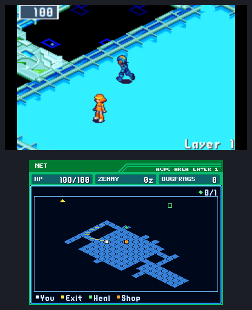

The New 3DS reads BN5's ROM where its heap has room for it. Put Team Colonel beside BN6's ROM and BN5's net joins your runs there as everywhere else. A 3DS without BN5 gets 16 MB of its heap back.

---

## 💾 Saves move between systems

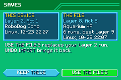 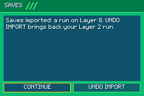

SAVES on the title (L, or Q on a keyboard) writes your profile and the run's checkpoint to one file, `cyberworld-endless.cwsave`, and reads one in on any other system: a PC, a phone, a handheld, a New 3DS or the browser. It shows both saves side by side, keeps yours unless you choose the file's, and UNDO IMPORT brings them back. Controls, screen and volumes stay on each device. A newer build's file, a damaged one, or a BN5 run without BN5 is refused before anything changes. On phones the automatic copy in your ROM folder never writes over another device's file: the game asks once which saves to keep. ([#114](https://github.com/saschb2b/Mega-Man-Battle-Network-Cyberworld-Endless/issues/114))

## 🔁 A soft reset that stays in the game

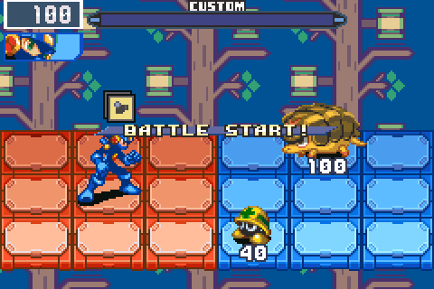

A+B+Select+Start reset BN6 to its own title while the run went on underneath, and going back in could put MegaMan elsewhere on the map. Now it returns to this game's title, in a battle too, and CONTINUE takes the run up at its last checkpoint. Thanks to Mattwj for the report. ([#113](https://github.com/saschb2b/Mega-Man-Battle-Network-Cyberworld-Endless/issues/113))

## 🎮 A smoother New 3DS

- **No freeze at a save.** A checkpoint wrote its ten files on the frame that saved, and on the 3DS's SD card that held the game still for up to a second at every layer. A thread of its own writes them now. In a six-minute run on a New 3DS, the stalls of 0.6 to 1.5 seconds went from 20 to none.
- **The act's card at full speed.** Its text went through the software renderer one letter at a time, and the card dropped the game to about 40 frames a second as it showed. A line of text is drawn once and blended whole now: the seconds with the card on screen ran at 56.6 frames a second, up from 40.8.

## 🌐 The site in Japanese

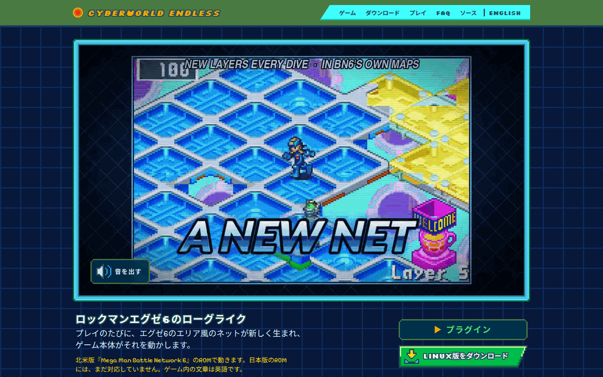

The home page, the downloads, the FAQ and the browser player have Japanese pages, written for Japan's players, who know the game as ロックマンエグゼ6, with BN6's names as Capcom's Japanese releases write them.

---

## Under the hood

BN5's battles in BN6's engine are held to BN5's own by a differential: each of 366 specs fights the same battle in BN5's engine and in BN6's and compares them frame by frame. 363 pass, and the three others stop where they are recorded to. Each of 167 deliberate breaks in the moved code fails its spec. The repository holds numbers only (addresses, ids, checksums); everything BN5's comes from your ROM as the game starts.
