

<h2 align="center">Cyberworld Endless connects.</h2>

<b>The ninth beta:</b> your MegaMan meets other players' now. A gate in Lan's HP leads to a Net Square on a server, eight operators a channel: say a phrase, trade a spare chip at Trade Central, NetBattle each other with the MegaMen your runs built, watch from the stands, and dive the week's DeepNet, the same net for everyone. Every system goes online, the browser and the New 3DS too. Plus a leaner first act that opens up as you go deeper, and an Order Service that sorts.

---

## 🌐 The Net Square

### Through the gate in Lan's HP

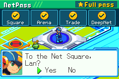 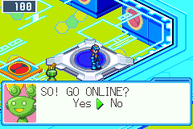

The way there is the great white gate at the front of Lan's HP, where every run begins and comes home between acts. The first time, the Mr.Prog who keeps it asks for the name other players will see, says what the server learns (your PET's address, that name, and MegaMan as he is) and asks before you go, the cursor on No. After that MegaMan asks each time, and Yes saves the run right there. R, or the pad you arrived by, takes you home, MegaMan back on the gate as he left it; if the game was closed in the Square, the next CONTINUE puts him there.

Your run waits at the gate. The Square has no battles of the net, no heal, no shop and no saves, and nothing there makes a run stronger: the one thing that comes home is a chip you traded. ([#120](https://github.com/saschb2b/Mega-Man-Battle-Network-Cyberworld-Endless/issues/120))

<!-- #153, reconnecting after a dropped connection: when it merges into Unreleased, a paragraph here on what a player sees when the server restarts or the connection drops (the warning, MegaMan reconnecting instead of going home), a picture of it if one shows it, and the issue linked: ([#153](https://github.com/saschb2b/Mega-Man-Battle-Network-Cyberworld-Endless/issues/153)) -->

### The Square: phrases, a greeter, a parade and its own music

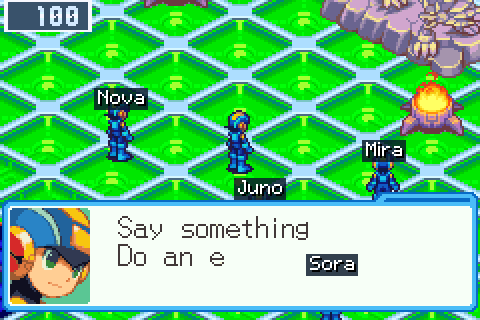

A plaza in one of BN6's daylight nets (Central, Sky or Green Area, by the server), with a landmark in its middle (a statue, a monument or a giant cybertree), a stage up a stair, the log-in plaza with its board and the pad home, Trade Central, and the Arena's ring with room to watch from. Up to eight players a channel; the gate's keeper moves you to the next or the last.

- **L** has MegaMan say a phrase or do an emote over his head, for the whole channel to see. Phrases come from a fixed list: there is no free text, and no one can type at you. Say something together round the landmark or on the stage, and the Square cheers.
- **A** facing another player's MegaMan shows his card (HP, act and layer, Crosses and Souls), and lets you ask him for a NetBattle, wave, mute or block him.
- **A greeter Mr.Prog** calls out who logs in, each arrival in BN6's own log-in beam. Two Navis stroll about and talk about who's here and what just happened, and every three minutes they parade round the landmark: walk with them.
- **The board** lists who's here, the last trade and NetBattle, the trade offers up and this week's DeepNet. A on a tree, the landmark or the sign says what it is.
- **Its own music:** whatever area it stands in, the Square plays BN6's Navi Customizer theme. ([#155](https://github.com/saschb2b/Mega-Man-Battle-Network-Cyberworld-Endless/pull/155))

### The NetPass

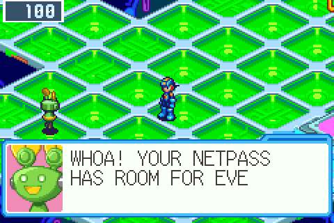

One rule says what is open to you online, and a NetPass in Lan's PET shows it as four stamps:

| Stamp | What it opens | What it needs |
| --- | --- | --- |
| **Square** | Walking, phrases and emotes, cheering, cards, the referee's calls, the board and its posts, reading the trade offers, the week's ranking | BN6 Cybeast Gregar (USA): everyone has it |
| **Arena** | NetBattles, and watching them | The full set |
| **Trade** | Trading at Trade Central, and posting or answering a trade offer | The full set |
| **DeepNet** | The week's DeepNet dive | The full set |

The full set is every game this version supports online: BN6 Cybeast Gregar (USA) and BN5 Team Colonel (USA). With BN5's ROM beside BN6's, all four stamps are yours, and the greeter stamps them on your next visit. With BN6's alone you hold the Square stamp: the whole Square but NetBattles, trades and the dive. If a later version supports another game online, the stamps that need it open again until you add that game, and the release notes and the site will say so ahead of time.

KeyItem in the PET, then A on NetPass, opens it; in the Square, where the PET stays shut, START does. It also shows across the top of the screen while MegaMan asks about going, and on a second screen (the New 3DS's bottom screen, an Android handheld's second display) while you are in the Square. ([#131](https://github.com/saschb2b/Mega-Man-Battle-Network-Cyberworld-Endless/issues/131))

---

## 🤝 Trade Central

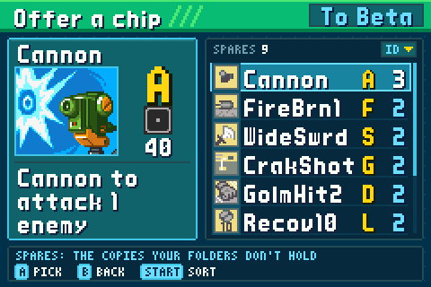 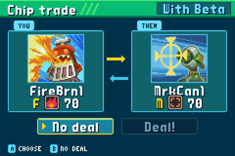

Trade Central, a desk in a wing off the plaza, trades one of your spare chips (copies beyond those in your folders) for another player's, one for one. It has two screens of its own, modelled on the Legacy Collection's:

- **The spares list**, where every chip for a trade is picked: your spares with their codes and counts, beside a card of the chip under the cursor (its picture, code, element, damage and description, read from your ROM, BN5's chips too). START sorts them by ID, ABCDE or Code.
- **The chip trade**: both chips, You and Them, No deal and Deal!, the cursor on No deal. Once you both say Deal!, the cards swap places to BN6's jingle, and the chips change hands as you come home.

One trade a visit. **The trade board**, at the same desk, puts one spare up with what you want for it (anything, a chip of an element, a Sword, Wind, Break or Cursor chip, or a Mega), and everyone in your channel reads it, there and on the log-in plaza's board, until you take it down, leave or trade. To answer an offer, pick it at the desk: the spares list shows only your chips that fit its want. ([#145](https://github.com/saschb2b/Mega-Man-Battle-Network-Cyberworld-Endless/issues/145))

## ⚔️ NetBattles, with rollback

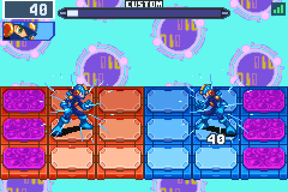

**Battle** on another player's card, where you both hold the Arena stamp, asks him for a Practice NetBattle, BN6's own over an emulated link cable. You fight with your MegaMen as your runs built them: HP, NaviCust, buster, Crosses, the folder with BN5's chips in it, and your Souls (UNITE on the Custom screen as in a run, and the other player sees your Soul too). Where more than one of your folders holds chips, MegaMan asks which goes. Win or lose, you are back in the Square where you stood, and nothing is won or lost. MegaMan then asks whether to go again with the same player, the cursor on No.

The battle answers your presses with rollback: each game runs it at once, guessing the other player's buttons as the last ones he held, and when his real presses come in otherwise, it rewinds the frames that guessed wrong and plays them again. On a good connection that is 2 frames of input delay. Each system measures how far it can rewind and asks the server for the delay its connection still needs; the longer of the two players' needs is the battle's. Running both players' GBAs got three times cheaper on the way, so even the Retroid Nova rewinds up to 7 frames within a frame's time. ([#128](https://github.com/saschb2b/Mega-Man-Battle-Network-Cyberworld-Endless/issues/128))

### The stands

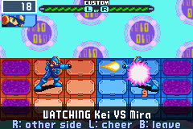

The referee Mr.Prog by the Arena's ring calls each NetBattle in your channel: who fights whom, their HP, the last chips they used, how many watch, the winner. With the Arena stamp he asks whether to watch, and the screen turns to the battle itself, a moment behind the players and from its first frame however late you came. **R** shows the other side, **L** cheers, **B** takes you back. The players hear the cheers from him after their battle. ([#128](https://github.com/saschb2b/Mega-Man-Battle-Network-Cyberworld-Endless/issues/128))

## 🏆 The week's DeepNet

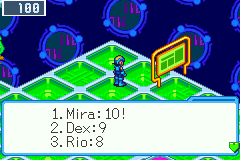

Every Monday (00:00 UTC) each server opens a net of its own for the week, and everyone on that server who dives it dives the same net, from the same start: the short net, the Standard folder, threat 0, no helpers and no Cross, nothing your other runs unlocked. The greeter in the log-in plaza offers it to a pass with the DeepNet stamp; the dive begins in Lan's room, as a new game does.

Your run in progress waits in a save of its own, untouched, and the title's CONTINUE stays with it. Talk to the greeter again to go on with an unfinished dive or start it over. How deep you got goes up on the board at your next visit: the week's eight deepest dives as reported, your own best and its place, and last week's three. Dive as often as you like; your best counts. A dive unlocks nothing, and nothing is won for one. ([#127](https://github.com/saschb2b/Mega-Man-Battle-Network-Cyberworld-Endless/issues/127))

## 📱 Every system online

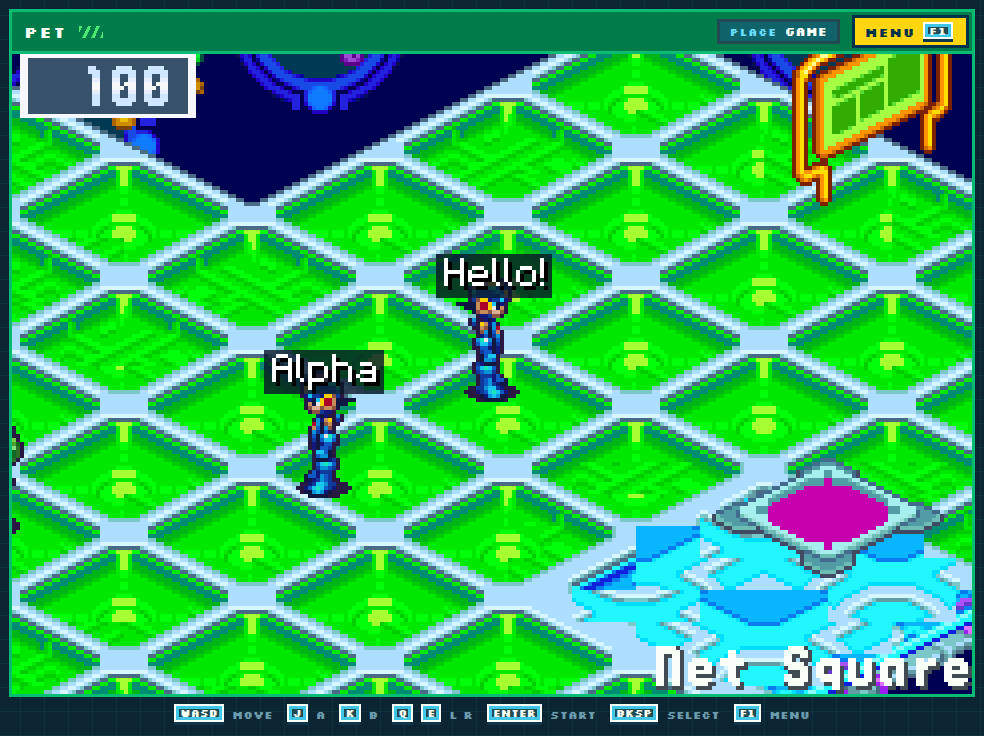

The Square, Trade Central and the DeepNet are on every system: computers, phones and tablets, PortMaster handhelds, the Steam Deck, the New 3DS and the browser.

- **NetBattles in the browser.** The browser build battles in the Square as the other systems do, rollback and watching from the stands included, against another browser or a game on a computer.
- **The New 3DS has no NetBattles.** Running a NetBattle's two GBAs takes it about 26 ms a frame, half again the 16.7 a frame has, so it offers no Battle and no watching, and its pass says so: "Every game in! No NetBattles on this PET." The referee still calls the channel's battles to it, and with BN5's ROM it trades and dives. Running the two GBAs on two of its cores is what is left to try ([#147](https://github.com/saschb2b/Mega-Man-Battle-Network-Cyberworld-Endless/issues/147)).

## 🖥️ The official server, and your own

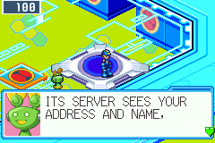

The gate offers the official Net Square first: Saschb2b's, at cyberworld.saschb2b.com, a hobby server with no guarantees. It asks for no account and no e-mail. There is no free text, so there is nothing to report: block a name from his card, and that MegaMan is gone from your Square. It keeps its trades for 14 days and the week's board for 2 weeks, by a key your game makes for that server alone and the name you chose, its daily totals with no names for a year, and no log of who came and went. Its rules, who moderates it, what it keeps and for how long, and how to have your data removed are in [its policy](../../server/README.md#the-official-server). ([#132](https://github.com/saschb2b/Mega-Man-Battle-Network-Cyberworld-Endless/issues/132))

Anyone can run a Net Square of their own: the server is a small ROM-free program in Python, with ready builds for Linux, Windows and macOS beside this release (or the zipapp, for any system with Python 3.11) and a recipe for a container, and it never needs a ROM or sees a save ([server/README.md](../../server/README.md)). Each server has its own channels, moderators and week's DeepNet; give its address to the gate's keeper to go there. For hosts: a server prunes what it keeps by itself, at its start and every hour (`trade_days`, `board_weeks`, `log_days` in `server.ini`), `--admin forget` takes a player out of every record but a ban or a mute, `--admin hide` takes an entry off the week's board, and `--backup DIR` archives the server's key, moderation and board once a day, `--restore` putting one back. A 0.13.0 game speaks protocol v9: a game and a server of other versions refuse each other.

### Online statistics

Where you said yes to the anonymous statistics, the same answer now covers online play, so that the Square's servers and the NetBattles' rollback are tuned on real networks: how a visit to a Net Square ended and its minutes, your NetPass and whether the server was the official one (never its address); a NetBattle's network numbers (input delay, rollback window, rollbacks and the deepest, the longest tick, the stalls) and how it ended; and that a trade was done, a battle watched or a dive posted. Never your name or another's, your identity on a server, the chips, the phrases or anything typed. Said no, nothing is sent.

For hosts: a server counts each UTC day's joins, how many different players (a number only: the day's identities are held in memory and dropped at its end), the most online at once, trades, NetBattles, battles watched, dives posted, and joins by version and by NetPass, with no names, in `stats.jsonl` for `stats_days` (365) and at `GET /stats`, today and the last 30 days. ([#156](https://github.com/saschb2b/Mega-Man-Battle-Network-Cyberworld-Endless/issues/156))

---

## 💰 A leaner first act that opens up as you go deeper

The first act used to hand out about twelve chips, many in your folder's codes, and more zenny than its dealer's answer chip and HPMemory cost together, so there was little left to want or to trade. Now:

- the first act lays half the green Mystery Data, and a green data holds a chip less often, zenny in its place;
- the plain finds (green and blue data, a dealer's shelf, a request) hold fewer 3-star, Mega and Giga chips;
- finds hold half the zenny;
- no find leans to your folder's codes.

Each of these opens act by act, back to what it was by the sixth act (the short net's third), never past it. A blue data at a detour's end stays the layer's prize, and BN6's own battle rewards are untouched, so a high busting level pays as it did. Measured over 300 runs of the endless net:

| Act 1 | Before | Now |
| --- | --- | --- |
| Chips | 12.2 | 9.5 |
| Good chips (3 stars or more, Mega, Giga) | 3.2 | 2.2 |
| Mystery Data | 14.8 | 11.6 |
| Zenny | 3,550 | 2,630 |
| The most chips of one code, with the \*s | 5 | 3 |
| Chips found in the folder's codes or \* | 63% | 35% |

At the act's dealer you now buy the answer's two copies or the HPMemory, not both. **The Chip and BugFrag Traders** pick a prize's code as BN6's own Chip Trader does, three times in four one you hold none of, rather than your folder's: your codes are your run's own, and worth a trade at Trade Central. A layer saved before this update starts afresh at a CONTINUE. Where you said yes to the anonymous statistics, a run's end also counts its chips, good chips, Mystery Data opened and zenny earned. The numbers act by act are in [docs/ECONOMY.md](../../docs/ECONOMY.md). ([#154](https://github.com/saschb2b/Mega-Man-Battle-Network-Cyberworld-Endless/issues/154))

## 🛒 The Order Service sorts

AsterLand's clerk listed every chip of the Library by ID alone, five a page, while the folder editor and the Chip Trader beside him sort by seven keys. START on his list now goes on to the next of the same seven (ID, ABCDE, Code, Attack, Element, No., MB), each the way BN6 first sorts by it, and SELECT turns it around; his box names the sort over the buttons ("By Attack,high first!"). No. is how many of the chip, in its code, you hold. The list opens in your last sort again. Thanks to whitt-e for the request. ([#124](https://github.com/saschb2b/Mega-Man-Battle-Network-Cyberworld-Endless/issues/124))

## 🔧 Fixed

- **A request pays once.** An asker at home paid a settled request again after Lan jacked in at his PC and back out: the lab's man gave his 1000 zenny twice. BN6's jack-in rerolled its own maps' Mystery Data and cleared their flags, some of which are the run's (a request settled, the visit's order at AsterLand). Each layer now leaves BN6's own Mystery Data out of the roll. Thanks to Baine53 for the report. ([#122](https://github.com/saschb2b/Mega-Man-Battle-Network-Cyberworld-Endless/issues/122))

---

## Under the hood

A NetBattle is BN6's own Practice NetBattle on an emulated link cable: each game runs both players' GBAs from both players' keys, the MegaMan each run built written into his side, BN5's installs in both, and the two games compare a hash of the battle as it goes. The server only pairs the players and relays their keys; it is ROM-free and never runs a game. A rollback puts both GBAs back to a snapshot and runs the frames again with the keys that came. The New 3DS, which cannot keep up, was measured on the device before its pass was made to say so.
