

<h2 align="center">Pick a side.</h2>

<b>The tenth beta:</b> the Net Square answers back. MegaMan performs every emote in his own BN6 poses and sounds, one press away on SELECT's strip or one tap on a second screen, and a wave gets its wave back. A NetBattle now runs from the ask to the result on PET screens, a rematch is back in the battle in about a second, and on a good link the input delay is down to one frame. And two players can team up: a relay one by one, or side by side, four MegaMen on one field.

---

## 👋 Say it with MegaMan

### Emotes, performed

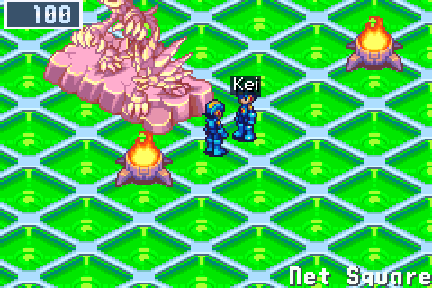 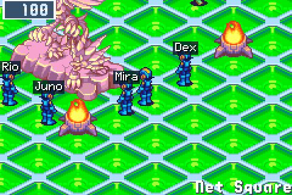

An emote is no longer a caption over a head: it is MegaMan's own BN6 pose and a sound of BN6's, the same on every screen. A hand raised for Wave, both arms up for Cheer, down on one knee for Bow, the item-get pose and jingle for Got it!, the buster held out, a collapse, a turn on the spot, sparks. A caption shows in BN6's chat box only where a pose can't say it ("Haha!", "Hmm..."). Twelve emotes, six of them new, and none of them ever moves MegaMan.

- **One press:** hold **L** and press a direction for one of four favourites: up Wave, right Cheer, down Bow, left Laugh.
- **Wave and wave back:** a Wave, Cheer or Bow sent while facing another MegaMan is aimed at him. A hand blinks over your name on his screen, and his next one answers you, whichever way he faces: within five seconds, BN6's "!!" and sparkle play between you two on everyone's screen. Past two unanswered at one player, the rest show on your screen alone, so nobody can be flooded with waves.
- **In step:** every emote starts on the server's beat, so a group's emotes play together on every screen. The Square cheers back, and the more of you there are, the bigger: from three together the walking Navis cheer too, from four the greeter calls out as well.
- **A burst of three**, then one a second (it was two, then one every two seconds). **Quiet please** in L's chat hides everyone else's.

([#176](https://github.com/saschb2b/Mega-Man-Battle-Network-Cyberworld-Endless/issues/176))

### The emote strip, and a palette on the second screen

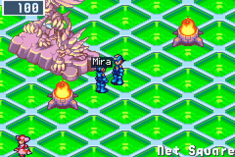 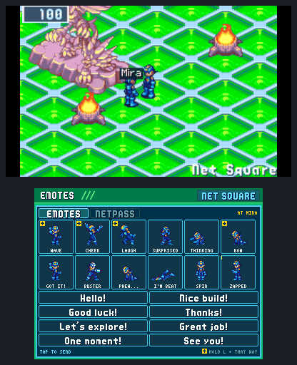

Emotes and phrases used to be pages of L's chat boxes away: 5 to 16 presses for an emote, 4 to 11 for a phrase. **SELECT** in the Net Square now opens the emote strip, a PET screen laid out as the Custom screen lays out its chips: the twelve emotes as MegaMan's own poses in two rows, the one under the cursor played by MegaMan in a window with its name and whom it goes to ("AT MIRA"), **A** to send, **L** and **R** to the eight phrases and back. An emote now takes 2 to 6 presses (4 on average), a phrase 3 to 6, and the last one again two, with no chat box typed out on the way.

- **Your own favourites:** hold **SELECT** and press a direction on the strip to put the emote or phrase under the cursor on **L** and that direction. Phrases can be favourites too.
- **On a phone**, SELECT's touch button opens the strip, and a tap sends.
- **On a second screen** (the New 3DS's bottom screen, an Android handheld's lower one) every emote and phrase is a button, one tap each, with the NetPass on a tab beside them.

L's chat keeps Look around and Quiet please, and the first time it opens MegaMan points you to SELECT. ([#178](https://github.com/saschb2b/Mega-Man-Battle-Network-Cyberworld-Endless/issues/178))

---

## ⚔️ NetBattles, from the ask to the result

### Asking, and being asked

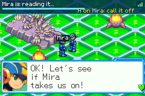 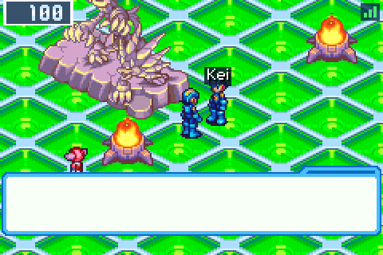

Before anyone commits, the Square now tells the truth about a challenge:

- **A challenge you sent** shows at the top of your screen: his PET ringing, then his time to answer running down once he reads it, the link's bars beside it. **Call off** on his card takes it back, and Battle on anyone else meanwhile gets MegaMan's "we already asked".
- **The player you challenge** hears his PET ring and sees a "!" over you. MegaMan reads him your MegaMan's card before "Take it,Lan?", and his 30 seconds start only once the question is up.
- **The link** between two players shows as bars, never a number, beside a player's card and the question.
- **Busy marks:** a small mark over a player says he is in a NetBattle (pulsing while the bout runs, as the referee calls it out), watching one, or at a trade.
- **A refused challenge** (busy, gone, no stamp) is MegaMan's word in the chat box, no longer a notice in the corner.

([#167](https://github.com/saschb2b/Mega-Man-Battle-Network-Cyberworld-Endless/issues/167))

### The way in and the result card

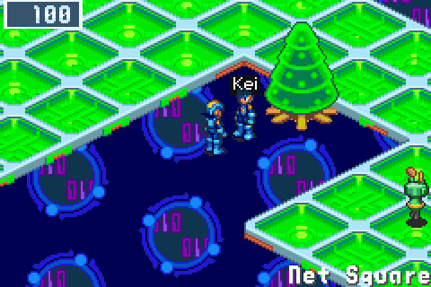 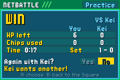

The way in is a PET Network panel instead of a black screen: both players, each MegaMan's HP, Crosses and Souls as carried, your set's score with this player, and whose PET is still on its way. On the Custom screen the other player's name sits on a small plate, and a link badge (bars only) shows the link steady, correcting a guess, or waiting. A wait past a second names whose PET it waits for, offers B to leave after ten seconds and ends by itself at twenty.

The battle ends on a result card instead of two lines on black: win or lose, the time, the HP each of you has left, the chips each used, the set's score, and the rematch asked right there, the other player's answer shown as it comes ("Kei wants another!"). A stop is the PET's word on the card, and a bout that broke off counts neither won nor lost: the referee calls it "BROKE OFF! NO CALL!". Short fades and BN6's own sounds take you in and out. ([#167](https://github.com/saschb2b/Mega-Man-Battle-Network-Cyberworld-Endless/issues/167))

### A rematch in about a second

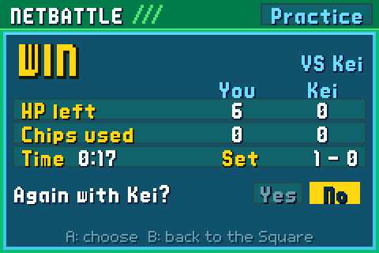

Two Yeses on the result card go straight back into the battle. Each game keeps the two linked GBAs as the bout began and goes in from there: a few hundred frames instead of the whole way in. Each bout still deals its own hands and rolls, the same on both games and for every spectator, and the set's score keeps counting on the panel and the card. ([#167](https://github.com/saschb2b/Mega-Man-Battle-Network-Cyberworld-Endless/issues/167))

### Snappier NetBattles

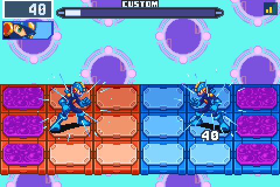

Where both games can rewind as far as the trip takes, a NetBattle's input delay is now 1 frame instead of 2: every press, step and chip of your own lands a frame sooner. The other player's sounds stay whole when a guess of his keys is corrected, instead of going silent. And the games share their waits evenly, so the player on the worse link no longer sees the deeper corrections, and they are held where nobody sees them: on the Custom screen, or while your keys rest. ([#167](https://github.com/saschb2b/Mega-Man-Battle-Network-Cyberworld-Endless/issues/167))

---

## 🤝 Team NetBattles

### Team up

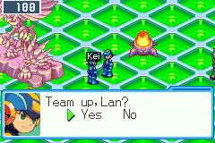 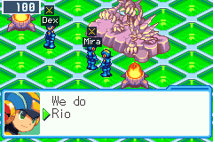

Where both players hold the Arena stamp, **Team up** on a player's card asks him to team up, his MegaMan asks Lan, and **Split up** on your partner's card ends it. The one who asked is the team's captain. **Battle** on a player of another team challenges his team, and MegaMan asks how to fight: **One by one** or **Side by side**. The other team hears which before it answers. ([#167](https://github.com/saschb2b/Mega-Man-Battle-Network-Cyberworld-Endless/issues/167))

### One by one: the relay

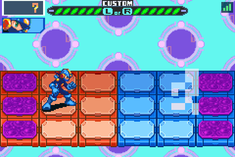

Each captain picks who goes first without seeing the other team's pick, then both orders are shown. The leads fight a NetBattle as ever; the winner stays on with the HP he has left, the loser's partner comes in, and a team is out when both its MegaMen are deleted. Whoever waits, and whoever is out, is taken to the stands to watch the bout, unasked. Between bouts the result card shows the MegaMen standing and who is next; at the end, the team's result. A leave or a dropped link mid-match breaks it off for both teams, with no result: nothing is won or lost. The referee calls a team's bouts.

### Side by side: two MegaMen a side

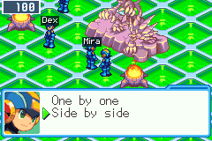 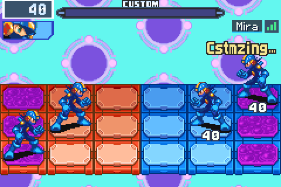

Side by side, all four MegaMen fight on one field, two a side. Each team's captain leads and his partner stands beside him, and every one of the four games runs the same battle in BN6's own engine from the four players' buttons, rolling back as a NetBattle of two does.

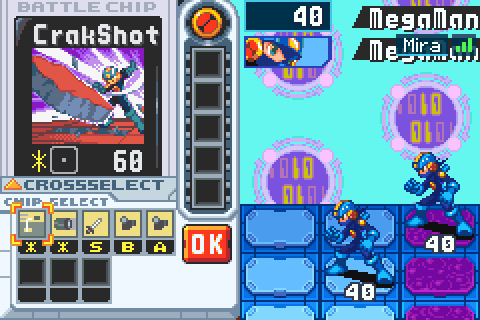 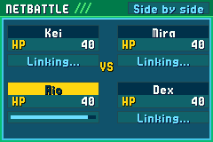

- **His own Custom screen:** each partner picks his chips on BN6's own Custom screen of his own game, from his own folder dealt into his own deck. The leads' screen waits for him by BN6's own link wait (the other side sees "Cstmzing..." over the side that waits), and a quiet sign tells a lead his partner is still picking, and a partner that his lead is ready. Once anyone has pressed OK, whoever is still picking has 30 seconds, then his picks so far are taken; only he sees a quiet sign in his last ten.
- **His whole MegaMan:** a partner brings his NaviCust's programs (his HP, buster, abilities and the chips his screen deals), his Cross from his own CROSSSELECT, his Beast Out from his own emblem, a Program Advance made on his own screen, and UNITE with his own Souls. Under full rules BN5's Souls, mood and DarkChips answer for each MegaMan: a partner's charged B is his own while his lead is in a Chaos Unison, and a partner's mood, dark and DarkChip after-effects are his own.
- **Four players of different runs** build the same battle, and a partner's choice his own Custom screen could not have made (a chip outside his hand, a Cross he lacks, a Soul he does not hold) is refused on every game alike.

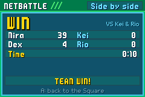 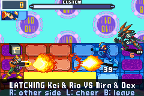

The way in shows all four MegaMen, a partner's seat has its own HP box, and the result card shows each one's HP left and the team's WIN or LOSE. A stall says whose PET it waits for, and anyone else in the channel can watch from the stands. ([#181](https://github.com/saschb2b/Mega-Man-Battle-Network-Cyberworld-Endless/issues/181))

---

## 🔧 Fixed

- **DarkInvs on the challenged player's side of a NetBattle.** Under full rules, the second player's DarkInvs (or ShadowSoul's Chaos Unison, which uses it) moved his MegaMan's AI data into the block the first player's MegaMan already held: both MegaMen read one AI data, the first turned grey under the other's DarkInvs and the battle stood still. Each MegaMan now has a room of his own, so either player's DarkInvs takes his own MegaMan alone, both at once too, and a NetBattle without it is the battle it was. ([#182](https://github.com/saschb2b/Mega-Man-Battle-Network-Cyberworld-Endless/issues/182))

---

## Under the hood

Side by side, a partner's buttons and choices travel inside his lead's GBA's own link packets, BN6's own, so both linked GBAs read them in the same frame as the lead's: a partner who never picks, or all four in Beast Out, can no longer make the two GBAs see different battles. Each partner's NaviCust is worked out by BN6's own code over the battle's own starting state, never a player's save. A rematch's bout seed is its battle's ID, which both players and every spectator already know, so no new message carries it.

The network thread no longer rests between looks: it wakes when a key is put to go out or one comes in, and uses less CPU. Every client socket asks for no Nagle where the system lets it.

A 0.14.0 game speaks protocol v15 (0.13.0 spoke v10): a server and its games update together, and the gate says which side is behind. For hosts: the Arena's delay still comes from `delay_for`, now 1 at least, and the server pairs teams, their relays and the four seats of a side-by-side battle as it pairs two players, keeping them in memory only ([server/README.md](../../server/README.md)).
