

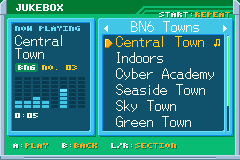

<h2 align="center">Every song, in BN6's own look.</h2>

<b>A point release for 0.14:</b> a Jukebox in the PET with every song of BN6 and BN5, the title's music on BN6's own sound engine, Options a press away with a Display section, and the screens the game adds drawn as BN6 draws its PET.

---

## 🎵 The Jukebox

 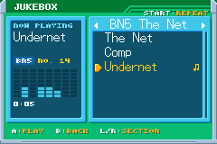

A new key item: **KeyItem** in the PET, then A on **Jukebox**. It plays every song of the game, BN6's 37, and with BN5's ROM beside it BN5's 35, as the cartridges play them: on BN6's own sound engine, which BN5 shares byte for byte. The game holds still while it is open and its music picks up where it was when you close it.

- **Sections by game and by where a song plays:** Towns, The Net, Battles, Story and Screens. L and R (or Left and Right) turn them, A plays, B closes, and on a phone a tap on a song plays it.
- **Three modes on START:** **Repeat** plays the song over and over, **In order** plays the section from the song on, and **Shuffle** plays the section in any order. A song that loops goes round twice before the next.
- **Its lights** are the song's eight tracks as they sound. The last song and mode are kept for next time.

The names are ours, for where each song plays, checked against where the ROM plays it. Twelve of BN5's songs whose place we haven't found yet are in **More** by their number. If you know where they play, tell us.

## 🔊 The sound as the cartridge plays it

- **The title's music, note for note.** The title, the run's setup, Options, SAVES and the PET's screens played BN6's songs on an approximation of the engine's own, duller than the game. They now play on BN6's own sound engine's rules, read from its code: its sequencer, its four channels and their priorities, its envelopes, the songs' reverb and its 8-bit mix, then the GBA's PSG and output as mGBA plays them. Laid beside the game frame by frame, it is the same, byte for byte, for every song and sound checked.
- **The music holds its pitch.** The game's sound is nudged a hair faster or slower to stay in step with the speakers, and that nudge moved the pitch 10 to 18 cents from one frame to the next: a slight warble on every held note. It follows the average now, under a cent a frame.
- **The Legacy Collection's balance, if you like it.** A player told us the sound felt off next to the Legacy Collection's. That collection plays CD recordings rather than the game's own sound, mixed softer. Options' **Audio** now has **Sound: Soft**, fitted to a recording of the Legacy Collection on the same songs: highs from 5 kHz up taken down (-10 dB at 10 kHz) and the deepest bass a little. **GBA**, the default, stays as the cartridge plays it. It changes at once so you can hear it, and the browser player's menu has a **Sound** button too.

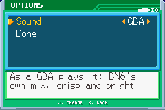

## ⚙️ Options, a press away

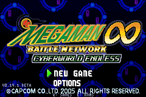 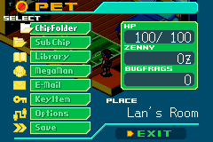

- **OPTIONS on the title's menu**, under NEW GAME and CONTINUE, in the title's own letters, and **Options in the PET's menu** during a run, in the place of BN6's Comm, which a run always greyed out. The game waits under it, and B brings you back to the PET where you were. SELECT on the title still opens it, and so does **OPTIONS** in a phone's touch menu.
- **A Display section:** **Fullscreen** on a PC (borderless, as F11 and Alt+Enter, which now keep your choice too), **Scale** and **Smooth motion**. Scale is **Auto** (as before), **Integer** (whole pixels everywhere), **Fill** (as big as the screen holds, its shape kept: on a 1920x1080 screen no border above and below) or **Stretch** (the whole screen, the picture pulled to its shape). The 3DS has Fill, Integer and Stretch for its top screen. Thanks to Mooshymush for asking about the borders.

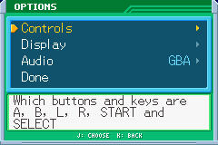 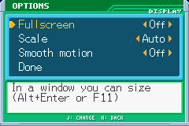

## 🖼️ The game's own screens look like BN6's PET

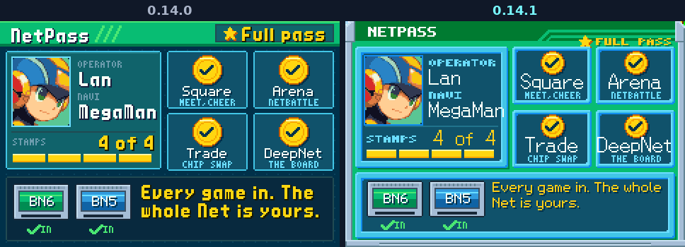

The screens the game adds to BN6 had a look of their own: a flat green band, thin teal panels on a dotted ground, bold letters everywhere. They are drawn to the measure of BN6's own PET screens now: the dark band with the screen's name and its stripes, the metal rails, windows framed in light and dark cyan round a navy field, the orange arrow for the cursor, key hints as E-Mail's START:SORT, notes in an information box like KeyItem's, and lists in BN6's own thin letters, read from your ROM. That covers the Jukebox, the NetPass, Trade Central, the NetBattle's cards, the wait for a dropped link, Options and the controls screen, the second screen, the ROMs screen and SAVES.

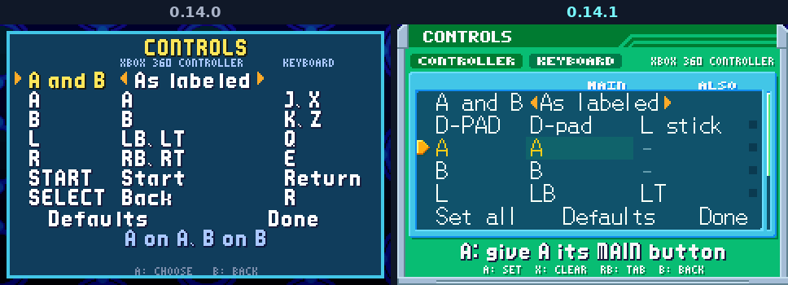

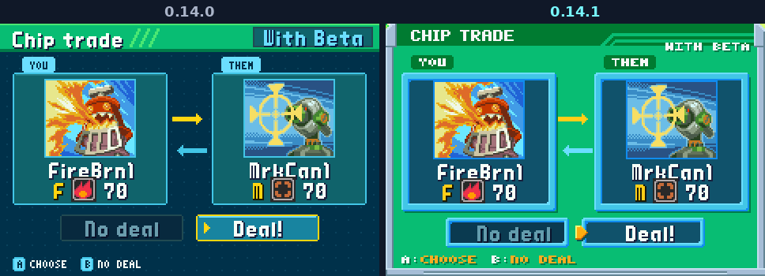

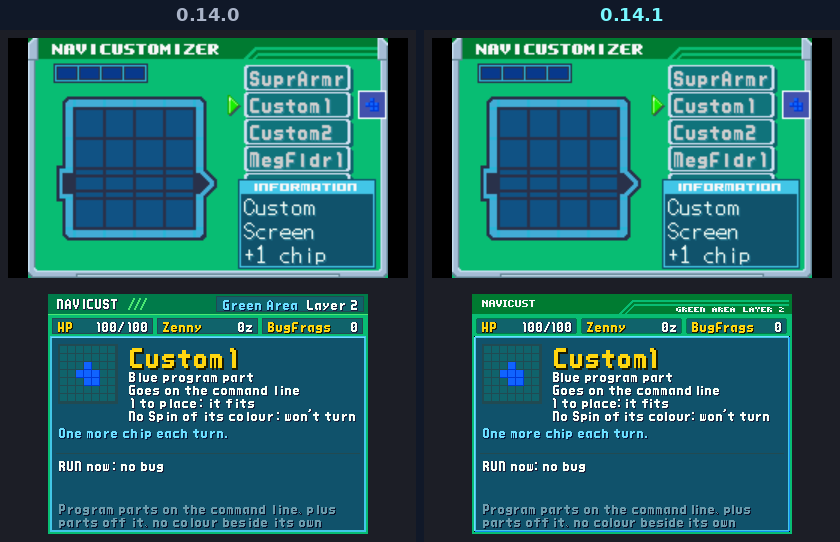

