

<h2 align="center">Liberate the net.</h2>

<b>The eleventh beta:</b> parts of the endless net go dark. From the second act, one way at the fork can lead to a layer gone dark, and taking it turns that layer into one of BN5's Liberation Missions, made afresh from the layer itself: a board of dark panels, DarkHoles and their guardians, and a Darkloid at the far end, liberated phase by phase against a par, in BN5's own look and sound. Beside it: the music off to play your own, a guardian's draft that knows what you hold, compression codes that stay entered, BN5's songs named, the Net Square as a hub, and the game's own screens closer still to BN6's.

---

## 🌑 Liberation Missions

### One way has gone dark

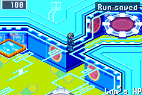 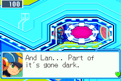

From the second act, two forks in three at home hold a dark way: behind one of their two pads or links, a layer of the next act has gone dark. Its portal swirls in BN5's dark panels' shades, MegaMan says so when he reads the way ("And Lan... Part of it's gone dark. Dark panels,like Nebula's!"), and the act's card says "A layer here has gone dark". It is a risk you choose: the dark layer gives up the act's second Net Dealer and its Mr.Prog. The short net meets dark layers in acts 2 and 3, the endless net in acts 2 to 4.

### The layer becomes a board

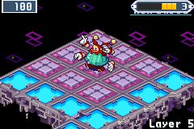 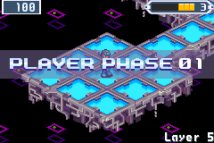

The dark layer is a Liberation Mission of BN5 Team Colonel's, made afresh from the layer's own floor, so no two boards are the same: dark panels, DarkHoles in their rings with a guardian on each (BigBrute, TinHawk, Bladia), item panels and BonusPanels, and a Darkloid, a Navi of BN6's, on his ring at the far end. As you arrive the camera goes to him and back, and Lan and MegaMan name the board: its DarkHoles and its par, the phases a planner took to clear it.

### A battle for every panel

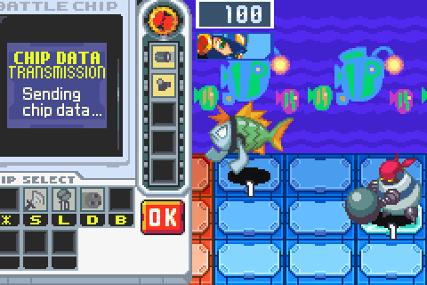 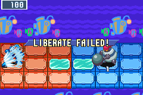

Each PLAYER PHASE MegaMan walks the clean panels as BN6 walks him and faces a dark one. A opens BN5's command window:

- **Liberation** is a battle with BN5's three turns: TURN 1 START!, TURN 2 START!, FINAL TURN!. A win frees the panel, and a win in the first turn (1 TURN LIBERATE!) frees the dark around it too. When the final turn's gauge fills, TIME UP! and LIBERATE FAILED!: the panel stays dark.
- **LongSwrd** spends an Order Point to free two panels in a line.
- **Pass** rests.

Item panels give Order Points, hearts, chips or zenny; a BonusPanel spins BN5's roulette. A guardian fights in its own battle, and a DarkHole sends its deleted guardian back until the hole itself is liberated.

### Then the dark strikes back

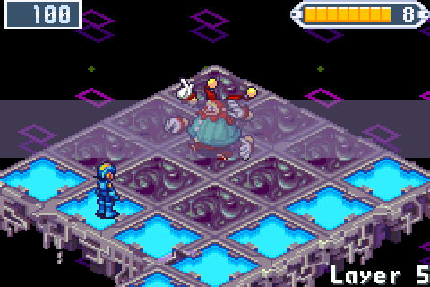 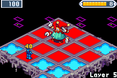

DARKLOID PHASE plays as BN5 plays it: the Darkloid first, his reach lit red, his line, his blow; then each guardian warps toward MegaMan and strikes, the camera going to each as it acts, and the harm in BN5's yellow digits. The board's harm never takes MegaMan's last HP.

### Beat the par

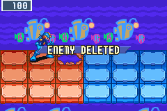 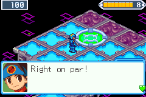 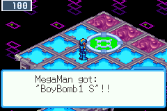

Close every DarkHole and the Darkloid's ring can be liberated, and the Darkloid fought from it. Delete him and the exit opens where he stood, and the board pays for how fast you were: the fewer the phases against its par, the better the chip it leaves for the rest of the run. Each act adds one of BN5's rules: in act 3 a barrier and its key, with a sealed route behind it; in act 4 a roaming TinHawk and a barrier across the way. A planner plays every board as it is made, sets its par from its plays, and turns away boards with too many dead phases or nothing to decide.

### In BN5's own look and sound

Everything on the board is BN5's, read from its ROM while the game runs (none of it is in the download): the board and its backdrop, the PLAYER PHASE and DARKLOID PHASE banners, the command window, the L view and its camera, the units animated, and BN5's board music; a battle won in its first turn ends on BN5's one-turn jingle. A CONTINUE goes on with the same board, phase and freed panels.

Liberation Missions need BN5 Team Colonel's ROM beside BN6's. MegaMan liberates alone for now; his teammates, the Navis whose Souls a run has won, come later. How the missions were taken apart and how the generator makes them: [docs/LIBERATION.md](https://github.com/saschb2b/Mega-Man-Battle-Network-Cyberworld-Endless/blob/v0.15.0/docs/LIBERATION.md).

---

## 🎛️ Smaller things, asked for by players

### The music off, to play your own

Options' **Audio** has **Music** and **Effects**, each On or Off. Music off keeps BN6's sound effects while your own music plays; both off silences the game. It applies at once and is kept.

### A guardian's draft knows what MegaMan holds

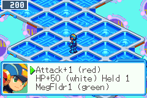

A player took UnderSht from Guardian Data while already holding it, more than once: BN6 sets UnderSht once, so a second does nothing. The draft now offers no program a copy would add nothing to (UnderSht, SuperArmor, the Shields, the shoes, the MAXes and the rest whose effect BN6 sets), and another of the build takes its place. A program that adds, like Custom1 or HP+50, shows how many you hold: "HP+50 (white) Held 1".

### A compression code stays entered

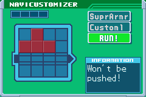

A compression code was kept once entered, but its ten buttons had to be pressed again in every run, and a player said they ended up not using them. Now every program whose code you have entered in any run comes compressed as a run begins. Compressing never costs a fit, and the code entered again undoes it for that run, as in BN6. Dad's Compression mail still lists each code, and a code you have never entered is never applied.

### BN5's songs, named

The Jukebox's BN5 songs had numbers in place of names, or names borrowed from BN6. Every song Team Colonel starts is now named for its own place, read from BN5's scripts: SciLab, Beach Day, A Stranger, Hope, Challenge, Area Liberated and One-Turn Win among them. In runs, BN5's own Before the Boss plays as a guardian logs in on BN5's areas, and a dark layer won plays BN5's song for a won mission.

---

## 🌐 The Net Square, a hub and its parts

 

Friends who visited together lost each other: the Square was one wide plaza with its wings out of sight. Now everyone arrives in a compact **welcome plaza**, its landmark in the middle, the pad home, the greeter, the keeper and the Board by the arrival. Three warps off its sides, BN6's own gem pads, go to **Trade Central**, the **Arena** (the ring and its stands) and the **stage**, each a small place of its own, the warp back right where MegaMan lands. Over each warp its name in gold and who is there now ("ARENA: Mira"); L's **Look around** says which way each warp lies and who is where. A part is a few seconds from the arrival and back.

A server and its players need 0.15.0 alike: a 0.14 game meeting the new Square is told a newer version is out.

---

## 🖥️ Closer to BN6's own screens

### The JACK-IN SETUP

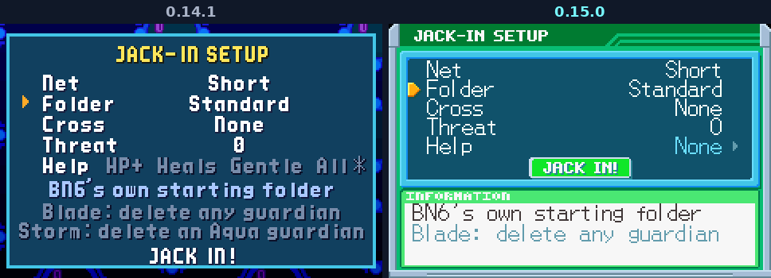

The setup after NEW GAME now sits in the PET window as Options does: BN6's orange arrows on each value, the row under the cursor explained in KeyItem's INFORMATION box, JACK IN! as the NaviCust's green RUN! at the foot of the list, and NEW in E-Mail's mark. The helpers have a page of their own: A on Help opens it, B goes back.

### A run ends on BN6's RESULT

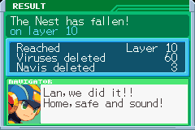 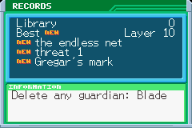

The summary after a run is two PET screens now, as BN6's battle RESULT gives its record and then what it got: **RESULT** (how the run ended and by whom, the layer reached, viruses and Navis deleted, and MegaMan's word in the NAVIGATOR box), then A to **RECORDS** (the Library and what the run added, the best, what the run opened marked NEW, and the closest goal), and A again for the title.

### The PET's screens say as little as BN6's

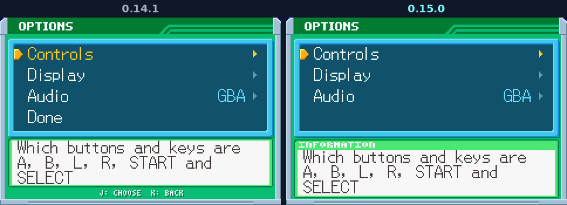

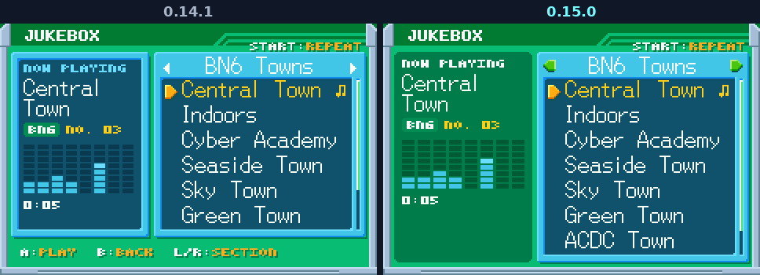

BN6's own screens never show what A and B do, turn pages under small green arrows, and ask Yes or No behind a green triangle. The game's own screens now do the same: the key lines under the Jukebox, Options, the statistics question, Trade Central and the emote strip are gone, and Options' Display and Audio take the band's name as the folder editor takes CHIP FOLDER's. Only lists sit in the cyan window, as in BN6; a chip shows on the Library's grey card, buttons are STATUS's pills, and explanations sit in SubChip's flat panel. Each screen fades up from black as it opens, START on Trade Central's list opens a SORT pop-up as the folder editor's does, and in a chip trade MegaMan asks in BN6's NAVIGATOR box. The rules, measured from BN6's screens: [docs/UI.md](https://github.com/saschb2b/Mega-Man-Battle-Network-Cyberworld-Endless/blob/v0.15.0/docs/UI.md).

---

Free and unofficial, not affiliated with Capcom. It runs from your own <b>Mega Man Battle Network 6: Cybeast Gregar (USA)</b> ROM; Liberation Missions, BN5's areas, and online trades and NetBattles also need <b>Mega Man Battle Network 5: Team Colonel (USA)</b> beside it.

