<p align="center">
<a href="../clips/trailer.mp4">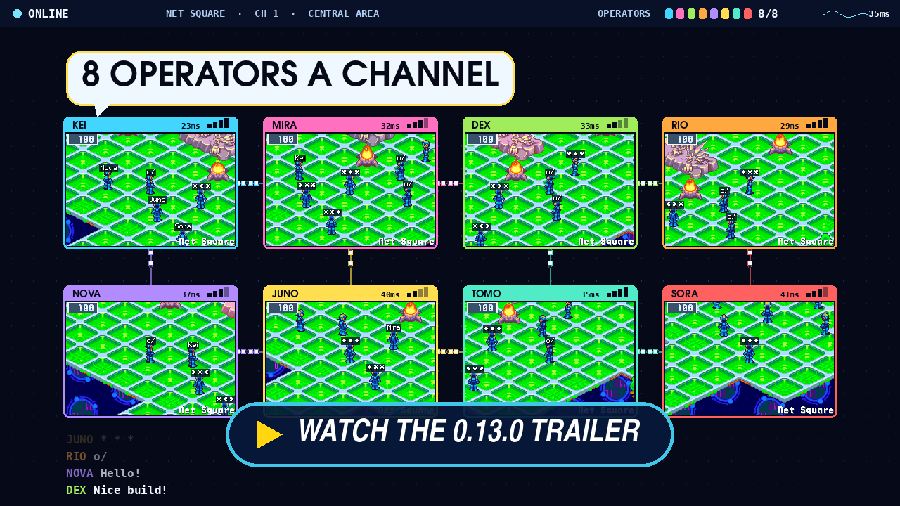</a>
</p>

<h2 align="center">Your viruses fight for you.</h2>

<p align="center"><b>The twelfth beta:</b> BN6's Virus Battler comes to the run. A Battler Mr.Prog waits at the end of a side path, his BtlrCard keeps every Rare virus you delete from one run to the next, and his series is a bet: stake zenny, place your viruses, and after each win take the pot or fight on. On a dark layer, the Navis whose Crosses you hold now join the team, and where more are held than there are places, you pick who comes. Beside it: rumble and a DualSense's adaptive triggers, a held Soul's chips in the finds, and a Net Square anyone can host with nothing to set.</p>

---

## 🦠 BN6's Virus Battler

### A Battler on a side path

<p align="center">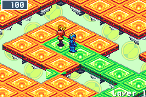 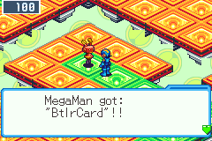</p>

On an act's first layer, in about half the acts from the second and in at least one act of every run, a Virus Battler Mr.Prog waits at the end of a side path, in his own BN6 colour: red, blue, orange, yellow or gold, never the green Mr.Prog. The first one you meet gives you the **BtlrCard**, with Mettaur and Gunner on it. From then on every Rare virus you delete joins the card, in this run and every run after. A on the BtlrCard in KeyItem shows BN6's own card screen.

### His series is a bet

<p align="center">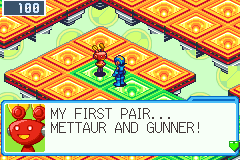 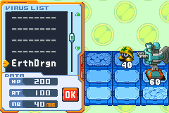</p>

<p align="center">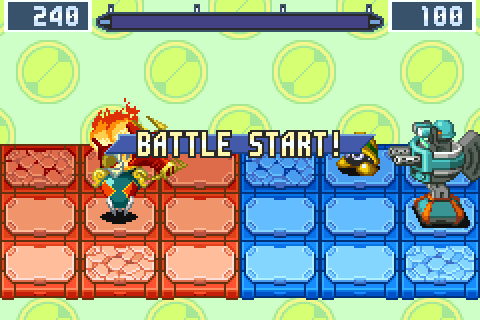</p>

He names his pair and his stake: 500 zenny for the first Battler, up to 3000 for the fifth, deeper in the net. Say yes and the round is BN6's own: BATTLE 1 START!, the **VIRUS LIST** with the viruses on your card, one or two picked and placed on MegaMan's panels, and then they fight his on their own. MegaMan stays off the field and his HP stays his. Delete every enemy to win; lose your viruses or let the gauge at the top fill, and the round is lost or drawn. Fast forward runs during the fight, which takes no input.

<p align="center">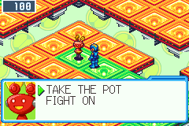 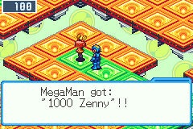</p>

Each win adds the stake to the pot, and he shows his next pair before you choose: **TAKE THE POT** or **FIGHT ON**, up to his BN6 series of 3, 5 or 10 rounds. A loss or a draw leaves the pot his. A whole series won pays the pot, and the first time in a run his BN6 prize too: WindRack \*, HP+500, BugFix \*, FldrPak2 or SuprVulc V. One series a visit. Layers made before this release continue afresh.

---

## 🌑 Your Crosses join the dark

### Pick who comes

<p align="center">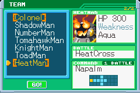</p>

On a Liberation board, the Navis whose Crosses the run holds, the one you brought or those won from the acts' guardians, now stand beside MegaMan as BN5's Souls do. Where you hold more Navis than the board has places, a **TEAM** screen opens after the board's first look: each Navi's face, HP and weakness, the form he fights in, and his command with its shape. It remembers your last pick, so one press takes the same team again, and the board's par is the one for the team you take. Every board has a spot for each held Navi's command, whoever you bring.

### Team ProtoMan's commands

<p align="center">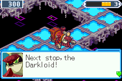 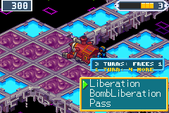</p>

<p align="center">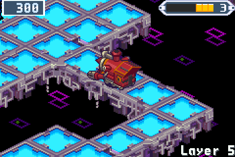</p>

Each Cross Navi stands in his own BN6 body and brings a command from Team ProtoMan, the other version of BN5, by his element:

- **HeatMan's Napalm:** four ahead and both sides of the third, one battle.
- **ElecMan's MagnetBarrier:** no harm on the board to the team till the next phase.
- **SlashMan's WideSwrd:** three across, one battle.
- **EraseMan's PanelSearch:** the item and trap panels of a dark line, one battle.
- **ChargeMan's BombLiberation:** he flies over the dark and frees the panel under him, no battle.

Each works as BN5's own code does, read from its ROM. A Cross Navi's battles are fought as MegaMan in his Cross from the first turn, on that Navi's HP: a hit of its weakness breaks it, and no other Cross or UNITE is offered in it.

---

## 🧩 A Soul's chips reach the folder

<p align="center">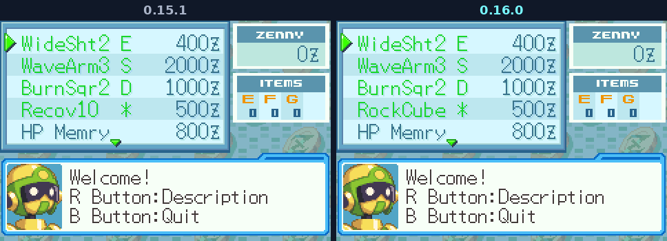</p>

A run that holds a BN5 Soul now finds the chips it unites with. A quarter of the chips in Mystery Data are of a held Soul's kind (Colonel's Obstacle, ShadowMan's Invisible, NumberMan's Plus, TomahawkMan's Wood, KnightMan's Break, ToadMan's Aqua), each as rare as the chip it replaces, and a Net Dealer's fourth chip is one. With two Souls held, the kind your folder holds fewest of comes first. You find as many chips as before; only which ones changes, and a DarkChip never comes this way. A Soul still takes a chip of that turn's hand, as in BN5, and a Soul won on a layer counts from the next.

---

## 🎮 Rumble, and a DualSense's adaptive triggers

<p align="center">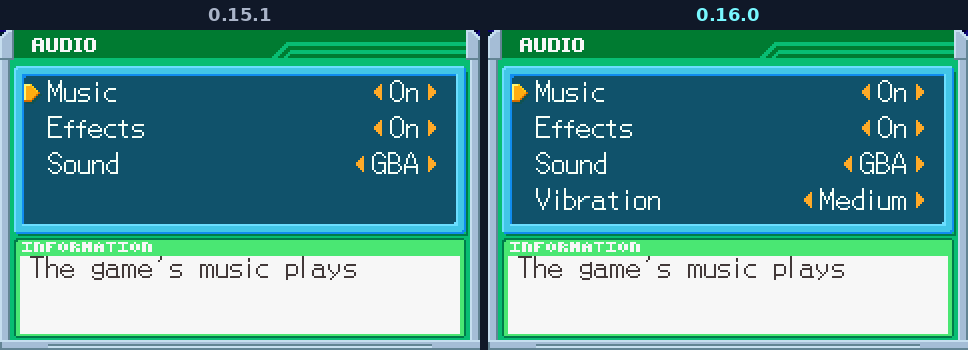</p>

<p align="center">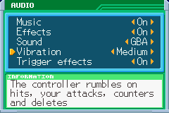 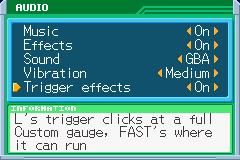</p>

A controller now rumbles on a fight's beats: MegaMan hit, harder the more HP it takes; the charged shot ready and fired; a counter's Full Synchro; a virus or a Navi deleted; Beast Out and a Cross; his defeat; and a jack-in. His own attacks rumble as BN6's sound of each one plays: each buster shot a tick, every Vulcan bullet its own, a sword's swing, a Cannon's blast and its tail, each hit he lands a knock. The buster's charge hums as it fills, clicks when full, throbs while held and kicks back as the shot leaves. Nothing rumbles while fast forward runs or online.

On a PS5 DualSense, over USB or Bluetooth, the triggers click where a pull does something. The trigger that is L clicks once the Custom gauge is full, and pulling through it opens the Custom screen; FAST's trigger clicks lightly where fast forward can run and pulls free in the fight. Elsewhere both pull free.

- **Options' Audio** has **Vibration** (Strong, Medium, Weak, Off) and, while a DualSense is the controller in use, **Trigger effects**.
- **Where:** Linux (a Steam Deck's own controls too), Windows, macOS and iOS rumble, iOS without the trigger effects. Android, the browser and the 3DS don't yet.
- **Steam:** with Steam Input on for the game's shortcut, the rumble gets through but the triggers don't. Turn Steam Input off for it, or start the game outside Steam ([Rumble and triggers](https://github.com/saschb2b/Mega-Man-Battle-Network-Cyberworld-Endless/blob/v0.16.0/docs/GUIDE.md#rumble-and-triggers)).

---

## 🌐 Host your own Net Square

Download the server for your computer from the release, unzip it and start it: on Windows a double-click. With nothing set, it opens a Square every computer on your network can reach and says where players come in:

```text
The Net Square "Cyberworld Endless" is open on port 8765.
Players give the Mr.Prog at the gate in Lan's HP, on this network:
  ws://192.168.1.20:8765
  ws://localhost:8765  (a game on this computer)
From the internet: forward TCP port 8765 on the router to this computer and give
ws://YOUR-PUBLIC-ADDRESS:8765, or see server/README.md, Host your own Net Square.
Settings: the defaults (server.ini beside the server changes them).
Ctrl+C closes the Square.
```

- **The address alone:** at the gate's keeper, choose another server and type `192.168.1.20`. An address that can only be on your own network, a Tailscale address among them, is taken as a Square started this way (`ws://`, port 8765); a scheme or a port you type is kept as typed.
- **Settings when you want them:** a `server.ini` beside the server is read by itself, and any setting can come from the environment (`CYBERWORLD_SERVER_SEED=7`).
- **Always up, with HTTPS** for the browser and the 3DS: `deploy/selfhost/compose.yaml` runs the server, its daily backup and Caddy with a Let's Encrypt certificate from one line of `.env` (`DOMAIN=square.example.com`). Each release publishes the server's image for x86-64 and ARM64 as `ghcr.io/saschb2b/cyberworld-server`.
- **Already hosting one?** A `server.ini` with no `host` line now listens on every interface rather than 127.0.0.1 (`host = 127.0.0.1` keeps a server behind a proxy on the same computer to itself), and one with no `origins` line lets the published browser game in (`origins =`, empty, keeps native games alone).

How, each way: [Host your own Net Square](https://github.com/saschb2b/Mega-Man-Battle-Network-Cyberworld-Endless/blob/v0.16.0/server/README.md#host-your-own-net-square).

---

<p align="center">Free and unofficial, not affiliated with Capcom. It runs from your own <b>Mega Man Battle Network 6: Cybeast Gregar (USA)</b> ROM; Liberation Missions, BN5's areas and Souls, and online trades and NetBattles also need <b>Mega Man Battle Network 5: Team Colonel (USA)</b> beside it.</p>
