

<h2 align="center">Sharper, not bigger.</h2>

<b>The thirteenth beta:</b> no new system, a sharper run. It follows a long look at how the game plays and what its players' own numbers say: a battle on every layer, fewer words between them, BN5's End Area walked one wide, choices where there were rolls (a Server's pick of three, BugFrags that buy programs, MegaMan reading the way ahead), the requests on one board, guardians who remember how the last fight ended, three more starting folders, and ProtoMan's netbattle no longer the end of a dive.

---

## ⚔️ The way between battles

### A battle on every layer

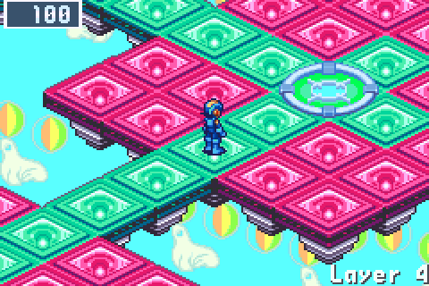

Every layer without a guardian now has at least one random battle. BN6's own roll still decides when: on a layer that has had none, it gets BN6's best odds once MegaMan has walked about a quarter of it, and on the few that still have none the exit pad waits for one as MegaMan steps on it. An act is no longer a walk to its guardian.

### BN5's End Area walks one wide

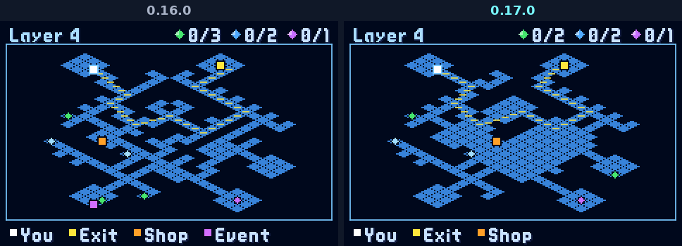

BN5's End Area draws no floor two panels wide but its pads, and its layers had been worn into rings and stubs, a junction at every other panel. Its rooms are now drawn whole as its pads and its ways stay one wide, as BN5 draws them: the junctions on the way to the exit fell from eleven a layer to two.

### Fewer words on the way

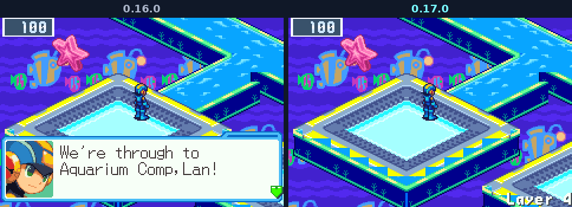

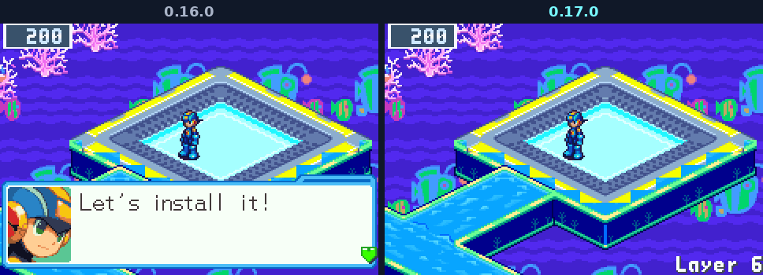

Lines that change no decision are gone. An act's first layer says two boxes where it said five to seven, a guardian's layer three or four where it said nine or ten, and the next guardian is named once at each place you decide: the act card, the Net Dealer, MegaMan at the portal, L on his own layer; his full tips wait in Dad's mail. After a guardian, BN6's own "MegaMan got:" boxes carry two things each and the call to install a program moves into the draft's ask: seven boxes where there were twelve. L still warns of EraseMan's erase and DiveMan's wave.

---

## 🎯 Choices where there were rolls

### MegaMan reads the way ahead

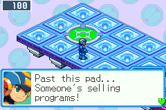 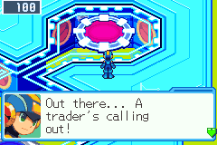

At a layer's two ways (the exit pad beside a dark warp, the warp itself, and each portal of Lan's HP) MegaMan says what he senses on the layer behind it: a strong virus signal, someone selling programs, a trader's call, the Net Dealer, a dark board. Choose the way the run needs.

### A Server pays a pick

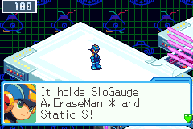 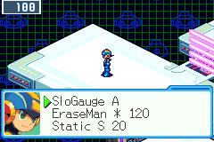

A won Server challenge offers three chips on the vault's screen, one to take, instead of one rolled chip. B leaves them at the Server until you take one.

### BugFrags buy programs

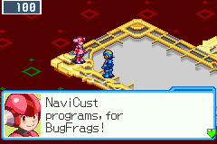 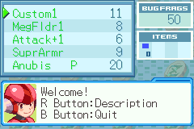

The NaviCust vendor now stands on every act's middle layer and sells for BugFrags in BN6's own shop screen: four programs and a rare chip from the BugFrag Trader's pool. A battle won with bugs on the board pays a BugFrag a bug level, five at most. Skipping a guardian's NaviCust draft for BugFrags now buys a program of your choosing at the next vendor.

### Finds vary again

A Mystery Data's chip is no longer rolled again until it comes in your folder's codes. The chip stays as the net rolled it and takes one of your folder's codes where it comes in one, more often the deeper you go; a battle's rare find does the same. The net holds more kinds of chips (a tenth more by act 4, a quarter more by act 6, Megas among them), and your folder still gathers by code. Act 1's Net Dealer says so.

---

## 🏠 Home and memory

### The requests on one board

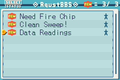 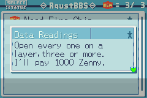

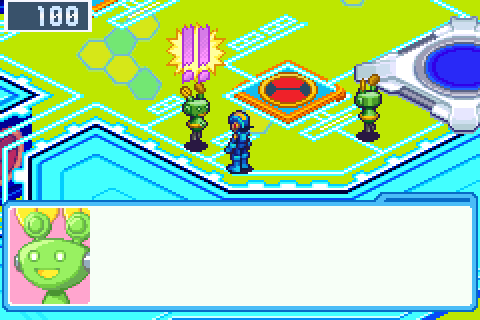

All three askers' requests go up on BN6's own Request BBS at AsterLand, so one walk reads them all, and the courier in Lan's HP says what each one asks and pays before you jack out. The askers still pay where they stand.

### Guardians remember how it ended

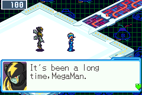

A guardian's arena intro names how your last battle with him went: a close call, his own Cross worn against him, a Beast Out, a Cross by name, or the runs since you met.

### Three more starting folders

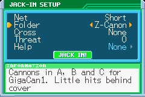 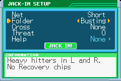 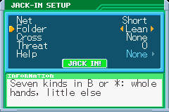

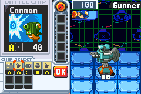 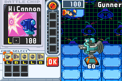 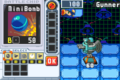

Z-Canon (Cannon A A B B C for GigaCan1), Busting (TankCan1, HiCannon and swords in L and R, no Recovery chip) and Lean join Standard, Blade and Storm in the setup, each a different way to play rather than a stronger one, each opened by a milestone that teaches its style.

---

## 🛡️ ProtoMan's netbattle no longer ends the dive

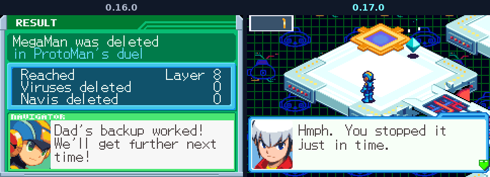

Where ProtoMan's blow would delete MegaMan, Lan stops the battle: it ends at once, MegaMan back on the layer at 1 HP, the duel lost and Chaud's full clearance still to win. The netbattle had become the most common end of a run (30 of 88 lost runs in the anonymous statistics since 6 October, most of them on layer 8, where it first waits), an hour's dive lost to one optional fight. A race's viruses still delete MegaMan as any battle's do.

---

## 📊 The statistics count a run's choices

Where you said yes to the anonymous statistics, a run's end now also sends what it chose: trips back home, requests taken, kept and vowed, orders at AsterLand, drafts left for their BugFrags, the Undernet's and dark layers entered, ProtoMan's duels and netbattles, folder edits, Virus Battlers' series and pots, and its seconds on the map against those in battle. Numbers only, as before; [the guide](https://github.com/saschb2b/Mega-Man-Battle-Network-Cyberworld-Endless/blob/v0.17.0/docs/GUIDE.md#anonymous-statistics) and the FAQ list them. They are what the next look at the game reads.

Layers made before this release continue afresh at a CONTINUE.

---

Free and unofficial, not affiliated with Capcom. It runs from your own <b>Mega Man Battle Network 6: Cybeast Gregar (USA)</b> ROM; Liberation Missions, BN5's areas and Souls, and online trades and NetBattles also need <b>Mega Man Battle Network 5: Team Colonel (USA)</b> beside it.

