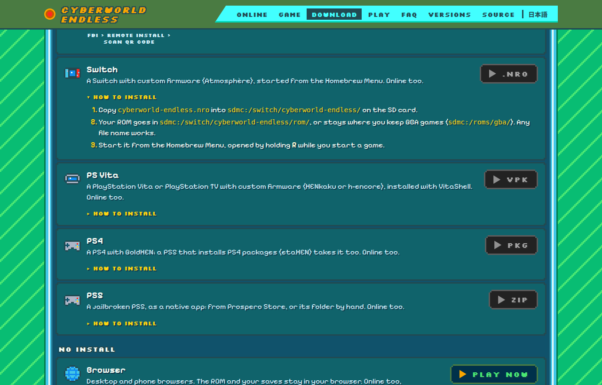
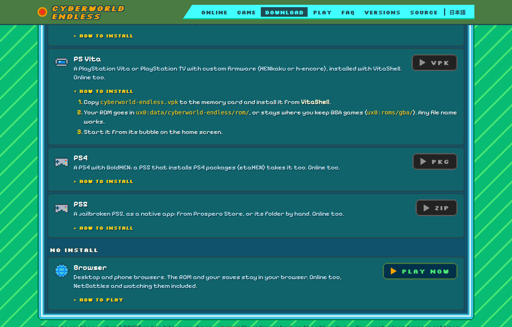
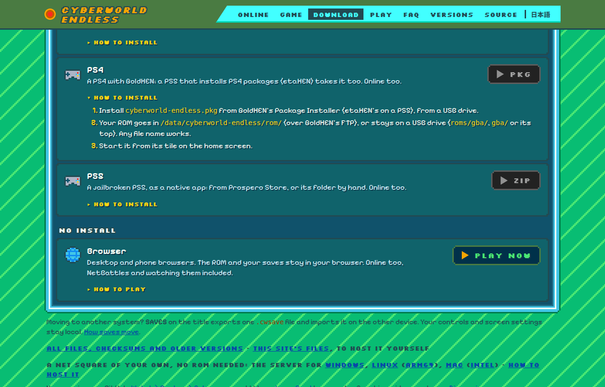
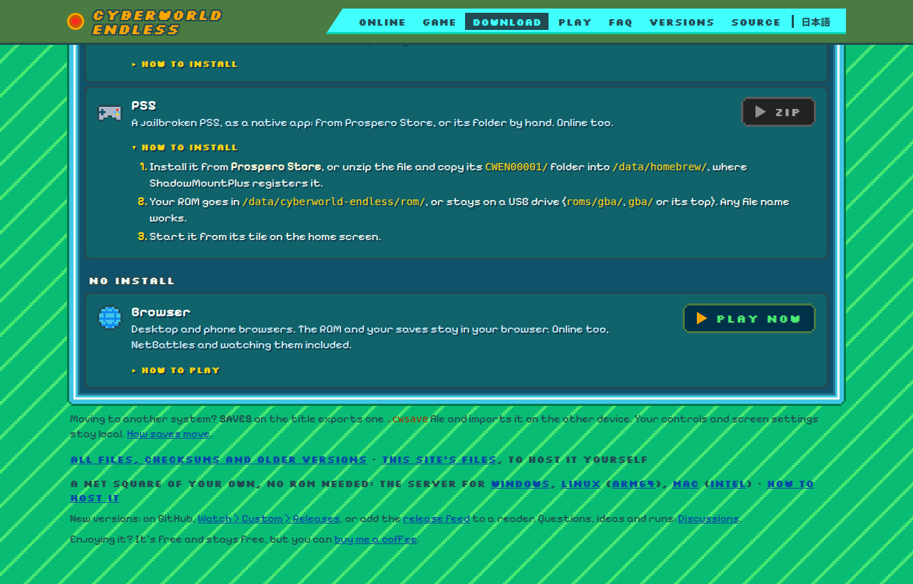

<h2 align="center">Four more systems.</h2>

<b>The fourteenth beta:</b> the same game on the Switch, the PS Vita, the PS4 and the PS5, online included. Each runs from your own ROM, as everywhere, and needs a console that runs homebrew.

These builds are made and checked by every change's CI, but none has run on one of our own consoles yet. If yours doesn't start, plays slow or maps a button wrong, tell us in <a href="https://github.com/saschb2b/Mega-Man-Battle-Network-Cyberworld-Endless/discussions">Discussions</a>.

---

## 🎮 The Switch

A Switch with custom firmware (Atmosphère) starts `cyberworld-endless.nro` from the Homebrew Menu. Copy it into `sdmc:/switch/cyberworld-endless/`, and your ROM into its `rom/` folder or where you keep GBA games (`sdmc:/roms/gba/`). Open the Menu by holding R while you start a game: the game gets a title's whole memory that way. The button marked A is the GBA's A, Plus START and Minus SELECT. Online is as everywhere, NetBattles included.

## 🎮 The PS Vita

A PlayStation Vita or PlayStation TV with custom firmware (HENkaku or h-encore) installs `cyberworld-endless.vpk` from VitaShell, with its own bubble and LiveArea. Your ROM goes in `ux0:data/cyberworld-endless/rom/` or `ux0:roms/gba/`. Cross is the GBA's A, Circle its B, and a touch on the front screen shows the touch controls. The game runs the CPU at 444 MHz and the GBA on a core of its own. Closing it from the LiveArea ends it at once, so a run goes on from its last checkpoint.

## 🎮 The PS4

A PS4 with GoldHEN installs `cyberworld-endless.pkg` from its Package Installer; a PS5 whose etaHEN installs PS4 packages takes it too. Your ROM goes in `/data/cyberworld-endless/rom/` (GoldHEN's FTP reaches it) or stays on a USB drive. Cross is the GBA's A. Online is as everywhere; this build sends no anonymous statistics and never asks.

## 🎮 The PS5

A jailbroken PS5 gets a native app of its own: unzip `cyberworld-endless-ps5.zip` and copy its `CWEN00001/` folder into `/data/homebrew/`, where ShadowMountPlus registers it, or install it from Prospero Store once it lists the game. Your ROM goes where the PS4's does, and the saves sit beside it, outside the app, so an update keeps them.

---

Free and unofficial, not affiliated with Capcom. It runs from your own <b>Mega Man Battle Network 6: Cybeast Gregar (USA)</b> ROM; Liberation Missions, BN5's areas and Souls, and online trades and NetBattles also need <b>Mega Man Battle Network 5: Team Colonel (USA)</b> beside it.

