

<a href="../clips/trailer.mp4">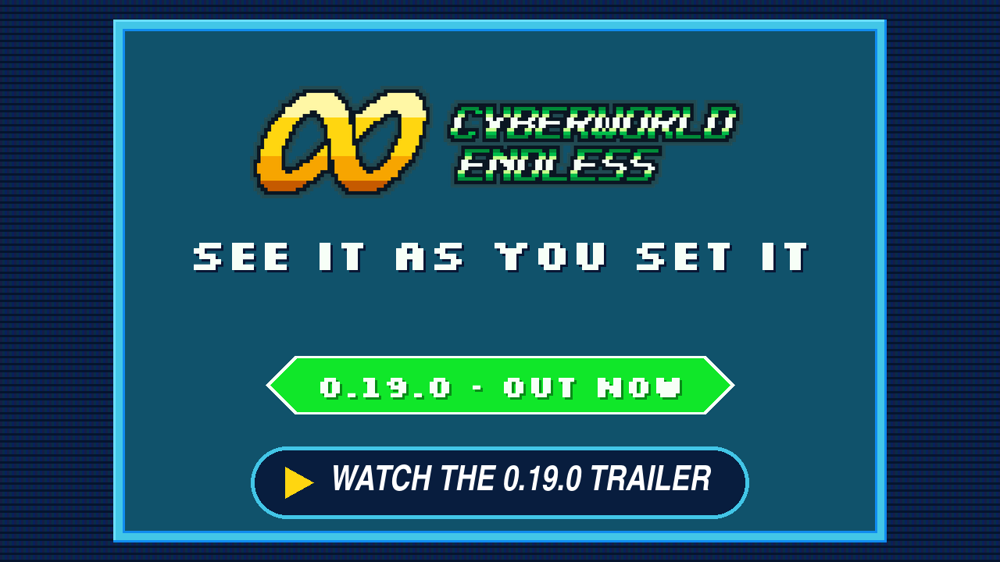</a>

<h2 align="center">Your screen, your sound.</h2>

<b>The fifteenth beta:</b> Options rebuilt in pages, and the game's screen and sound set your way while you watch them change. A GBA's own screen if you want it (its colours, its ghosting, its pixel grid), three more handhelds' colours beside it, the music and effects in levels, and a way to play for headphones or one speaker. Every one of them is off or as before until you choose it.

---

## 🎛️ Options, rebuilt

### Options in pages

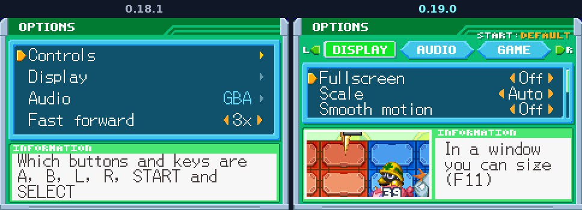

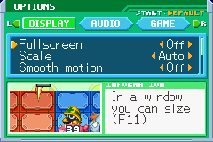 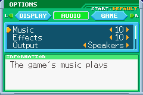 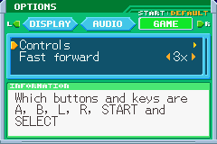

Display, Audio and Game (Controls, Fast forward, Statistics) are tabs along the top. L and R turn from one to the next as the Library turns its own, a tap opens one on a phone, and Options opens again where you left it. START puts a page's lines back as they came, after a Yes.

### See the screen while you set it

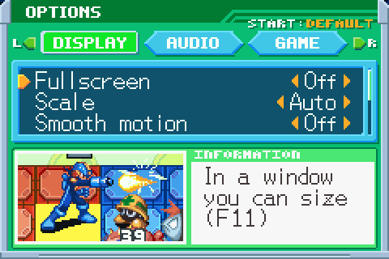

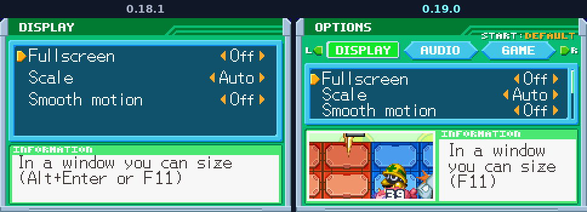

The Display page plays a battle of BN6's own beside its lines, on a second GBA of the game's from your ROM, staged for the line under the cursor: a busy fight for the colours, MegaMan hit and flickering for Frame blending, steady steps under a moving sky for Smooth motion. Turn a line and the battle changes at once. On the 3DS the paused game shows there instead.

---

## 📺 A GBA's screen, if you want it

Asked for in issue #265 by a player on a KONKR Pocket Advanced. Each is off until you turn it on, in Display.

### Colour correction

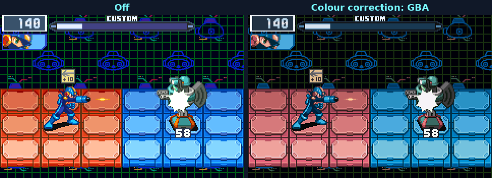

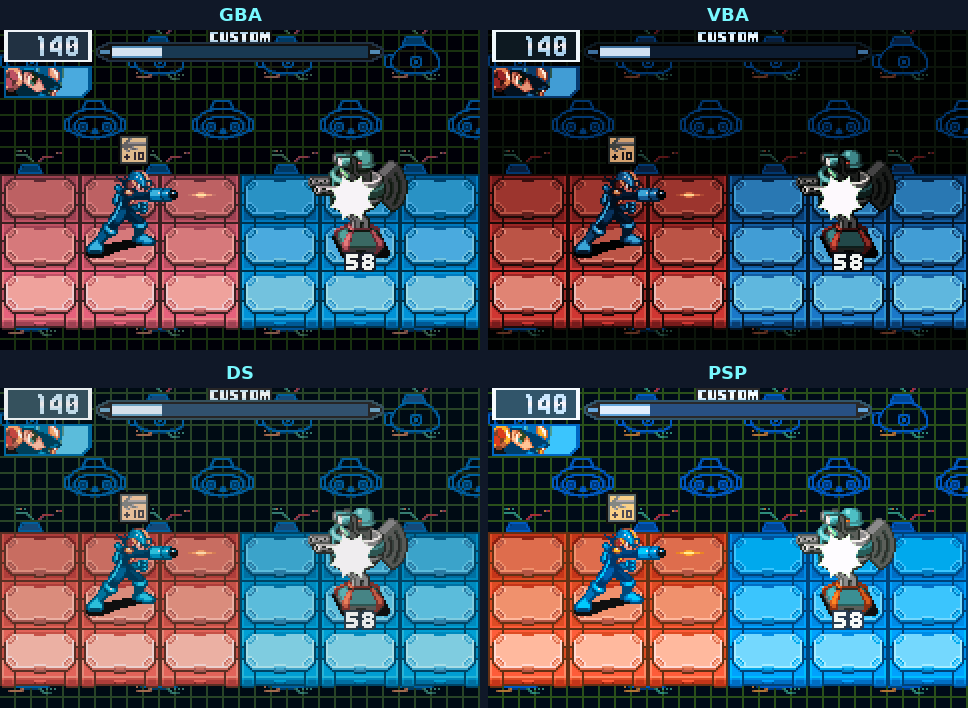

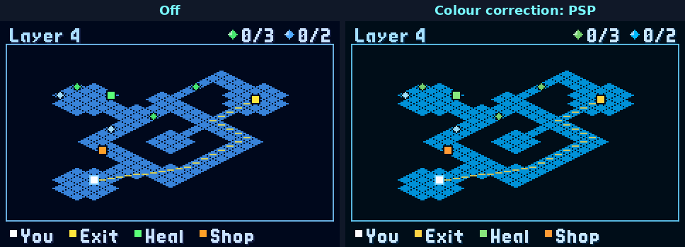

**GBA** shows the game's colours as a GBA's own screen did, darker and softer: mGBA's Color Correction as RetroArch's mGBA core runs it, matched to its own code for every colour. Three more sit beside it, from libretro's handheld colour shaders: **VBA** (VisualBoyAdvance's GBA colours, darker still), **DS** (the first DS's screen, dimmer and softer) and **PSP** (a PSP 1000's or 2000's, bright and warmer). Whichever you pick covers Cyberworld's own screens and the map too, so the whole screen reads as one.

### Frame blending

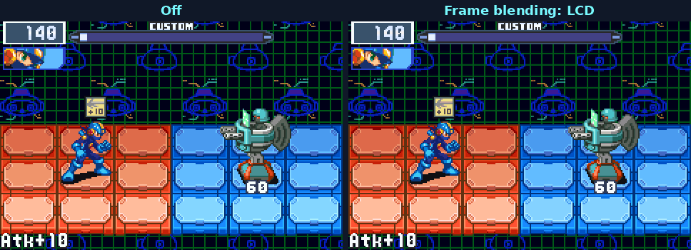

mGBA's Interframe Blending, matched to its code frame by frame: **Simple** mixes each frame half and half with the last, **Smart** only where a pixel flickers, **LCD** fades each frame out over the next four as a GBA's slow screen did, and **LCD fast** keeps one running mix, a longer trail.

### LCD 3x

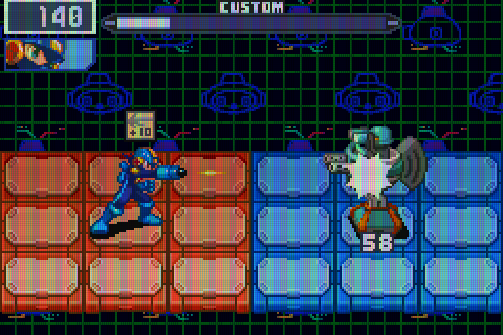

RetroArch's lcd3x shader at your screen's own pixels: each of the game's pixels striped red, green and blue with a darker line through each row, the picture a little darker for it. It looks best at a scale of 3 or more. Not on the 3DS, whose own screen shows the picture.

---

## 🔊 The sound your way

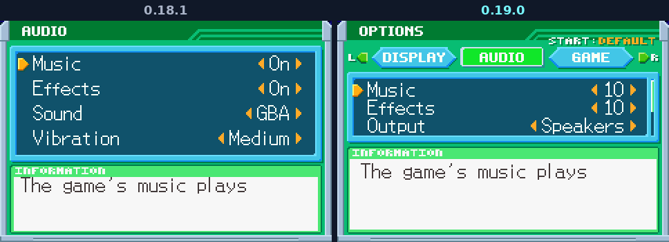

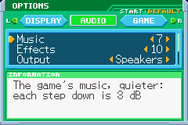 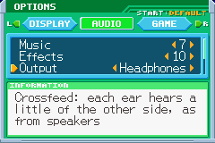

**Music** and **Effects** now go from 10, the game's own level, down to 1 in steps of 3 dB, and Off; your old on and off carry over. **Output** lays the sound out for where you listen: **Speakers** as before, **Headphones** with bs2b's crossfeed (each ear hears a little of the other side, as from speakers in a room) or **Mono** for one speaker, one earbud, or hearing on one side. **Sound** has a third choice beside GBA and Soft, **mGBA**: mGBA's Audio Filter as RetroArch's mGBA core has it, matched to its code sample for sample. With the defaults the game sounds exactly as before.

---

## Everything else

- `colour_correction`, `interframe_blending`, `lcd3x` and the new audio lines are kept in `settings.ini`, and `--colour-correction`, `--interframe-blending` and `--lcd3x` set them from the command line.
