

<a href="../clips/trailer.mp4">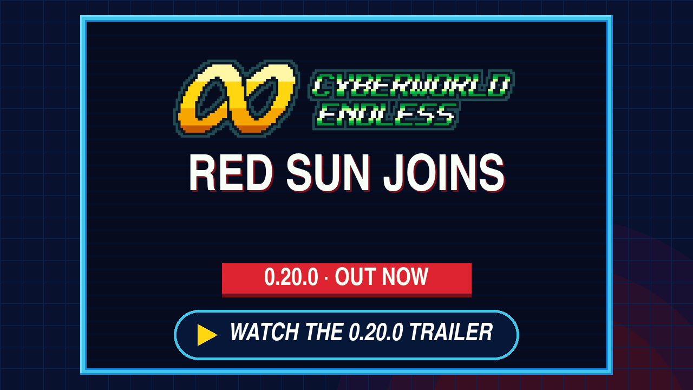</a>

<h2 align="center">Red Sun joins the run.</h2>

Battle Network 4 Red Sun beside BN6: its areas, music and viruses in the net, and a tournament on BN4's own bracket where its Navis fight in BN6's engine. A Glitch layer that comes apart as you explore it, with a copy at its heart that changes guardians mid-battle. And a new EXTRAS page in the setup to leave out, for one run, anything this game adds to BN6.

---

## 🔴 Battle Network 4 Red Sun joins

### Its ROM beside BN6's

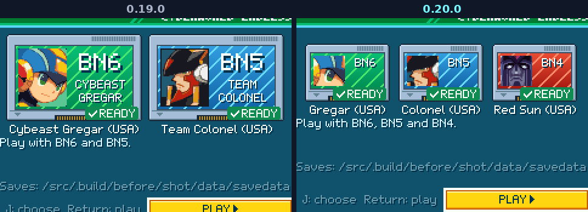

Put **Mega Man Battle Network 4: Red Sun (USA)** beside BN6's and the ROMs screen takes it as a third cartridge, red, with Duo's face. Without it a run is exactly as before, and a run saved with it goes on without it, a layer of BN4's starting again in BN6's tiles. It works on every system that takes BN5; the New 3DS has room for one of the two, BN5's first.

### Its areas and its music

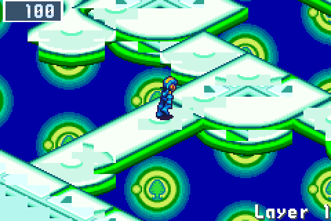

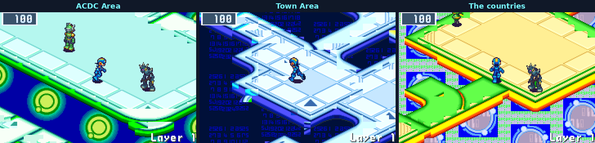

BN4's five net areas turn up in runs in place of the BN6 areas they resemble: ACDC Area, Town Area, Park Area, the net of far countries and its Undernet, each in BN4's own tiles and backdrops, with BN4's music on the map and in battle and its battle backgrounds. The seed picks them area by area, about half the runs that come there (a quarter where BN5 has an area there too).

### Its viruses visit

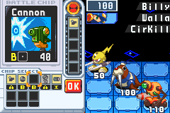 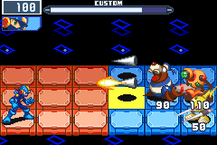

From the second act six of BN4's virus families visit battles: Billy, Spikey, Shrimpy, Walla, Elmperor and CirKill, in the same one battle in four that BN5's viruses visit, and MegaMan names them as the older Net's. Each was moved into BN6's battle and checked against BN4's own frame by frame. They pay from BN4's own rewards; a chip BN6 has not got pays 200 zenny.

---

## 🏆 The tournament

### Three Navis in a row

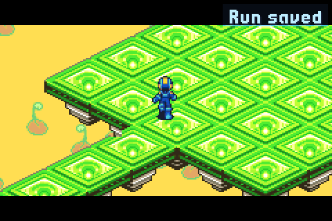

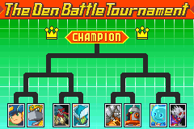 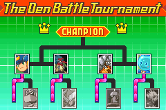

Once a profile has reached the Nest, and with BN4 Red Sun's ROM beside BN6's, act 3's arena in half the short runs (and one of acts 3 to 5 each endless cycle) holds three Navis in a row instead of one guardian: two rounds below the act's guardian and the final at it. Your HP carries from round to round with no heal between, and a round lost is the run's end. BN4's own bracket screen shows the rounds between them, every entrant with his own face; BN6's and BN5's Navis' faces are made from your ROMs as the game starts. The act's card lists the three ("???" for a Navi you never met), and MegaMan reads three signals at the portal. A quit comes back at the arena's door, round 1 again.

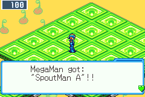

Each round pays its results screen and its Navi's chip, the final his Guardian Data. With the rounds' pay, the short net's act 3 hands out about 8,400 zenny a run where it handed out about 7,000. The Tournament switch in EXTRAS turns it off.

### BN4's Navis fight in BN6

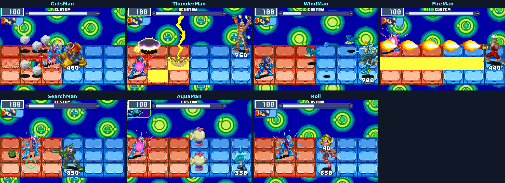

GutsMan, ThunderMan, WindMan, FireMan, SearchMan, AquaMan and Roll enter the tournament's first two rounds, each on his own plate of BN4's bracket. Each was moved into BN6's battle engine and checked against BN4's own battle frame by frame. A round against one of them pays a BN6 Navi chip of the round's strength until BN4's chips come.

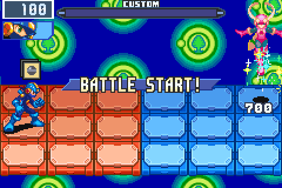

Roll's summon brings BN4's own Mettaur, moved into BN6 for her.

---

## 👾 The Glitch layer

### A warp that glitches

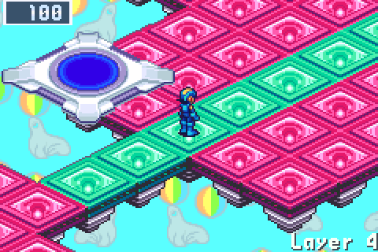

In one run in three, a warp glitches on an act's first layer from act 2 on: a pad that switches looks under BN6's mosaic, its colours turned and torn. Step on and say Yes, and it leads to a layer of the same area that comes apart as MegaMan takes its data.

### A layer that comes apart

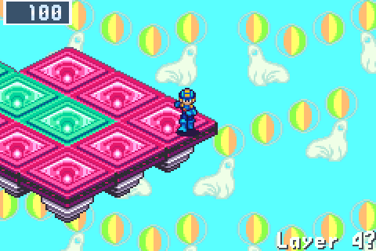

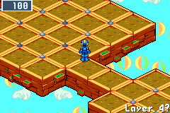

Other areas' looks flip onto the same floor through BN6's own renderer, longer and more often the more of its data MegaMan takes, its battles growing tougher with them; its data come from up to two acts deeper. Its exit leads on to the act's next layer.

### The copy at its heart

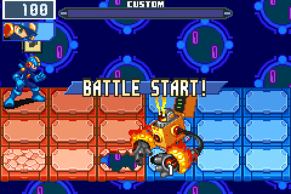

At its heart stands a copy, the guardians you have fought written over each other. It fights as three of them in one battle, each glitching out in BN6's sprite mosaic as the next arrives on its panel, and pays a pick of their Navi chips in your folder's codes. The Glitch switch in EXTRAS turns the layer off.

---

## 🎛️ Leave out what you don't want

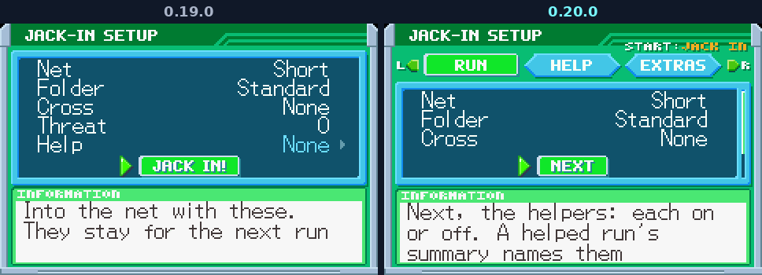

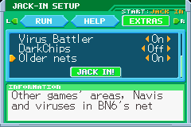

The setup after NEW GAME now comes in three pages, RUN, HELP and a new EXTRAS, turned with L and R; NEXT at a page's foot goes on to the next and JACK IN! is on the last (START still starts the run from any page). EXTRAS switches off, for one run, the things this game adds to BN6: Liberation Missions, the Tournament, Glitch layers, the Virus Battler, DarkChips and, with BN5 or BN4 beside BN6, the Older nets (their areas, Navis and viruses). Everything is on unless you switch it off, the run keeps what it started with, and it counts like any other run; its summary names what was off. A run saved before this version continues with everything on.

---

## Everything else

- **Nobody stands in a walkway's mouth.** A Mr.Prog's service or a navi no longer stands where a walkway meets a small room (BN5's Nebula Area had its Recovery Mr.Prog block one); where a room has no other spot, he moves to the next room.
