

<a href="../clips/trailer.mp4">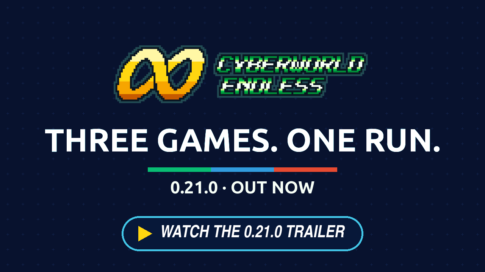</a>

<h2 align="center">Three games. One run.</h2>

Every act of a run is now about one virus family, which can be BN6's, BN5's or BN4's, met alone, then beside a partner, then in a battle built around it. A Battle Lab in Lan's HP sets up test battles from the viruses and Navis MegaMan knows. The Library has a page for each game. And Red Sun brings 77 of its chips and seventeen Program Advances, its Navis guard its areas, and more of Team Colonel's Navis fight in BN6's engine.

---

## 🧬 Every act has its virus

### One family, three layers

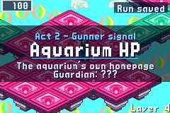

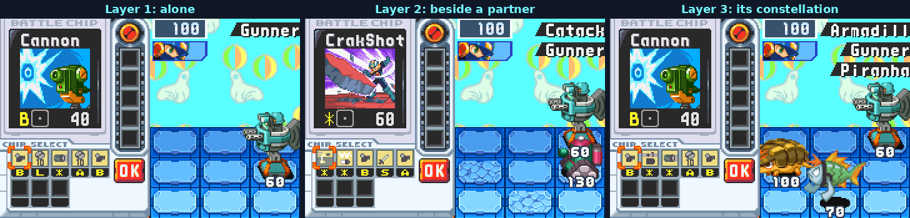

Each act of a run is now about one virus family, named on the act's card. Its first layer meets that virus alone, the second beside a partner, the third in a battle built around it, and a Server's challenge is the hardest battle it stands in. Such a battle pays from that family's own rewards, so a run's chips change with its acts. A layer's other battles are the area's own as ever.

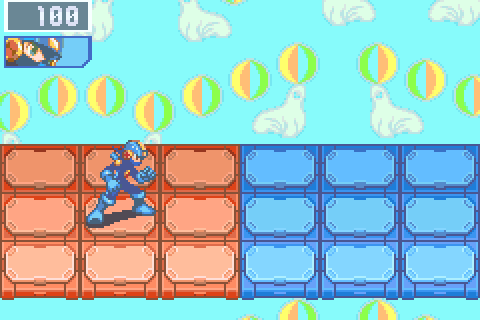

This replaces the one visiting virus in every fourth battle and the deep's mix of both nets.

### Any game's virus

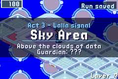 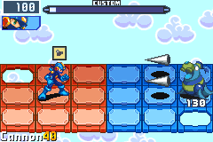

The family can be any game's whose ROM you have: BN5's and BN4's viruses come to BN6's areas, more often the deeper you go, and act 1 stays close to the area's own.

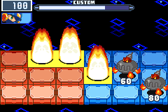 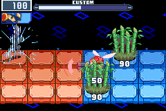

With BN4 Red Sun's ROM, VolGear, Kilby and MagTect join Billy, Spikey and the rest among the viruses an act can be about, each moved into BN6's battle and checked against BN4's own frame by frame, their sounds BN4's own.

---

## 🧪 The Battle Lab

### A Navi of Dad's lab

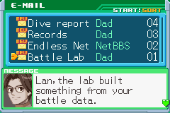 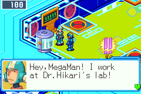

Every virus MegaMan deletes adds to his battle data on its family, in every run. Once the data on three families is complete (eight deletions each), Dad writes, and a Navi of his lab stands in Lan's HP.

### Set up a battle

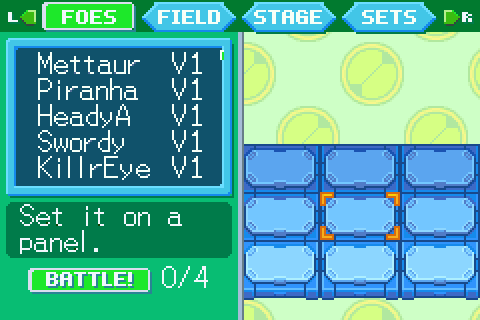

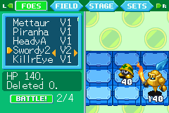 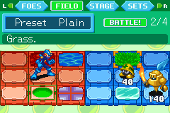

He sets up test battles: the foes, their versions and panels, the field's eighteen panels (BN5's lava, sea and magnet panel and BN4's Hole among their types), the background and the song, BN5's and BN4's among them where their ROMs are read.

 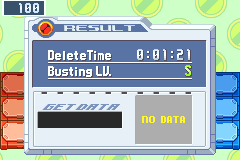

Nothing in one can delete MegaMan, it pays nothing, and the run is afterwards exactly as it was. Four sets are kept with their best time and busting level.

### A folder of the Lab's own

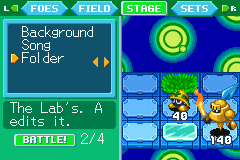 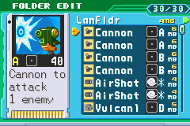

A test battle can be fought with a folder built for it: on STAGE, Folder turns from MegaMan's own to the Lab's, and A opens BN6's folder editor with every chip your profile has held in any run, in each of its codes. The run's folder and pack are untouched.

### Navis

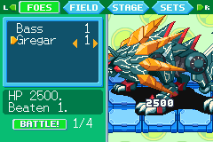 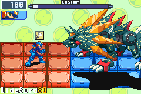

A guardian MegaMan has beaten twice can be set there, alone, in each version beaten from now on (his first for wins of before). Bass and the Cybeast open with one win, ProtoMan with a netbattle won, and one of BN5's Darkloids with a dark layer's board won over him from now on.

---

## 📚 The Library, a page per game

### BN6, BN5 and BN4

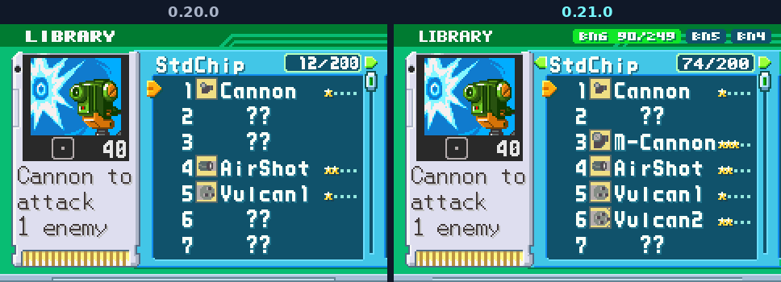 Library, 0.20.0 beside 0.21.0: BN6's own Library with no games on its band before; after, the band reading BN6, BN5 and BN4, each with its count">

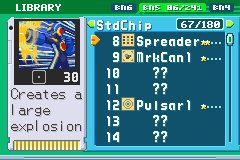 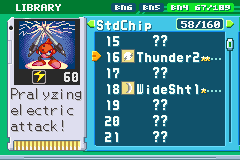

PET > Library now opens the run's own Library, drawn as BN6's own to the pixel, with BN6, BN5 and BN4 named on its band: each game has its StdChip, MegaChip and GigaChip pages. Left and Right turn the pages, **L** and **R** move the list a screenful. Each page is the game's own Library in its own numbers and counts only chips a run can hand out today; a chip two games share, Cannon or Sword, fills its place on each. A class whole turns its count gold. BN6's P.A. Memo is gone with its old screen for now; a page for Program Advances follows.

### Reward picks on a screen of their own

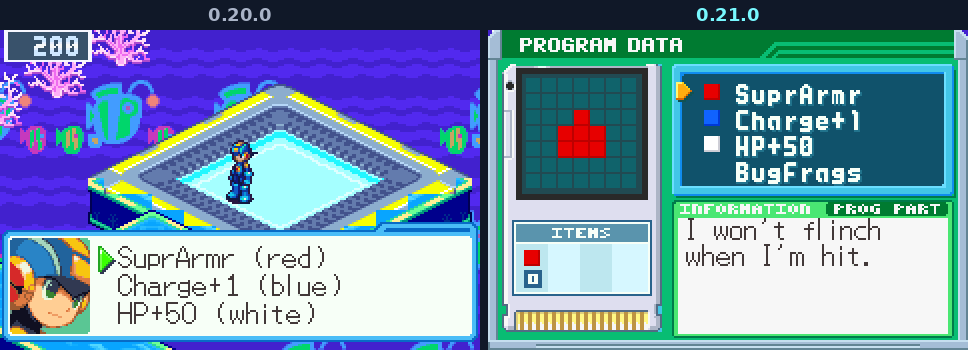

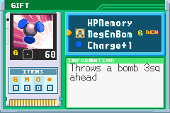 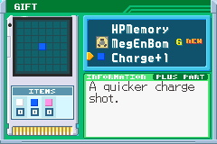

A guardian's draft, a vault's, a Server's and a Glitch copy's three chips, an official gate's and Mr.Prog's gift are now picked on a screen in the PET's look, laid out as the Library: each choice on its card with its picture and details, what MegaMan already holds marked as BN6's shops mark it, a long description scrolling as BN6's chat box does.

---

## 🔴 More of Red Sun

### Its chips in your folder

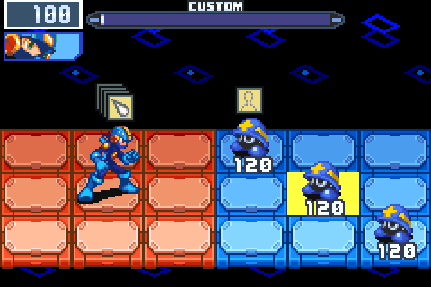

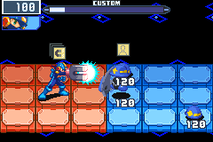 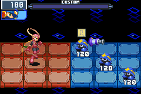

With BN4's ROM beside BN6's, 77 of Red Sun's own chips now play in BN6's battles, each checked frame by frame against BN4's own: the Heat and Bubble spreads, FlmLine, MagBolt, Thunder, TwnFng, SidBmbo, SeekBom, PropBom, Meteors, Ligtnin, MokoRus, BigHamr, AirHoc, GutPnch and RollAro, AquaUp and GreenWd, FirePlus, TimeBomb and more, and GutsMan's chip and his SP.

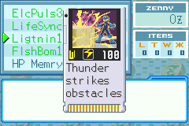

Half of what a layer of BN4's areas hands out comes from BN4's own catalogue: the Net Dealer's stock, Mystery Data, the vaults', Servers' and gift's picks, and a Chip Trader's list; in the deep the half draws on every game's chips you have. BN4's dark chips stay out of a run for now, and the Library's BN4 page counts only what a run can hand out.

### Its Program Advances

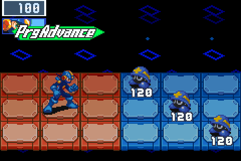

Seventeen of BN4's Program Advances form in the Custom screen as in Red Sun: HeatSprd, BubSprd, FlmCros, BstFang, MagShok, PitRng and PitHoky.

### Its Navis guard its areas

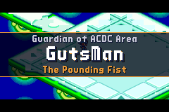 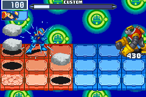

Red Sun's nine Navis now guard the areas BN4 dresses in half the runs, as BN5's six guard theirs: GutsMan or AquaMan in ACDC Area, FireMan or Roll in Town Area, WoodMan in Park Area, ThunderMan or WindMan in the countries' areas, SearchMan and JunkMan in the deep's pool. Each is held to the act's band and leaves Guardian Data as BN5's do.

### Four more Navis in the tournament

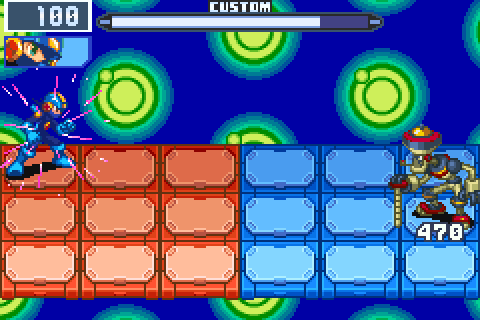

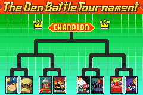 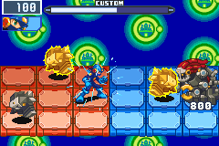

TopMan, JunkMan, BurnerMan and SparkMan join BN4's tournament as rounds, each on his own plate of BN4's bracket: TopMan's spinning top, his dashes and his sounds, JunkMan's junk raining down, BurnerMan's flames and SparkMan's sparks, each proved frame by frame against BN4's own battle.

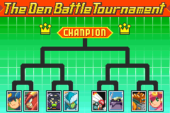 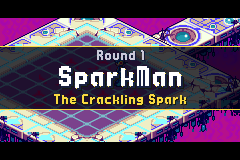

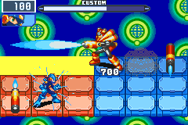 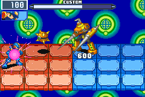

### Its songs in the Jukebox

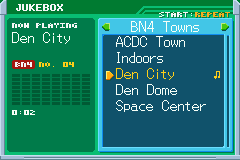

The PET's Jukebox lists Red Sun's 34 songs in sections of their own, each named for the place in BN4 that starts it.

### In the NetPass's full set

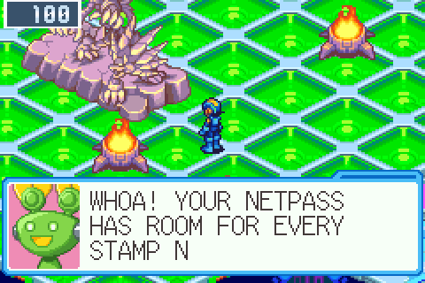

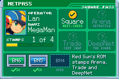

NetBattles, trades and the week's DeepNet now need BN4 Red Sun (USA) beside BN6 and BN5 Team Colonel. The Square stays open to every game. A pass that was full shows a new open slot, the greeter tells you once, and the stamps land again when you add BN4's ROM. BN4's chips go into NetBattles and trades as each is proved. A New 3DS reads one ROM beside BN6's, so BN5 or BN4 alone gives it the Trade stamp: it trades the chips both games hold, and the week's DeepNet stays shut there, its dive not being the Board's without the other game. Online play speaks protocol v18: an older build and this one no longer meet, and someone hosting their own Square updates the server with the game.

---

## 🔵 More of Team Colonel

### CloudMan and CosmoMan on the dark boards

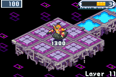 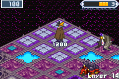

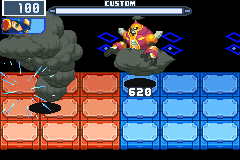 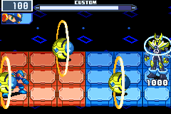

With BN5's ROM beside BN6's, CloudMan and CosmoMan fight in BN6's own engine, proven against BN5's battles frame by frame. CloudMan is act 4's own Darkloid on a dark layer, as BN5's third mission has him; the later acts' dark layers bring CosmoMan, as BN5's fifth does; in the other acts each is one more choice, so a board repeats less. A board pays its Darkloid's own Navi chips: his SP two phases under par, his own chip at par.

### LarkMan and GridMan in the deep

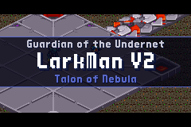 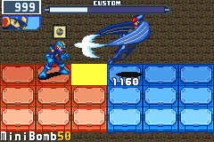

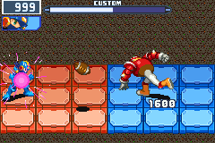 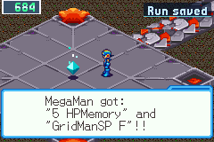

BN5's Nebula Navis LarkMan and GridMan can guard a deep act (5 or 6) beside Team Colonel's six: LarkMan at V2, GridMan at V3, held to the act's band, SP on later cycles. Neither has a Soul to give: his Guardian Data hands over his Navi chip, its SP version in the deep.

### Seven Navis' chips, and the last Program Advances

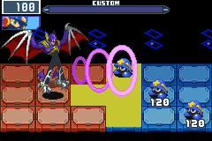 

The Navi chips of ShadeMan, BlizzardMan, CloudMan, CosmoMan, LarkMan, GridMan and Django are in the game, each as V1, SP and DS, and turn up among BN5's chips in the finds. The DS chips answer only to a dark MegaMan, as in BN5.

 

With them the five Program Advances made with a Darkloid's or Nebula Navi's chip form on the Custom screen: BigNoise, CsmoPris, WildBird, Football and PileDrvr.

 

And BN6's own CrosOver forms from a run's Django chips (Django, his SP and his DS, in D): BN6's recipe names its own Django 1-3, which no run hands out.

### SoulT+1

A guardian who gives his Soul now puts BN5's NaviCust program SoulT+1 in his draft: a plus part of four cells that keeps a Soul united for four turns in place of three. A Beast Out stays three turns.

### Arrow lanes, and BN5's win music

 

A layer dressed as SciLab, End Area, Oran Area, Nebula Area or BN5's Undernet now gets the quick way back BN6's areas have: a lane of one-way arrow panels from a far detour to the way, drawn in that area's own arrows, read from BN5's maps. And a battle won on one of BN5's areas, or on a dark layer, ends with BN5's own victory music.

### Team ProtoMan in BN6's engine

Five of Team ProtoMan (NapalmMan, GyroMan, SearchMan, Meddy and MagnetMan, with BN5's magnet panels that pull MegaMan along) now fight in BN6's battle, moved from BN5's own and checked against it frame by frame. No run meets them yet: they join the guardians, with their Souls, in a later version.

---

## 🌐 The PET in the Net Square

START opens the PET in the Net Square as anywhere: edit a folder before a NetBattle, run the NaviCust, use a SubChip, play the Jukebox. What you change there comes home with you, also if you close the game in the Square. The NetPass, which START used to open there, is on R in the PET's menu (it says so) and in KeyItem as everywhere. A chip you trade is in your Pack on the spot, ready for a folder.

---

## Everything else

- **NumbrOpn in the NaviCust.** From act 5 a guardian's draft can offer NumbrOpn: ten chips in the Custom screen's hand, for a 5x5 block that fills the board. Custom1 and Custom2 are not offered beside it, and the vendor sells it in later runs once it has been found.
- **Showdown and Sorrow.** ProtoMan's netbattle now plays Showdown, and a lost run's summary plays Sorrow, as a won one plays the staff roll's music.

- **Fixed: Lan's HP before one of BN4's areas.** With BN4 Red Sun's ROM beside BN6's, a visit home drew Lan's HP as scrambled magenta tiles whenever the act ahead was one of BN4's areas, since 0.20.0. Home looks as it should again.

- **Fixed: menus on BN4's areas.** On a layer of BN4 Red Sun's areas the Chip Folder, a dealer's shop and the Chip Trader drew as scrambled tiles; they look as on any other layer again.
- **Fixed: AreaGrab could stop the game on a dark layer.** In a Surrounded battle, once a Catack had driven through a row of MegaMan's two columns, AreaGrab dimmed the screen and the game stood still for good. It now takes his column's panels back and the battle goes on.
- **Fixed: New 3DS, layers with another game's ROM.** On a New 3DS with BN5's or BN4's ROM beside BN6's, memory ran short while an area was learned, and a layer could come out different from the same seed. An area now takes about 20 MB less at its peak, and one crash on that path is gone.
- **Chip ids past 511.** BN6's chip ids grew from nine bits to ten inside the game, ground for BN4 Red Sun's chips. Nothing plays differently. A run saved by an earlier version goes on as before (its folders are converted once as it loads); a save from this version moved to an earlier one is refused there as a newer version's.
