<h2 align="center">The net, drawn as its maps draw it.</h2>

The generated layers take far more of each area's own maps: rooms come out as the area's framed platforms, borders run whole, pads are cut whole, and the areas' own pieces stand on them, CopyBot's claws to the Undernet's fire bowls. The layouts are the ones they were. Depth lighting lights the world in 3D if you turn it on, and a run continued from 0.20.0 no longer stands still at the first hit.

---

## 🗺️ The net's floors

### Drawn as their maps draw them

Every clip below is one walk through one layer, the same seed and the same steps, 0.21.0 on the left and 0.21.1 on the right.

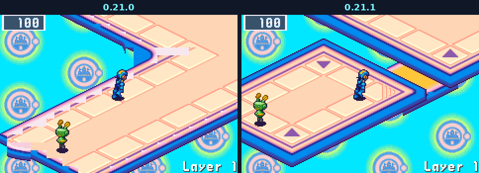

A room of any size comes out as the area's framed platform, a border runs whole round it instead of in teeth, a walkway meets a room without biting into its rim, a pad is cut whole, and no piece of one floor's art strays onto another. Every area changed, BN4's Park Area and Net countries and BN5's ACDC and Oran Areas the most.

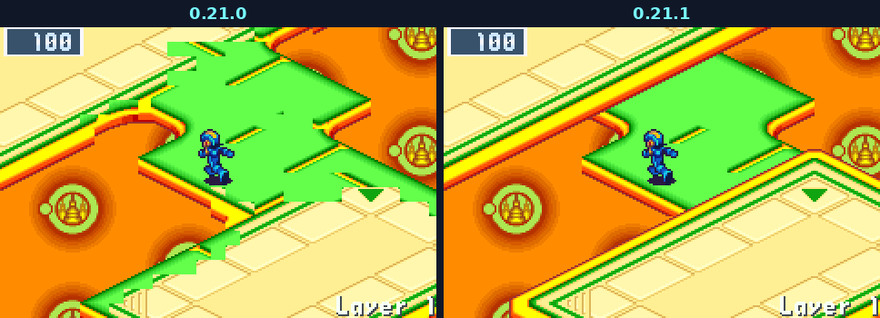

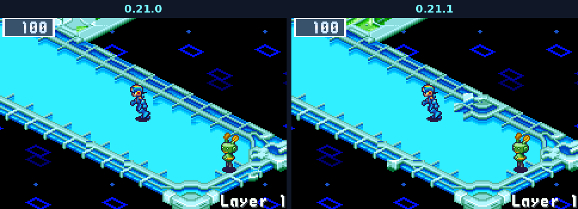

Where an area has several maps (Seaside, Sky, the Nest and a dozen more), each layer follows one of them by its seed, so two layers of one area can look like two of its maps.

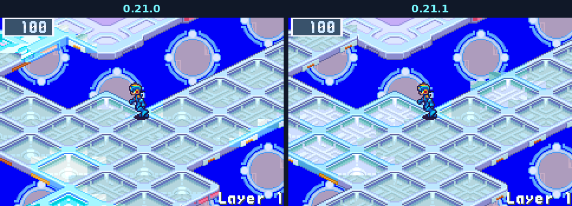

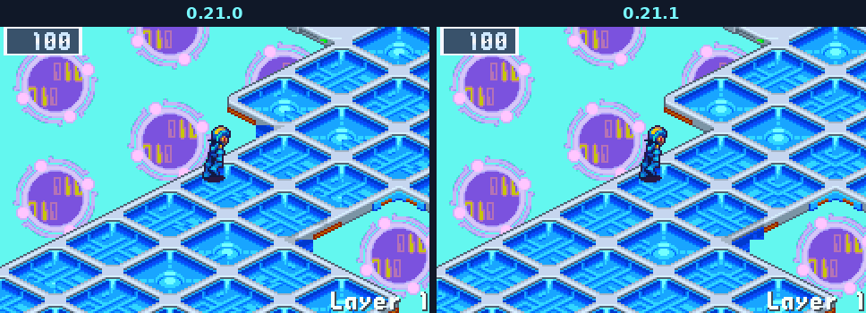

The layouts are the ones they were: a seed makes the same layer, drawn better. A layer saved before this update starts afresh at a CONTINUE.

### Roads on the way out

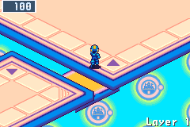

In BN4's Park Area the walkways from a layer's arrival to its exit are BN4's orange roads, the side paths pink. BN4's ACDC Area does the same in its cyan roads and its Town Area in its yellow ones.

### Each area's own pieces

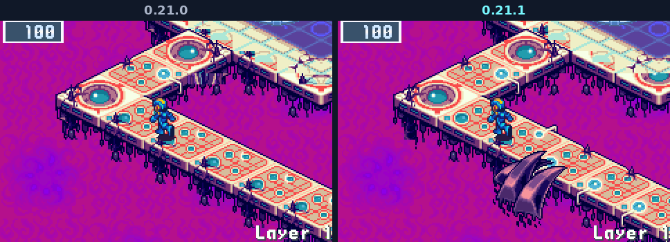

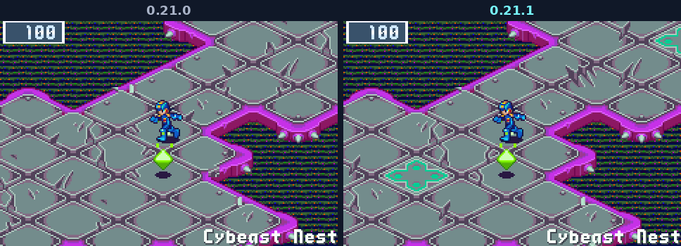

Robot Control Comp's teal pads; CopyBot Comp's pools in their stone rim, and its claws gripping the walkways, MegaMan passing behind one as in BN6; flames beside BN4's Undernet's catwalks; the Underground's teal emblem panels; BN5's ACDC Area's guardian's arena as one of its rooms; a teleport's island in Central, Seaside and Sky as a small platform; and no stray arrows beside Green Area's conveyor lanes.

### Fire bowls in the Undernet

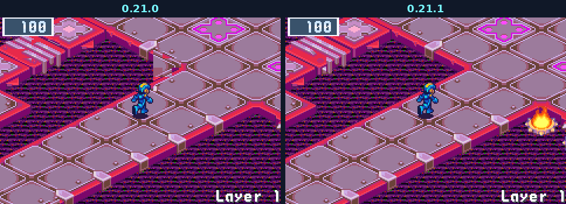

The Undernet's layers get the fire bowls its maps hang beside floors and bridges, alone and in twos and threes, burning as BN6 burns them.

---

## 💡 Depth lighting

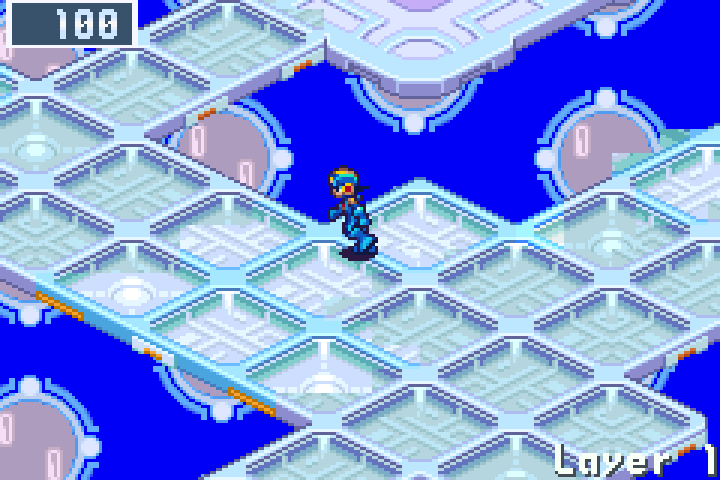 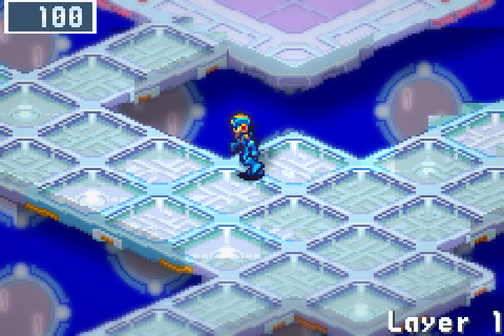

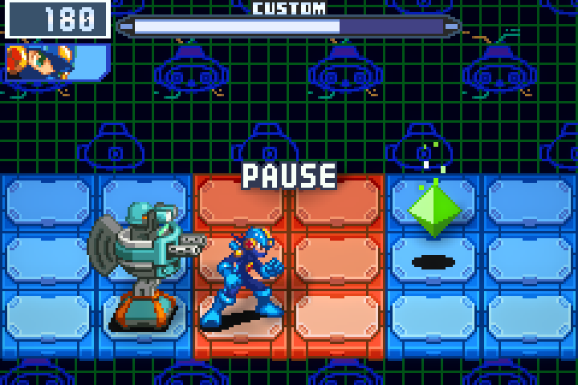

A new line in Options' Display, off by default: the world lit in 3D as the game runs, on the net, in town and in battle, with a sun and soft shadows, shaded sides, a glow, and the far distance out of focus. The HUD, the chat boxes and BN6's menus stay the game's own pixels. Not on the 3DS or the Vita.

---

## Everything else

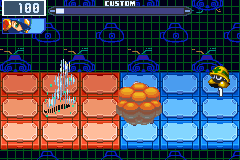

- **Fixed: a run continued after the update to 0.21.0 could stand still in its first battle.** A run saved by 0.20.0 or an earlier version and continued in 0.21.0 froze for good the moment any attack hit: a chip, the buster, or a virus's shot at MegaMan. It showed first on a dark layer, but any battle of such a run did it. Those runs now go on, the ones already continued in 0.21.0 too.
