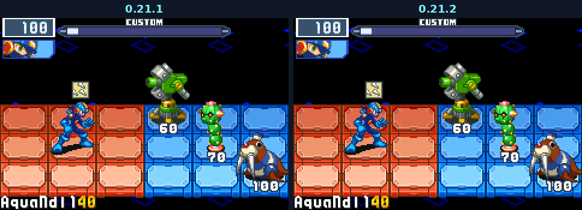
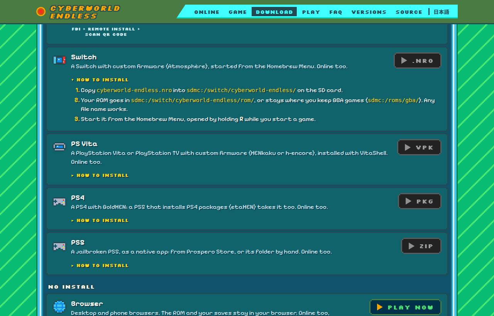

<h2 align="center">Needles that land, a Switch that starts.</h2>

Two fixes for 0.21.1, both reported by players: AquaNdl hits BN5's and BN4's foes, and the Switch build no longer crashes as a run starts.

---

## 🛠️ Fixed

### AquaNdl at BN5's and BN4's foes

MegaMan threw, and no needle landed on BN5's or BN4's viruses or Navis. The needles find them now as they find BN6's, one on each foe, and BeastOut's lock-on marks them too. Reported by [arnoldsanchez96](https://github.com/arnoldsanchez96) in [issue #523](https://github.com/saschb2b/Mega-Man-Battle-Network-Cyberworld-Endless/issues/523).

### The Switch build starts its runs

On a Switch the game closed right after "Building the net...". It plays on into the run now. Copy the new `cyberworld-endless.nro` over the old one; the saves stay where they are. Reported by [AlicafeZ](https://github.com/AlicafeZ) in [discussion #524](https://github.com/saschb2b/Mega-Man-Battle-Network-Cyberworld-Endless/discussions/524).

Thank you both!
