

<a href="../clips/trailer.mp4">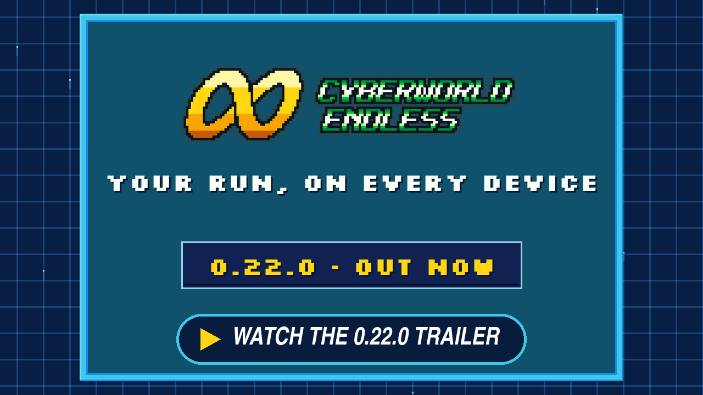</a>

<h2 align="center">Your run, on every device.</h2>

Cloud saves keep every device you play on in step, with nothing to press and no account, and a ten-digit code sends your saves anywhere once. The week's DeepNet is dived together now: every diver on the server walks your layer, crews of four join each other's battles, and a party takes a guardian on one field. The game tells you when a new version is out and, on most systems, updates itself with one press. The PSP joins the systems, the New 3DS plays in 3D at full speed, the net is built faster everywhere, and a long round of playtests left the way through a run shorter, clearer and kinder.

---

## ☁️ Your saves, everywhere

### Cloud saves, like Steam Cloud

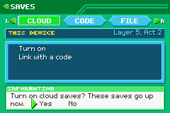 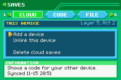

SAVES › CLOUD › **Turn on** on one device, **Add a device** there, and its code under **Link with a code** on each other. From then on every device fetches the newest saves as the game starts and sends its own after each save and as you close it, with nothing to press. Only where two devices both played since they were last in step does the game show both saves side by side and ask which to keep, UNDO IMPORT after it. The saves are sealed on your device, so the server cannot read them, and a copy unused for 180 days is deleted. No account.

### Send your saves with a code

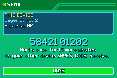

SAVES › CODE › **SEND** puts your saves on the game's server and shows a ten-digit code. On the other device, **RECEIVE**, type the code, and the two saves are compared as with IMPORT, UNDO IMPORT after. A code works once, for 15 minutes; the saves are locked with it before they leave, and are gone once received. Every system with the Net Square sends and receives, the browser too.

### SAVES in three pages

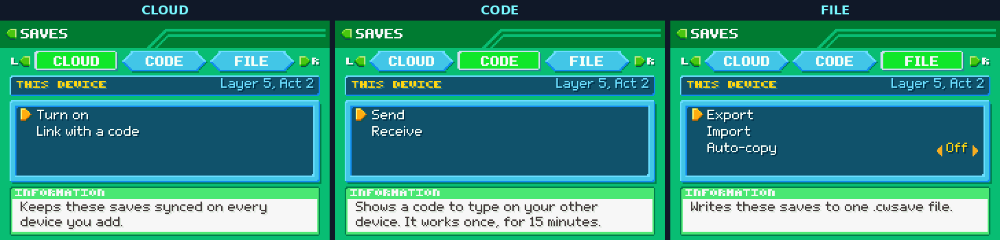

SAVES' eight buttons became three pages, CLOUD, CODE and FILE, turned with L and R as Options' are, each a short list with a box that says what the line under the cursor does. UNDO IMPORT is START, and it asks first, as Turn on, Unlink and Delete do. On a first start, before anything is saved, the device reads "No runs yet", not "Damaged".

## 🌐 The week's net, together

### The week's DeepNet, dived together

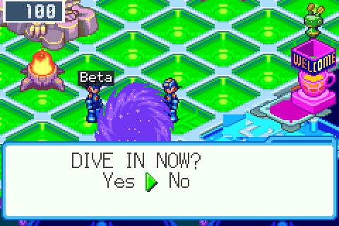

The greeter Mr.Prog by the Board gave way to a portal, which warps MegaMan straight into the week's net, and everyone on the server who dives it at the same time is there with you: whoever stands on your layer walks it as a MegaMan, and a band at the foot of the screen says who was deleted, who beat a guardian, who cleared the net.

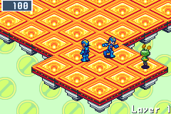 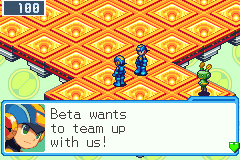

**A** on a diver asks to team up, a crew of up to four: a crewmate's battle near you is yours to join on one field, each with his own reward, and at Lan's HP a portal waits for the whole crew. At a guardian's door the divers on the layer wait for each other; the leader's **A** takes up to four in against a stronger guardian, every MegaMan with his own folder, and **B** goes alone.

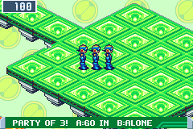 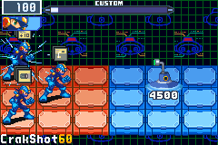

The week leaves traces: a skull burst where a diver was deleted, phrases left on a panel with **R**, Mystery Data others opened sparkling, your busting time's place among the week's. The Board marks a dive that fought a guardian as a party and lists who dives now. On the New 3DS and the PSP each of a party fights on a field of his own, the guardian's HP shared. New, and played by two at a time so far: tell us how a full party goes.

## 🎮 The PSP

### A new system

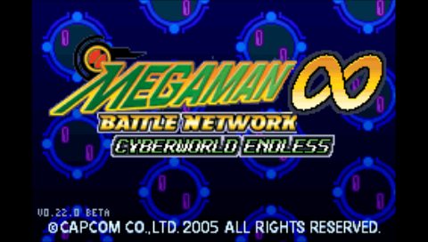 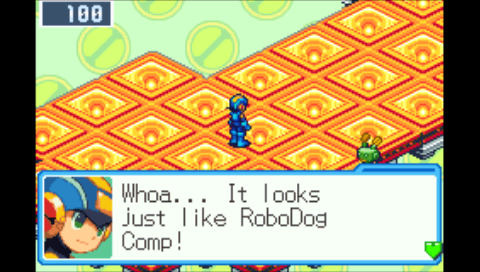

A PSP-2000, PSP-3000, PSP Go or PSP Street with custom firmware (6.61 PRO or ARK-4) plays the game: unpack `cyberworld-endless-psp.zip` onto the memory stick and start it from the XMB, under Game, Memory Stick. Your ROM goes in `PSP/GAME/cyberworld-endless/rom/`, or stays where you keep GBA games. It holds BN6's net alone, with no room for BN5's or BN4's ROM, and plays offline. Its GBA core is gpSP, built for the PSP's CPU, which keeps a battle at full speed where mGBA could not; that core makes this build GPL, and the zip's `SOURCE.txt` says where its source is. Played in PPSSPP so far: tell us how it runs on yours.

## ⬆️ The game updates itself

### What's new, on the title

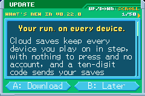 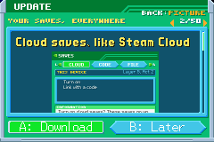 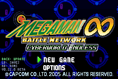

At each start the game looks for a new version (one request for the release's own `update.json`, nothing about you sent). When one is out, a box opens on the title with its release notes, a page an entry with its picture (SELECT shows it full size), Left and Right to turn them, and two buttons that say what they do: **Update now** and **Later**. On Windows (the installer's copy), as a Linux AppImage and on a PortMaster handheld, Update now downloads the new version, checks it, and starts again as it, your saves and your run kept; elsewhere the box opens the download page or says where the update comes from. Later is kept: the title's hints show **Update** on SELECT, and Options has its line. Options' Game page has an **Updates** switch to turn the look off.

### Android and the consoles too

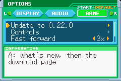

On Android the update line downloads the new version, checks it and installs it, from Android 12 on without a tap once you have allowed installs from the game; then open the game again from its icon. The Switch's `.nro` and the New 3DS's `.3dsx` update themselves as the game closes. The 3DS's CIA, the Vita and the PS5 say where the new version is.

## 🕶️ 3D, sound and speed

### 3D on the New 3DS, at full speed

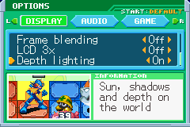 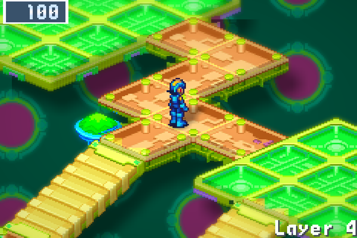

With the 3D slider up, the net sinks into the screen: the moving background far behind, the floor tilted away from you, MegaMan, viruses and people upright at their feet's depth, the HUD flat on the glass. The game holds 59 frames a second with 3D up, battles included. It is Options' Display's **3D depth**, on by default on the 3DS. Elsewhere the same line is Depth lighting, about six times faster than in 0.21.1.

### The music plays on under the menus

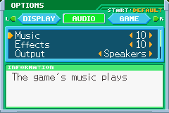

Options, the touch controls' menu, the Library, a reward pick and the Battle Lab's builder used to cut the music dead. The song plays on now from where it was, and goes on in the game as you close them. Where nothing was playing, the NaviCust's theme fills in.

### Building the net, faster and lighter

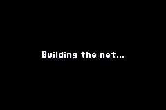

"Building the net..." does about 40% less work up to the first layer, with BN6 alone and with BN5 and BN4 alike; picking a layer's tiles takes 45% less time in every area, and learning an area's maps 59% less. Every seed makes the same layer it made. A run also needs about 17 MB less memory, room the New 3DS feels most.

### Touch controls you can turn off

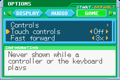

Options › Game has **Touch controls**: Auto shows them at a touch, as before; Off keeps them away while a controller is connected or the keyboard plays, for a handheld with a touch screen and buttons of its own (a phone with neither still shows them at a touch). On Auto they no longer come back by themselves after SAVES, the ROMs screen or a Net Square name field when a button was pressed there. Asked for in discussion #552.

## 🗺️ On the net

### The net climbs

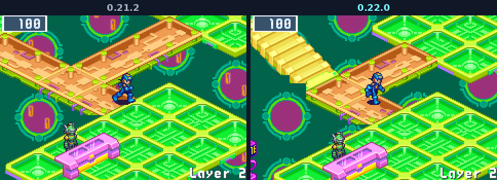

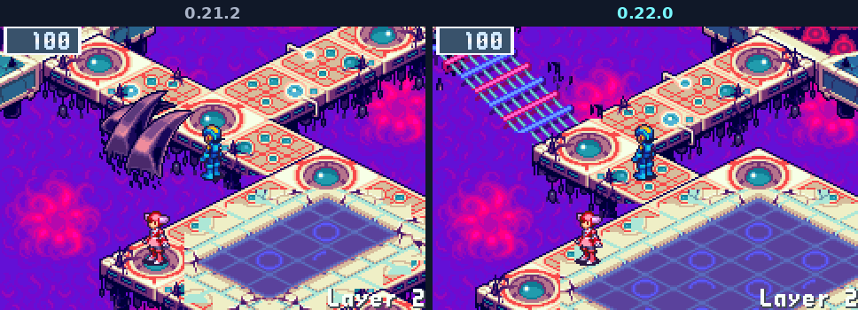

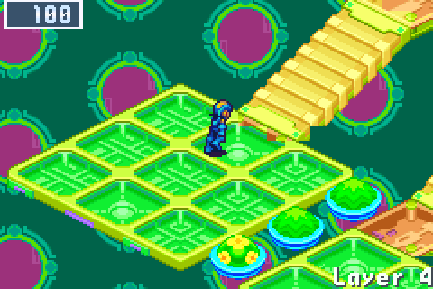

Twelve areas build their layers with their own stairs, where only Sky Area and the Undernet did: Green Area's yellow stairs, CopyBot Comp's railed ladders, the Graveyard's and Mr. Weather Comp's long ramps, Undernet Zero's, BN5's End Area, Nebula Area and Undernet, and BN4's Town Area and countries. A room the rest of the floor meets only from the front stands raised, a stair at every way in; elsewhere a terrace of floor rises behind a line across the layer. Green's and CopyBot's platforms stand at their real height. A layer saved before this update starts afresh at a CONTINUE.

### What stands beside the floor

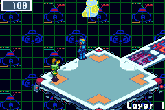 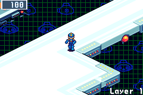

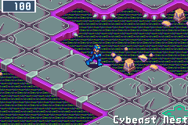 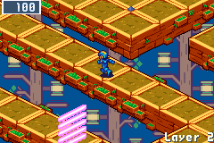

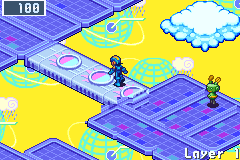 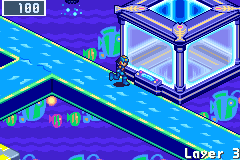

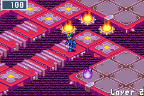 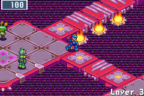

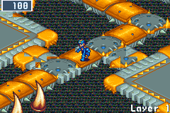 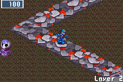

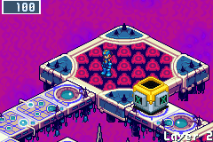 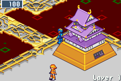

More areas' layers set what their maps stand round their floors: Robot Control Comp's robot figures and its wires with red lights, the Cybeast Nest's crystals, Judge Tree Comp's tufts of grass and planters, Mr. Weather Comp's low clouds, the Undernet's and Undernet Zero's fire bowls behind a floor's upper edge, BN4's Undernet's horns along whole catwalks, BN5's Undernet's skull totems, their eyes flashing, Aquarium Comp's big glass tanks, CopyBot Comp's dark crystal spikes ringing its plateaus, and BN5's End Area's pagoda, a landmark MegaMan walks behind.

### The net's locks, met every act

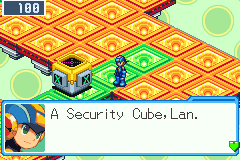

Each act's middle layer now holds one of BN6's locks off the way: Rush's gap, a Link Navi's obstacle, a security cube or door, or an invisible path. Half the runs had met none before their first guardian; now a run meets one on its second layer.

### The Glitch layer, glitchier

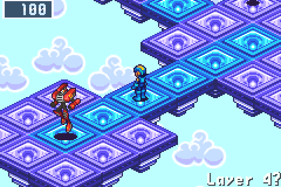

Towards the copy at its heart the glitches come up to twice as often and run deeper, so they lead you to it. While another area's look is on the floor the music drags, and stalls as a flip opens; a flip brings that area's sky with it; and the copy changes between its forms' bodies as it waits.

### The comps' walkways, as their maps lay them

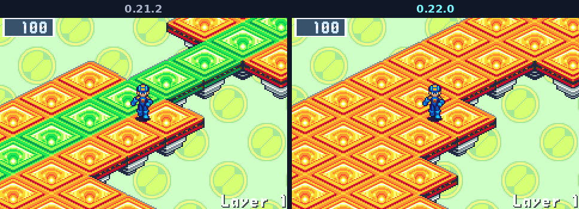

A way through the comps and homepages crosses one one-wide walkway at most, as their originals' rooms do; its others are two panels wide, so the walk from arrival to exit catches less on walkway mouths (RoboDog Comp, where runs most often start, caught the most). In every area, a pit left between walkways, which the walk had to jog round, is filled, and a one-wide walkway the way turns into off wide floor widens first. A layer saved before this update starts afresh at a CONTINUE.

### BN4's ACDC Area and BN5's Oran and Nebula Areas, drawn whole

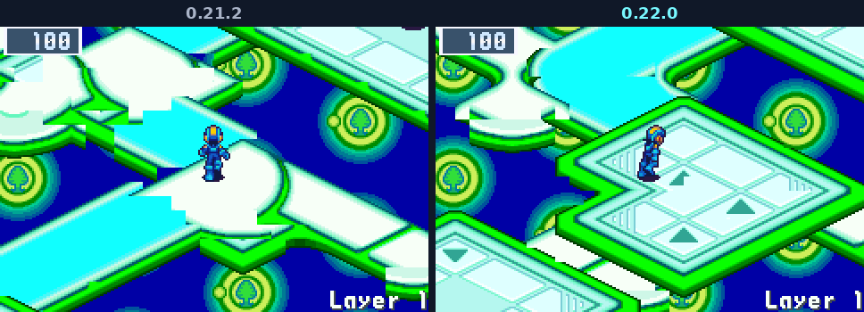

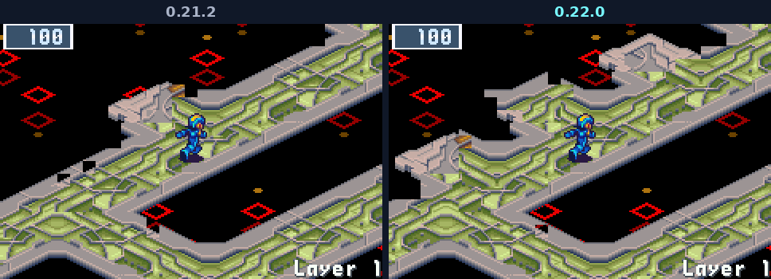

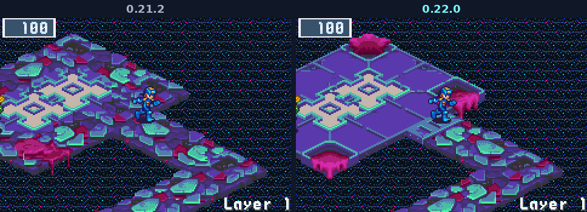

BN4's ACDC Area draws every room as its framed squares, rings and L's too, and its walkways meet at small squares as BN4's do, with no stray cyan scraps. BN5's Oran Area lays its hubs as one floor with their circuits, joined as BN5 joins them, where every meeting was a jumble of docks and orange chips. BN4's ACDC roads turn only where BN4's own roads bend, with no navy squares left in the cyan. BN5's Nebula Area draws a room of any size as one of its plates, purple to the rim with stones at its corners, where a wide room was a field of cobbles round a plate.

### The guardian's gate on the way's line

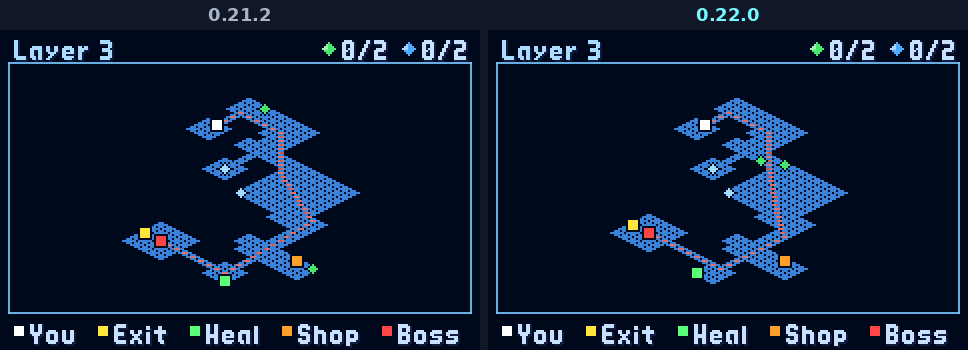

The bridge to a guardian's arena leaves its antechamber where the way meets it, straight on, rather than from the middle of a side you had to turn into.

### BN4's and BN5's areas keep their wide ways

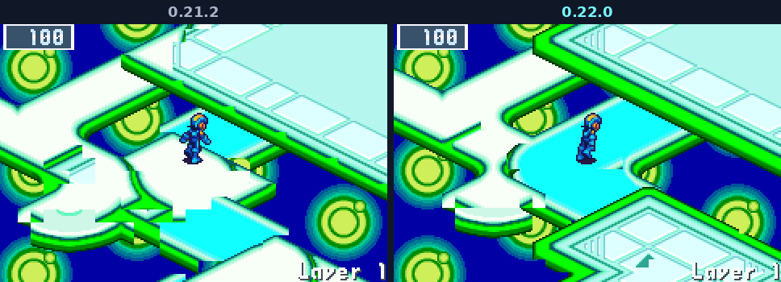

A way through their layers keeps the two-panel walkways it was laid with, crossing no more one-wide ones than the area's own maps do. The drawing used to wear them back to one wide, step them aside and cut their mouths off a junction's line: BN4's ACDC squares let you out at their corners alone, and BN5's Oran and Nebula Areas tied knots of narrow junctions.

### ProtoMan's races leave out Powies

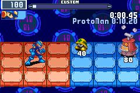

A Powie spends two seconds on its panel between jumps and can't be hit in the air, so a race against it timed its jumps, not your hand. A race squad with one is rolled again among the act's battles, as one with a Quaker already was. A run saved on a race's layer by an earlier build continues that layer afresh.

### The arrow and the map, clearer

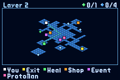

In Lan's HP the arrow points up the corridor from anywhere in its mouth. While it leads to the Recovery Mr.Prog, the map draws the way in the key's Heal green, and the key keeps every entry on a busy layer, You and ProtoMan included, taking a second row where one can't hold them. The arrow, the corner notes, the area cards and L's counters step aside while BN6's own fade covers the screen.

### The arrow keeps out of the way

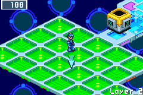

It waits through a chat that is not L's (a Mystery Data's, a Prog's, a dealer's), a cutscene and a guardian's arrival, and comes back after with the time it had left. Pointing down it stands below MegaMan's feet, not on his legs, and through L's words it waits for the box to close rather than cover it. It now rings MegaMan where the camera draws him, also where the camera stops short of keeping him in the middle.

### Jacking in from a step short

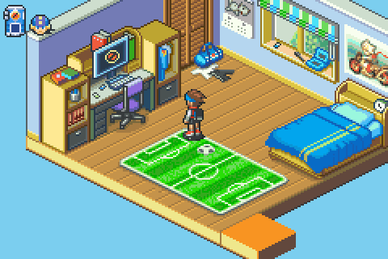

At Lan's desk, R a step short of the PC walks Lan onto it and jacks in, as R does at the town's jack-in spots.

### The Battle Lab's builder, easier to drive

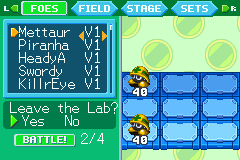

B goes back a level on every page and asks "Leave the Lab?" before it leaves, FIELD's Preset is reachable with Up, and held directions repeat.

### Shorter stops on the way

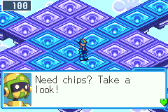 

A Net Dealer says one box before his list, where he said seven or eight. L's first press says the way and two things worth a detour at most (ProtoMan, a flame of darkness, a violet mark, Mystery Data behind a lock, the heal while you're hurt); the tips that rode along with it come where they help instead. When L points you to the heal and you walk away from it, the arrow turns back to the exit. A second talk with the Virus Battler is his first pair and the question, as a shop's second visit is. L's Mystery Data counter fades in and out once a press, and draws nothing when there is nothing to count.

## 💬 Words

### Chaud's call and ProtoMan's race

 

Lan's surprise comes right after Chaud's name; a profile that has heard him gets "Lan,it's Chaud again."; ProtoMan names the race Chaud set rather than telling it over (six boxes, from nine); his time is run to the hundredth; and the race's question is MegaMan's "Race his time?".

### Lines that say what they mean

 

The Recovery Mr.Prog says the HP his patch gave, or "fully restored". At a fork's exit pad MegaMan's read opens "Where this pad leads...", so a dealer he senses is the next layer's. The Program Advance whisper asks "Got these?": a combo to try with your own chips, not a gift. The DarkChip post opens on the purple flame the Navi saw. MegaMan's arrival in the older Net says "Cross and all!" only with a Cross, and Dad's first call says what the run is: the short net down to the Nest, or the endless one. After the first virus from another Net, Lan's answer fits where you are: "Its old viruses too!?" in BN4's areas, "Both Nets,like you said..." in the deep.

### What the run tells you

 

Dad's first call says what a dive leaves behind and what it keeps, R on a layer answers with the way home, and RECORDS counts the Library's new entries from the starting folder on. MegaMan's word before a guardian's arena comes a few panels from its door, never while someone stands in reach of A, and says "Let's get ready first!" rather than asking a question that takes no answer.

### The title and the Jukebox

 

The title shows your best depth whenever you have one, a saved run's CONTINUE beside it, and its SAVES and ROMs hints sit clear of the copyright line. The Jukebox's section of the songs BN5's and BN4's cartridges hold but never play is called Unused, not More.

## 🛠️ Fixed

### GutsMan's Guardian Data

Continued at his data, BN4's GutsMan logged in again, unseen, and stood on it: A only turned MegaMan to face it. A guardian deleted before a CONTINUE now stays gone, and BN4's Navis show and go with BN6's beam, as their own sprites have no log-in of BN6's. GutsMan no longer stands invisible through his entrance, either. A run saved before this update starts its layer afresh at a CONTINUE. Reported by [Desticler](https://github.com/Desticler) in [issue #614](https://github.com/saschb2b/Mega-Man-Battle-Network-Cyberworld-Endless/issues/614), with the save that showed it. Thank you!

### A quit with a text box open

Quitting while a chat, a shop or the PET was open saved nothing, so CONTINUE went back to the last save while it said "From where you left off": purchases, Mystery Data and a race won were gone. The run is now kept as it stood the moment before that box opened, and CONTINUE says "From before that talk".

### After a guardian

The A that paged his last word no longer takes his Guardian Data the moment it appears, from a panel away: it waits to be taken for a second. The crystal goes as its "MegaMan got:" boxes close, not after the program pick, the map drops his red Boss mark once he is deleted, and the exit pad in BN4's Town Area shows on its pale floor, where it was there but unseen.

### The PET's Save and your next A

It closed the PET with only the corner's "Run saved", so the A you meant for a save box talked to, or picked up, whatever MegaMan faced: one took a Guardian Data. The PET's Save now ends on a box of its own, "Run saved.", as BN6's save screen ends on its words, and A does nothing on the map until it is up.

### A prize before the chatter

After a server's or a vault's pick, MegaMan's words on the older Net's virus in the battle before could play first, and "MegaMan got:" after them. The prize's box comes first now.

### The Glitch copy and CosmoMan

The copy at a Glitch layer's heart stood in SpoutMan's, TomahawkMan's or another Falzar Navi's warp-out, over and over; it now stands as he does in battle. CosmoMan's BN5 sprite faces the camera only, so on a dark layer's board he vanished whenever he turned to strike upward; he now turns towards the camera. Nobody the game places in another game's sprite turns to face MegaMan where that sprite draws nothing.

### BN4's guardians face you

BN4 draws its Navis facing four ways where BN6 draws eight, and BN6's "facing left" is a back view in BN4's: with MegaMan on his left, GutsMan, Roll, FireMan, ThunderMan and AquaMan showed their backs, WindMan, TopMan and SparkMan nothing at all. Each now stands in his own sprite's view that faces MegaMan, on either side of his arena.

### A quit after a won battle

Quitting on a won battle's RESULT, or in the fade back to the map, fell back to the layer's start: the battle, its reward and the walk since were gone. The game now runs on until MegaMan is free and saves the run where he stands.

### Blank chips in the Standard folder

A system that kept its start-up state from before 0.21.0 dealt a new game's folder misread: some chips came out blank, and FOLDER EDIT opened empty on "You found damaged Chip Data!". The state is made afresh now, and a run begun from the old one is mended as it continues.

### Mr.Prog's gift, taken unseen

An A pressed at a steady pace through Mr.Prog's lines could land just after the gift's screen opened and take its first choice. A reward pick now takes a choice only once it has been up a second and a half (the cursor moves sooner), for every kind of pick. Its cursor shows when: it stands still and faded while A would take nothing, and bobs in full orange once A takes.

### RESULT's virus count

The battle that ended a run, and a battle you ran from, now count the viruses deleted in them. RECORDS' closest goal reads as a whole sentence.

### Two menu lines made whole

Options' Fast forward note ran past its box and ended at "BN6's"; it fits whole now. The ROMs screen said BN4 Red Sun brings only its viruses: it says what BN4 brings today, its areas, viruses, Navis and chips, as BN5's line does.

### Holes in the floor

Here and there a panel MegaMan could walk on let the background show through, a gap in its tiles (Sky's catwalks, BN4's areas, Oran, Robot Control Comp). Every tile is checked now as the layer is drawn, and a hole is filled with a piece of the area's own maps.

### A CONTINUE's next battle

A CONTINUE mid-layer counted the layer's battles from nothing again, so its first random battle came round once more; it goes on with the layer's next.

### Mr.Prog's patch after a CONTINUE

On a layer continued from the title, the Recovery Mr.Prog asked to use the layer's one patch, then healed a single HP and called it spent. It heals half of MegaMan's max HP again, however you reached the layer.

### First meetings

Chaud's first call, the Net Dealer's first words and MegaMan's first dive into an older Net's area went by how deep a profile had gone, so a second run could hear the wrong one, and MegaMan knew an old area before he found it. The profile remembers each line as it plays now.

### A word after a battle

A line of MegaMan's right after a battle opened its box as an empty grey frame under BN6's fade back to the map; it waits for the fade now.

### A stray A at a DarkChip or a shop

"Take the DarkChip?" starts on No, its options a moment after the question, and a shop opened from a talk takes no A for its first second and a half, so an A pressed through the words takes nothing.

### A CONTINUE at a guardian's door

 

After a CONTINUE from an arena's door, the act card names the guardian met there, and B hurries his words again. The card's "A layer here has gone dark" shows only before the act's dark layer.

### SAVES on a first start

Before the first save, SAVES read THIS DEVICE as "Damaged" and said its saves could not be read. It says "No runs yet".
