<h2 align="center">A run that stays where you left it.</h2>

Eleven fixes and one thing asked for. A quit at the wrong moment no longer costs a layer or a won battle, the Chip Trader takes the chips you give it, a dark layer shows its dark panels with BN6's ROM alone, and Options can take you back to the title. Most of the fixes were found by the game playing its own journeys from end to end and checking what came out.

---

## 🧭 Back to the title

### Return to title, in Options

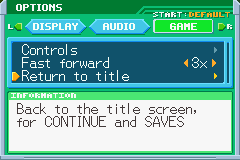 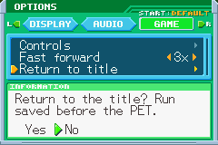

In a run, Options' Game page ends with **Return to title**. It asks, says where the run is saved, and shows the title's menu, so SAVES and the cloud are reached without closing the game. The run is kept where MegaMan stands, as a quit keeps it, and CONTINUE takes it up there. Asked for by [AlicafeZ](https://github.com/AlicafeZ).

---

## 💾 Quits and CONTINUE

### A quit as a layer's exit was taken

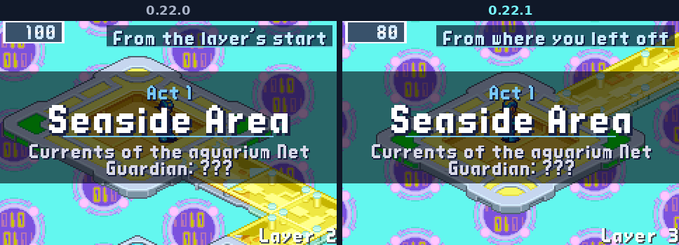

From the exit pad's warp until "Run saved" on the next layer, some two seconds, a quit or a handheld's close kept the run at the layer just left, at its last checkpoint: its battles and their zenny were gone at the CONTINUE. The game now finishes the warp first, unseen, and the run goes on from the next layer.

### A won battle on a dark layer, and a quit

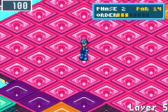

Closing the game while MegaMan spoke after a battle won on a dark layer's board (a one-turn win, a DarkHole closed, an item found), the CONTINUE went back to before that battle. The run is now kept as it stood when he began to speak.

### A Glitch layer, settled for good

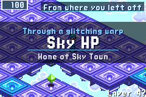 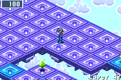

With the copy at its heart deleted a Glitch layer settles: its own look back, its battles its own. A quit and CONTINUE there brought the glitch back, its flips and its stronger viruses with it, though the copy was gone. It stays settled now.

---

## ⚔️ Battles and dark layers

### Every battle a liberation's, after a deletion in one

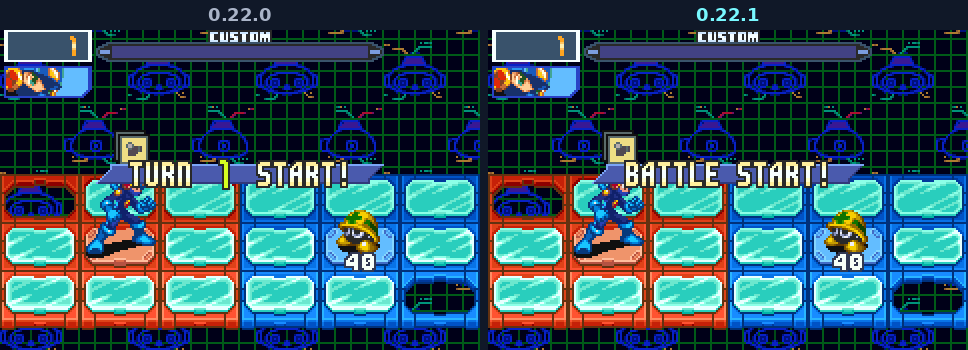

MegaMan deleted in a dark layer's battle, the next run's battles all kept its rules: three turns, the Custom screen opening by itself, TIME UP! at the third, the guardians' battles too, until the game was closed. A liberation's rules now end with its battle. Reported by [galpartuk](https://github.com/galpartuk) in [issue #669](https://github.com/saschb2b/Mega-Man-Battle-Network-Cyberworld-Endless/issues/669).

### A dark layer's panels, with BN6's ROM alone

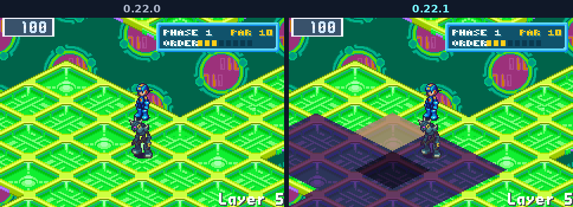

With BN6's ROM alone the board's dark panels, its DarkHoles and the lit panel MegaMan faces were drawn a screen's width off on most layers, so the floor looked clean and the fences stood unseen. They are drawn where they lie.

### START on the team's pick

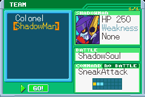 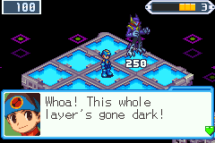

Taking the team a dark layer offered with START, the button went on to the game and opened the PET over Lan's briefing. START takes the team and nothing else.

### A new run's count of viruses

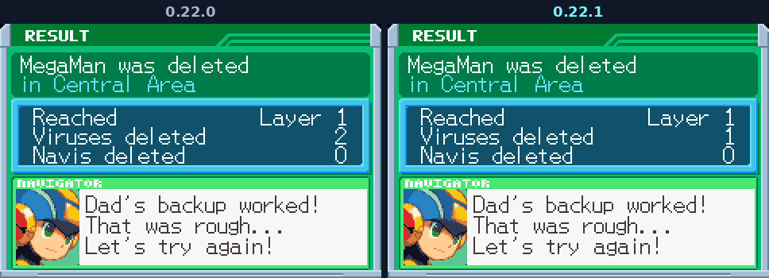

MegaMan deleted in a battle, a new run begun without closing the game started its count of viruses deleted with those of that battle, so its RESULT read too high. The count starts at nothing again.

---

## 🧰 Chips, screens and settings

### The Chip Trader takes your three chips

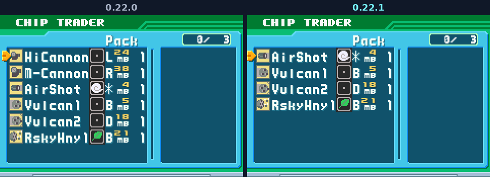

Since 0.21.0 a Chip Trader gave its chip without taking the three you put in, and could take copies of other chips from your Pack instead (two HiCannons put in cost Cannons). The layers' traders and AsterLand's take exactly the three again.

### The Library, and a chip just got at home

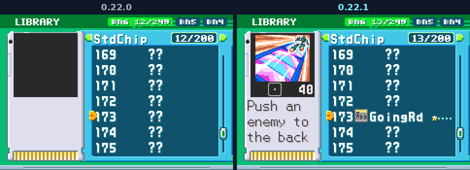

The PET's Library counted a new chip only from the run's next save. On a layer the PET saves as it opens; at home before a run's first layer it does not, so a chip AsterLand's Chip Trader had just given was not on its page until MegaMan reached the net. The Library now counts what you hold the moment it opens.

### LCD 3x, kept

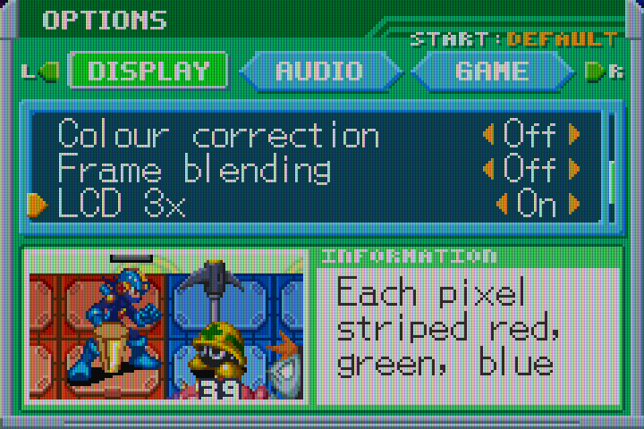

Options' Display's LCD 3x was off again each time the game started, and every turn of it added a line to `settings.ini`. It is kept now, and an older file's spare lines go the next time the line is turned.

### The JACK-IN SETUP after a first win

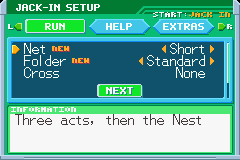 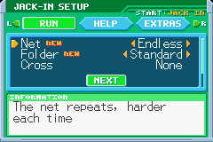

A profile's first run starts without the JACK-IN SETUP; once its short net was won, the setup it opened started on the endless net, so START alone began an endless run. The setup starts on the last run's net, the endless one a turn away, marked NEW.

---

Thank you, galpartuk and AlicafeZ!
