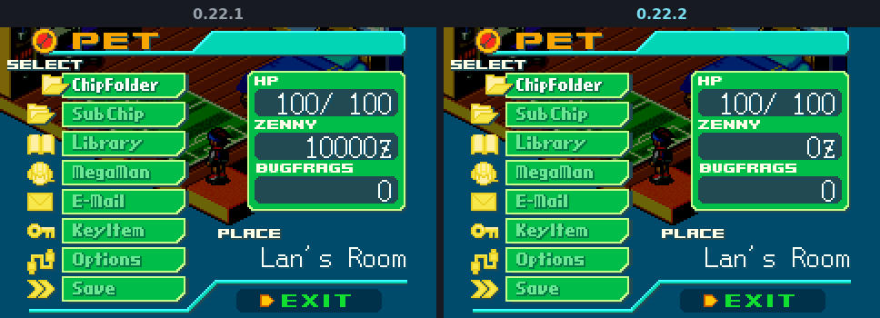

<h2 align="center">A new run starts new.</h2>

One fix: on some systems every NEW GAME began with an earlier run's MegaMan. It now begins as a new game, and a system it happened on is mended at its next NEW GAME, with nothing deleted.

---

## 🛠️ Fixed

### A new run that began with the last run's MegaMan

On some systems every NEW GAME kept the HP, zenny, SubChips, RegUPs, NaviCust and Crosses of an earlier run, and its folder showed blank chips that the folder's edit called damaged, until the app's data was deleted. A new game starts from a new game the system keeps; there it held a played one. A new run now checks that it begins as a new game, and where it does not, the kept game is made again. Reported by [Espilan](https://github.com/Espilan) in [issue #688](https://github.com/saschb2b/Mega-Man-Battle-Network-Cyberworld-Endless/issues/688), with the save that showed where to look.

---

Thank you, Espilan!
