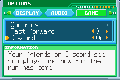
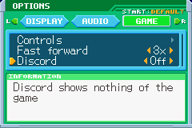
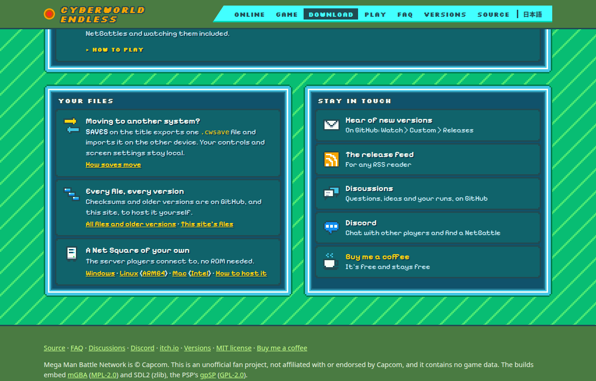
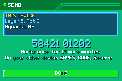
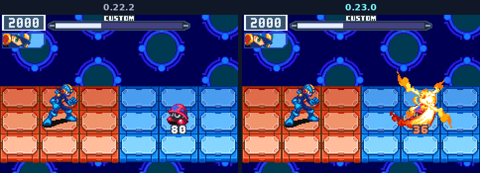
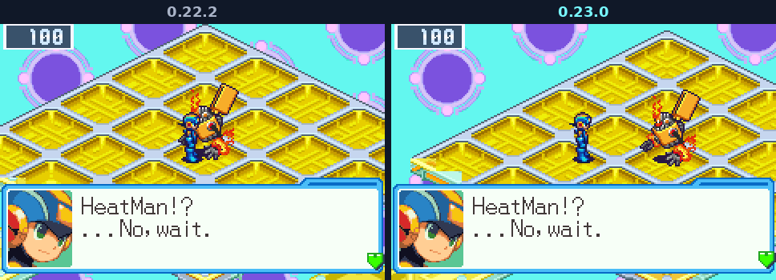
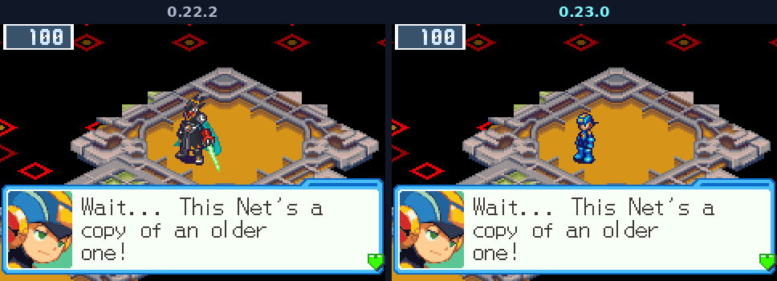

<h2 align="center">Your run on Discord, and a server to talk in.</h2>

Your friends on Discord now see that you're playing, and how far the run has come. The game has a Discord server of its own too, for runs, NetBattles, help and ideas. Four fixes come with them: Windows receiving saves, BusterUp and the Champy chips beside BN4's ROM, SlipRunr into a guardian's arena, and a liberation teammate's body that stayed on after the board.

---

## 💬 Discord

### Your run on your Discord profile

 

On Windows, Linux and macOS, with the Discord app open on the same computer, your profile and the member list show Cyberworld Endless and where the run stands:

| You are | Discord shows |
| --- | --- |
| On a layer | **Layer 14 · Sky Area**, and **Exploring**, **Busting viruses**, **Fighting ElecMan** or **Dueling ProtoMan** |
| Home between acts | **Home · layer 4 next**, and the town or **Lan's HP** |
| In the Net Square | **In the Net Square**, **Online** or **NetBattling** |
| Between runs | **Setting up a run**, **Run over on layer 14** or **Won the run on layer 10** |

It also shows the time you've played, your best run on the picture's tooltip, and a **Get Cyberworld Endless** button for your friends. The game talks only to the Discord app on your computer, never to a server of its own, and your Activity Privacy settings in Discord decide who sees it. **Discord** on Options' Game page switches it off, and off clears it at once. The handhelds, consoles, phones and the browser have no Discord app beside them, so they have no line. More in the [guide](https://github.com/saschb2b/Mega-Man-Battle-Network-Cyberworld-Endless/blob/main/docs/GUIDE.md#discord).

### The Cyberworld Endless Discord server

**Join: <https://discord.gg/mfZyWFvyfG>**

The game has a Discord server now, a place to talk that's quicker than GitHub's Discussions:

- **#general**, **#runs-and-folders** and **#screenshots-and-clips** for your runs, the folders that carried them, and the moments worth showing.
- **#net-square** to find an opponent for a NetBattle, trade, or talk about the week's DeepNet. Pick the **NetBattle pings** role and anyone looking for a match can ping you.
- **#battle-network** for the original games.
- **help**, a forum tagged by topic and system, for setups, ROMs (your own dump, never a link), saves and online play.
- **ideas**, a forum for what you'd like in the game. One that's picked up gets the **On GitHub** tag and an issue.
- **#announcements** posts each new version as it's published. Pick **Release pings** when you join to get a ping for it.
- **#dev-talk** for how the game is made, and the **Lounge** to talk by voice.

GitHub stays where the work is tracked: a bug goes to [the issues](https://github.com/saschb2b/Mega-Man-Battle-Network-Cyberworld-Endless/issues/new/choose), even after it's been talked through on Discord. The README, every page of the site and the guide link the server. On the site, the download page's notes under the systems are two PET windows now, **Your files** and **Stay in touch**.

---

## 🛠️ Fixed

### Windows receiving saves by code or from the cloud

On Windows, a code's transfer stopped part of the way, and CLOUD said it couldn't reach the server, while every other system sent and received the same saves without trouble. Windows took a message that reached it in pieces for a broken connection, and a save's data is the largest message there is. The pieces are joined now. Reported by [Espilan](https://github.com/Espilan) in [issue #700](https://github.com/saschb2b/Mega-Man-Battle-Network-Cyberworld-Endless/issues/700).

### BusterUp and the Champy chips with BN4's ROM

With Battle Network 4's ROM in the game, BusterUp did nothing, and neither did FireHit1-3 (the Champy chips, whose punch never came), FlmHook1-3, SandWrm1-3, GolmHit1-3, JustcOne and ColArmy. BN4's chips were added to the game's table for chips like these, but the table kept only the first 7 of BN6's 23 entries. It keeps all of them now. BusterUp raises MegaMan's buster by one level for the rest of the battle, as in BN6: a shot deals 2 instead of 1, and a charged shot 20 instead of 10. With BN6's ROM alone, or with BN5's beside it, these chips always worked. Thanks to the players who reported them.

### SlipRunr into a guardian's arena

A slide on SlipRunr carried MegaMan past the guardian's staging to the spot where the guardian appears, so the two met on one panel and his Guardian Data showed under MegaMan, hard to see and to take. The arena's door now ends a slide as a wall does: MegaMan steps up beside the guardian as he does on foot, and takes the Guardian Data after the battle as ever. Reported by [Espilan](https://github.com/Espilan) in [issue #697](https://github.com/saschb2b/Mega-Man-Battle-Network-Cyberworld-Endless/issues/697).

### A liberation teammate's body, kept after the board

A dark layer's board left with a teammate in play (Colonel, EraseMan, HeatMan) kept his body on the player: the next layer's MegaMan was that Navi, so was the next run's Lan, and Lan's jack-in never went through. Every layer, home, run and CONTINUE now gives MegaMan and Lan their own bodies back wherever no board is on ([issue #696](https://github.com/saschb2b/Mega-Man-Battle-Network-Cyberworld-Endless/issues/696)).

---

Thank you, Espilan, and the players who reported the chips! See you on [Discord](https://discord.gg/mfZyWFvyfG).
