

<a href="../clips/trailer.mp4">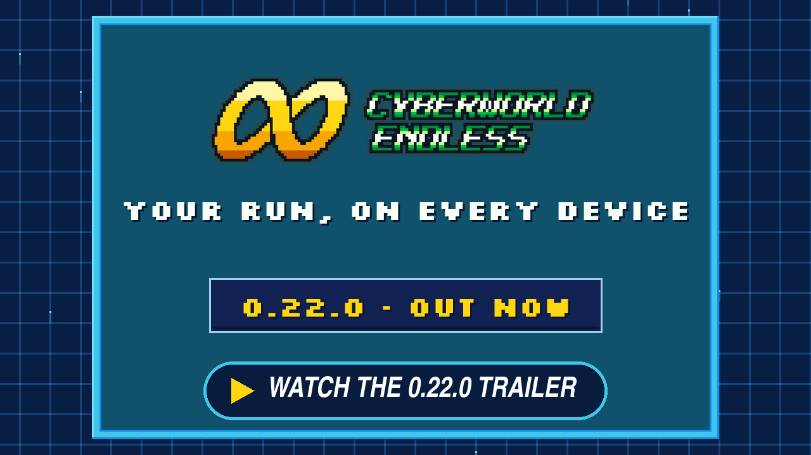</a>

<h2 align="center">Your MegaMan, your crew.</h2>

MegaMan wears colours of your own now, picked in the PET from palettes you earn, and the players around you see them: in the Net Square, in a NetBattle, on a dive. In the week's DeepNet a crew is whoever walks with you, and its battles and guardians are fought together. The setup shows every starting folder there is, ten of them, four new and one rebuilt. Team ProtoMan guards the net, Falzar's Navis give their Crosses, and a long list of fixes comes from players' reports.

Come and talk: runs, folders, NetBattles, help and ideas on the game's <a href="https://discord.gg/mfZyWFvyfG">Discord</a>.

---

## 🎨 Your MegaMan

### MegaMan in colours of your own

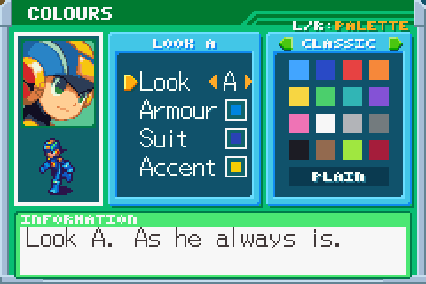

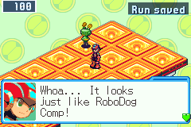 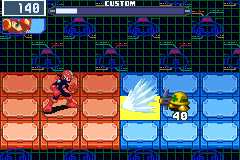 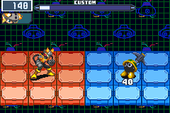

**Colours**, a new entry of the PET's menu, opens a screen where MegaMan's armour, his suit and his gold each take any colour of the palettes you own. The preview follows the cursor, and three looks are kept, A to C. He wears it on the field, in battle, in a chat box and on the Custom screen, BN6's shading kept. A Cross, a Soul or BeastOut keeps its own colours, and the look is back when the form ends.

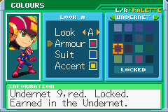

Classic is yours from the start. Six palettes come with milestones a profile reaches (the Undernet, the Cybeast's fall, Chaud's respect, a Darkloid, the tournament, the top threat rung), three are sold at AsterLand's counter for 6000 zenny each, and two hide in the net: a Mystery Data's ColrData between layers 4 and 7, or a Glitch layer's. A palette you don't own yet can be tried on him and says where it comes from. A profile gets the milestones it already holds at its next start ([issue #854](https://github.com/saschb2b/Mega-Man-Battle-Network-Cyberworld-Endless/issues/854)).

### Other players see your MegaMan in your colours

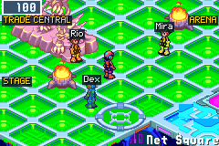 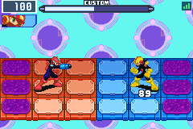

In the Net Square your look travels with your name, and the players around you are drawn in theirs. The plaza has room for three sets of colours besides yours: past that, the players farthest from you are drawn in BN6's blue until they come nearer, never in wrong colours.

In a NetBattle you see your MegaMan in your look and the other's in his, on your screen and on his, with your own face in the emotion window. Game and server both need this version ([issue #854](https://github.com/saschb2b/Mega-Man-Battle-Network-Cyberworld-Endless/issues/854)).

## 📁 Starting folders

### Every starting folder on the setup's shelf

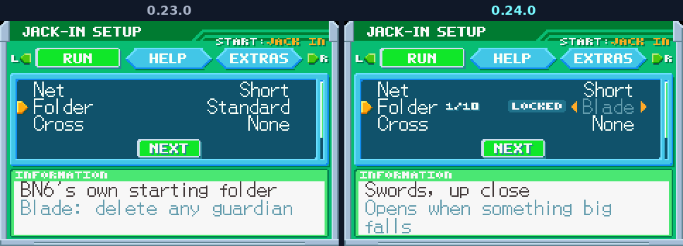

The FOLDER row turns through all ten starting folders and counts the open ones. A locked folder can be looked at, not taken: the box says what it plays like, with a hint at what opens it, never the deed itself.

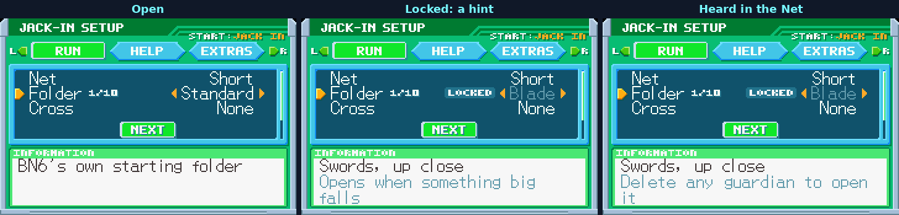

The answer is out there in the Net. A bystander may tell how one opens, and from then on the setup says it plainly. Stuck for three runs, the Endless Net BBS posts one. The summary's closest unlock follows the same rule ([issue #864](https://github.com/saschb2b/Mega-Man-Battle-Network-Cyberworld-Endless/issues/864)). Thanks to Baron Solomon for the idea.

### Four starting folders

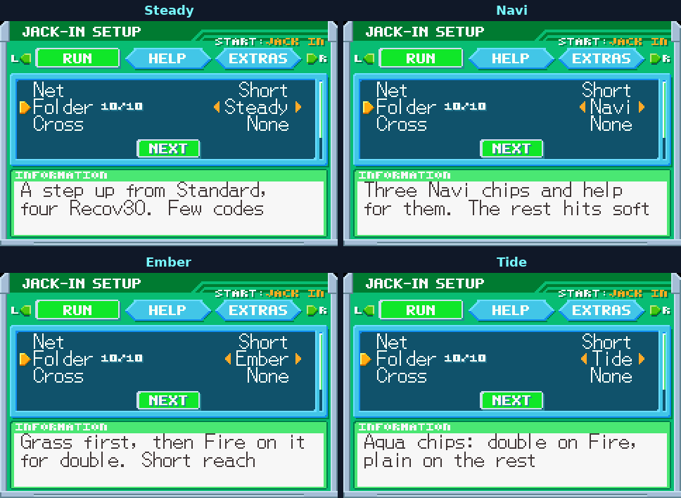

- **Steady** is BN6's own ExtraFolder (HiCannon, Vulcan2, EnergBom, LifeSword's three swords) with four Recov30. It opens once a run reaches act 3.
- **Navi** is BN6's Navi folder made a start's: BlastMan, DiveMan and CircusMan with small chips in their codes, BblStar1 and WhiCapsl to hold a foe for them, and three Navi+20. It opens once you use a Navi chip.
- **Ember** lays grass with GrasSeed and burns it with Fire chips, which hit a foe on grass for double. It opens once a guardian falls to MegaMan in HeatCross.
- **Tide** is Aqua in codes A and T, double on Fire foes, with bubbles and IceSeed's ice to hold a foe still. It opens once a Fire guardian is deleted, so a profile that has beaten HeatMan or BlastMan has it at once.

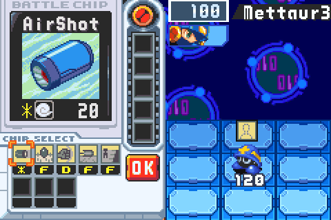

([issue #865](https://github.com/saschb2b/Mega-Man-Battle-Network-Cyberworld-Endless/issues/865))

### Z-Canon rebuilt around three Program Advances

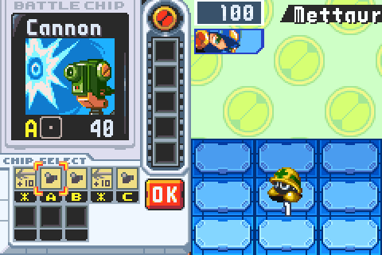

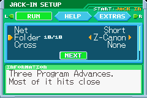 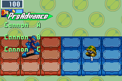

The folder is now BN6's own Program Advance folder one tier down: Cannon A B C for GigaCan1, FireBrn1 F G H for WideBrn1, FireHit1 D E F for FlmHook1, and LifeSrd's three swords in S, with Standard's kind of support in \*. With the old folder a Program Advance came together in 1 battle in 100; now in about 1 in 11, at about Standard's damage. It still opens with any Program Advance used ([issue #865](https://github.com/saschb2b/Mega-Man-Battle-Network-Cyberworld-Endless/issues/865)).

## ⚔️ Guardians, Crosses and Souls

### Team ProtoMan guards the net, and their Souls are MegaMan's

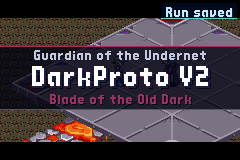 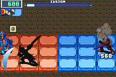

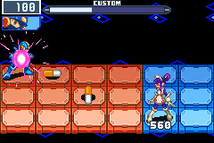 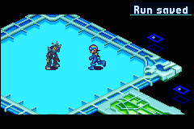

With BN5 Team Colonel's ROM beside BN6's, from act 2 a coin of the seed puts a BN5 area's guardian's partner in his place: GyroMan for ShadowMan, SearchMan for NumberMan, NapalmMan for TomahawkMan, MagnetMan for KnightMan, Meddy for ToadMan, and DarkProto, BN5's ProtoMan, for Colonel in the Undernet. The deep acts draw from all of them. Each fights as BN5's does. Team Colonel's ROM draws none of the other five on the net, so there they stand in a HeelNavi's body.

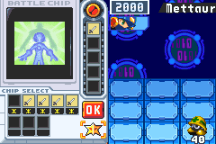 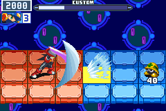

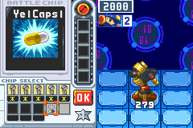

Each leaves his Soul and a chip of its kind: GyroSoul, SearchSoul with its SHUFFLE, NapalmSoul, MagnetSoul, MeddySoul with her capsules on the Custom screen, ProtoSoul.

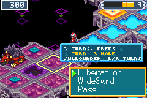 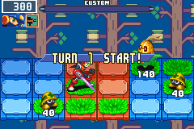

On a dark layer a held Soul brings its Navi onto the board with his own command, ProtoMan in person ([issue #774](https://github.com/saschb2b/Mega-Man-Battle-Network-Cyberworld-Endless/issues/774)).

### Falzar's five Crosses

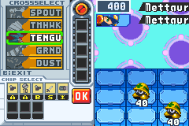 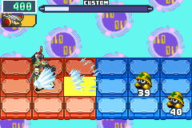

SpoutMan, TomahawkMan, TenguMan, GroundMan and DustMan now give their Crosses when they fall as an act's guardian, as Gregar's five Cross Navis do: SpoutCross, TomahawkCross, TenguCross, GroundCross and DustCross, each with its own body, element, weakness and charged shot, chosen on CROSSSELECT beside Gregar's. Once their Navi has fallen, a run can start in one ([issue #706](https://github.com/saschb2b/Mega-Man-Battle-Network-Cyberworld-Endless/issues/706)).

### Forms, the run's Crosses and Souls on one screen

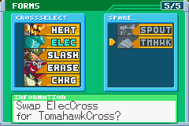 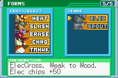

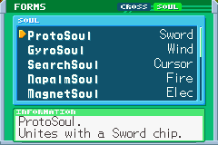

A run can hold ten Crosses and CROSSSELECT lists five. **Forms** in the PET's menu shows the five and the spares in the folder editor's two windows: A on one, A on another swaps them, whenever you like and at no cost. Its second page lists the Souls you hold and the chip each takes ([issue #774](https://github.com/saschb2b/Mega-Man-Battle-Network-Cyberworld-Endless/issues/774)).

## 🌐 Together

### In the week's DeepNet, a crew is who walks with you

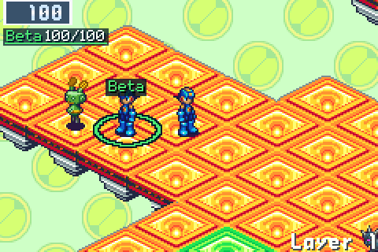

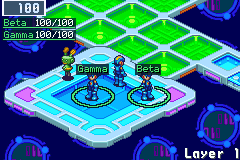 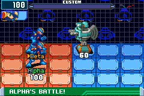

Stand near another diver for a second and you are a crew, up to four; walk out of sight and you are not. Nothing to ask or answer. A crewmate's battle starts at once with every free crewmate in it, side by side at the front. Each diver's name stands over his MegaMan, your crew's in green with a ring at their feet; a plate under the HP box gives each crewmate's HP and where he is (his layer, BATTLE, BUSY, HOME), and the map and the second screen show them too. A crewmate deleted in a battle the crew wins is pulled back once a dive, on a quarter of each standing crewmate's HP. Game and server both need this version: an older one is told so at the gate.

### A guardian's door waits for your crew

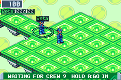 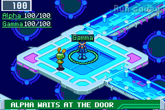

A guardian's door waits ten seconds for your crew (hold A to go in early), and a party meets the guardian a diver alone meets, his HP times the party.

### Into the dive and out of it

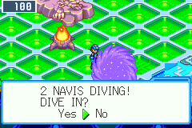 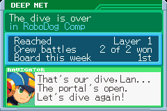

The portal asks once and says how many are diving ("2 NAVIS DIVING! DIVE IN?"), the title's CONTINUE takes an unfinished dive straight back up, a dive's end has a RESULT of its own and reaches the Board as it ends, and a dropped link is said in the band and taken up again however long it was away.

### A NetBattle rides out a dropped link

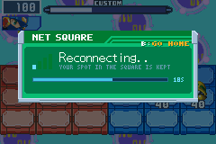 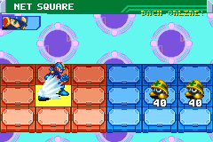

The server holds the battle and your place; once the link is back the two games catch each other up and fight on, a Team NetBattle's relay and two a side included. Past 20 seconds it stops, and the card that says why stays until B. A lopsided connection gets a few frames less input delay ([issue #180](https://github.com/saschb2b/Mega-Man-Battle-Network-Cyberworld-Endless/issues/180)).

### A partner's HP in BN6's own digits

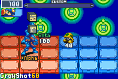

On a party's field and in the Arena's two a side, your ally's HP stands under his name in BN6's battle digits, beside him as BN6 puts an enemy's, never over another MegaMan of the crew: orange while it falls, green while it rises.

## 🧭 In a run

### The PET's menu in two columns

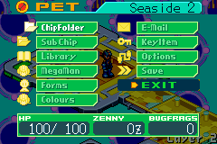

START on the map opens BN6's own menu laid out again from BN6's pieces: ChipFolder, SubChip, Library, MegaMan, Forms and Colours down the left, E-Mail, KeyItem, Options and Save down the right, EXIT under Save, HP, Zenny and BugFrags in one strip, the field darkened behind it. Down from ChipFolder and Up to Save count as in BN6; Left and Right go across. In the Net Square the menu stays BN6's ([issue #793](https://github.com/saschb2b/Mega-Man-Battle-Network-Cyberworld-Endless/issues/793)).

### Fast forward keeps the music at its own pace

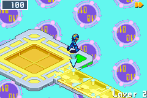

While the game runs fast, the song plays on as it would at BN6's speed instead of hurrying along with the game, and when fast forward stops the game picks the song up from there. A battle's theme and the win's start as they come; the game's sounds still play fast, with what is on screen. `fast_music = off` in `settings.ini` brings the faster music back ([issue #839](https://github.com/saschb2b/Mega-Man-Battle-Network-Cyberworld-Endless/issues/839)). Thanks to Agergo100 for the idea.

### The layer's map stays open

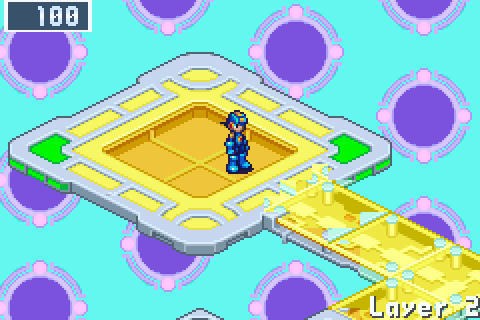

A press of SELECT opens the map and leaves it open while MegaMan walks; the next press closes it, as does a battle, a chat, the PET or a warp. Held, it shows while held, as before. Thanks to Agergo100 for the idea ([issue #840](https://github.com/saschb2b/Mega-Man-Battle-Network-Cyberworld-Endless/issues/840)).

### A request's reward is taken in Lan's HP

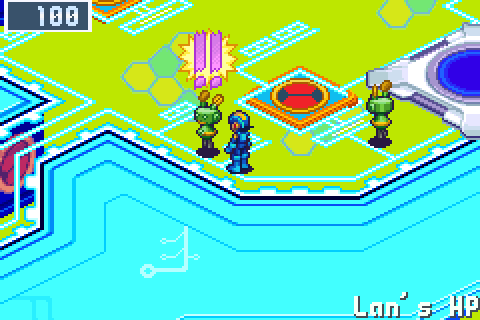

The Mr.Prog there hands over a finished request's pay in its asker's name, carries a Bring request's chip to the NetBattler and his trade back, and passes on the asker's word where a request was not done, so the board opens for a new one at once. No jack-out and walk to the asker any more; they still settle it in the town for whoever goes to them first, once either place. Thanks to Agergo100 for the idea ([issue #841](https://github.com/saschb2b/Mega-Man-Battle-Network-Cyberworld-Endless/issues/841)).

### You choose the chip a Bring request takes

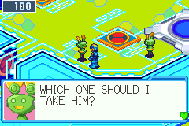 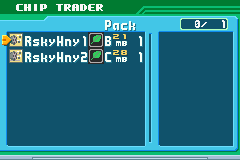

Where more than one kind of chip in your Pack fits the NetBattler's request, he opens BN6's Chip Trader screen over those alone: put in the one you can spare, and he takes that one. B leaves it with nothing taken, the request still yours. One kind alone goes as before ([issue #842](https://github.com/saschb2b/Mega-Man-Battle-Network-Cyberworld-Endless/issues/842)). Thanks to Agergo100 for the idea.

## 🛠️ Fixed

### Chips turned round with MegaMan

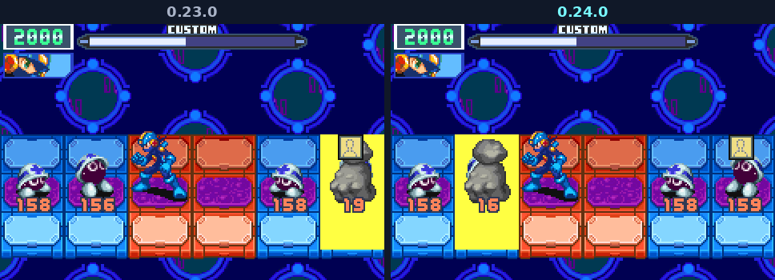

On a liberation's Surrounded field, turned left with L, GolmHit's fist came down behind him, and SandWrm, BurnSqr, TenguMan's chip, AirRaid and Magnum, and BN4's GutsMan, PanlSht, SeekBom, PitRng, RollAro, GutPnch, Meteors, Boomer, DrkVulcn and DarkBomb aimed by his side alone: they struck behind him or nothing at all. They now strike ahead of him whichever way he faces, and BlastMan's flames start where he stands. Thanks to Agergo100 for the report (issues [#838](https://github.com/saschb2b/Mega-Man-Battle-Network-Cyberworld-Endless/issues/838), [#846](https://github.com/saschb2b/Mega-Man-Battle-Network-Cyberworld-Endless/issues/846)).

### A liberation's battle after its time is up

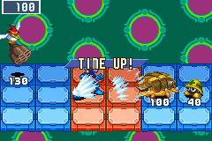 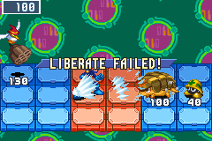

As the third turn ended, the foes kept moving and attacking under TIME UP! and LIBERATE FAILED!, and a hit there still counted. The battle now stands still from the moment the time is up, as BN5's does. Thanks to Agergo100 for the report ([issue #794](https://github.com/saschb2b/Mega-Man-Battle-Network-Cyberworld-Endless/issues/794)).

### CosmoMan SP's card

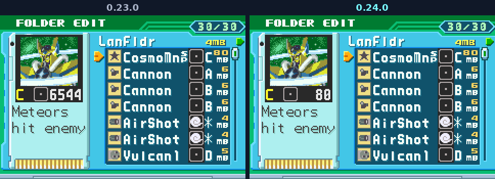

The Navi chips' SP from Battle Network 5 and 4 (NumberMan's to GridMan's, and GutsMan's) showed a wrong number on their card in Folder Edit and sorted wrongly by Attack: 6544 for CosmoMan SP. The card now shows the power the chip deals in battle, the one its own game shows for a Navi you never deleted against the clock: 80 for CosmoMan SP. Thanks to Agergo100 for the report ([issue #835](https://github.com/saschb2b/Mega-Man-Battle-Network-Cyberworld-Endless/issues/835)).

### ColonelDS in the Pack

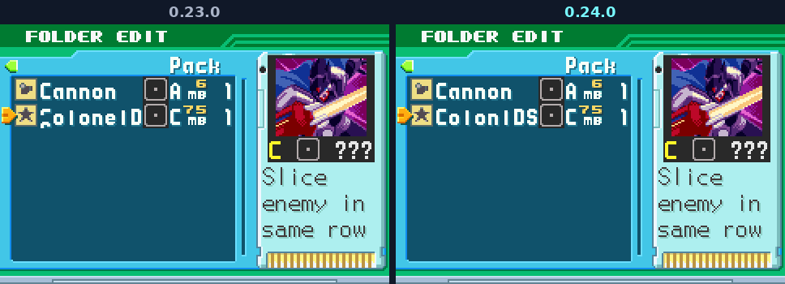

BN5's DS Navi chips had names of nine letters where BN6's lists hold eight, so every row under one stood a cell late and the Custom screen cut the name short. The twelve are eight now: ColonlDS, NumbMnDS, ShadoMDS, TmhkMnDS and the rest. Thanks to Agergo100 for the report ([issue #732](https://github.com/saschb2b/Mega-Man-Battle-Network-Cyberworld-Endless/issues/732)).

### The Security Cube on its panel

A layer's Security Cube floated over its panel's edge. It stands on its panel's middle now, sunk as BN6 stands its own in Central Area, and MegaMan stops where the cube begins. Thanks to Agergo100 for the report ([issue #735](https://github.com/saschb2b/Mega-Man-Battle-Network-Cyberworld-Endless/issues/735)).

### HubBatc's card

Gregar's ROM gives Falzar's five Gigas the pictures of its own, so HubBatc's card showed ColForce's. BigHook, BassAnly and CrossDiv now show BN5's pictures of them where BN5's ROM is there, and all five show BN6's blank card where no ROM holds theirs, never another chip's. Thanks to Agergo100 for the report ([issue #731](https://github.com/saschb2b/Mega-Man-Battle-Network-Cyberworld-Endless/issues/731)).

### A Chip Trader's trade and the reward pick

After a trade, the layer's vault or another pick of three now and then opened over the trader. BN6 saves after every trade, and the run read its flags while the save held them scrambled. It waits the save out now. Thanks to Agergo100 for the report ([issue #734](https://github.com/saschb2b/Mega-Man-Battle-Network-Cyberworld-Endless/issues/734)).

### Three more

- **A gap between two floors in Mr. Weather Comp** was drawn in pieces of floor cut straight down, sky through them, like a walkway that was not there. Each floor now ends in its own rim, the gap open sky. Thanks to Agergo100 for the report ([issue #836](https://github.com/saschb2b/Mega-Man-Battle-Network-Cyberworld-Endless/issues/836)).
- **DiveMan's launcher fired on under JudgeMan.** In the Glitch copy's fight, a form taken off by the swap left its own objects on the field until the battle ended. They go with the form now. Thanks to Agergo100 for the report ([issue #733](https://github.com/saschb2b/Mega-Man-Battle-Network-Cyberworld-Endless/issues/733)).
- **A crew's battle could stall on its Custom screen for half a minute.** A crewmate's chips were now and then lost on their way, and the field waited for them to the turn's limit. They always arrive now.

---

Thank you, Agergo100, for a whole notebook of reports and four of this release's ideas, and Baron Solomon for the folders' shelf! See you on [Discord](https://discord.gg/mfZyWFvyfG).
