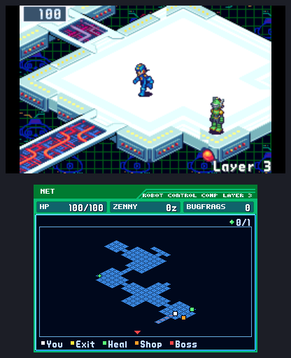
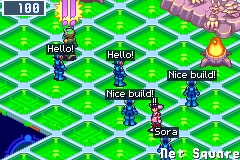
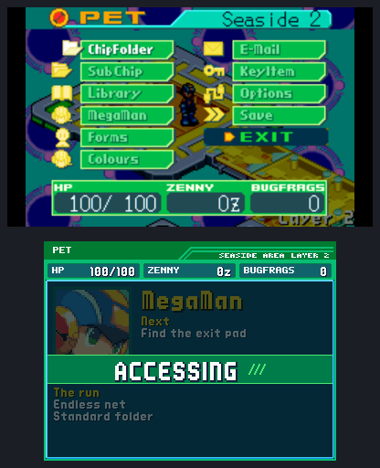
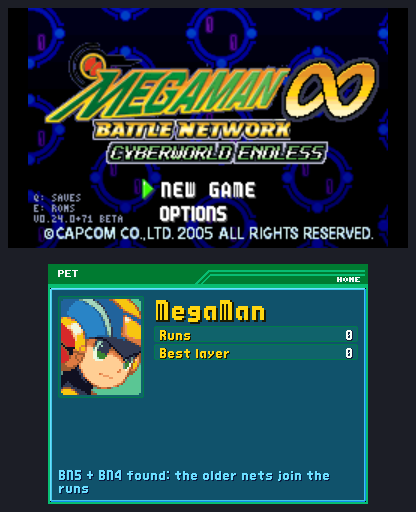
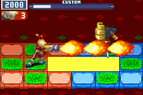
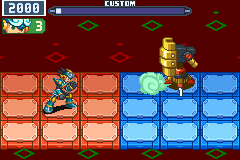
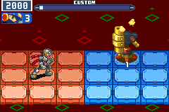

<h2 align="center">Full speed on the 3DS again.</h2>

0.24.0 ran slower on the New 3DS and the PS Vita than the versions before it. That is fixed, and the 3DS got more on the way: the Net Square and the start menu at full speed, and BN5's and BN4's ROMs read together. In a SOUL BN4 run all twelve of BN4's Souls are MegaMan's now.

Come and talk: runs, folders, NetBattles, help and ideas on the game's <a href="https://discord.gg/mfZyWFvyfG">Discord</a>.

---

## 🛠️ Fixed

### The New 3DS and the PS Vita ran slower since 0.24.0

The new PET menu's picture asked the game where it stood on every frame drawn, whether the menu was open or not. On the systems where the GBA runs on a processor core of its own, each of those questions held the drawing back until the game's next frame was done: dropped frames and broken sound everywhere, slower than before 0.22.0. Measured on a New 3DS in the city, 0.24.0 showed 54 frames a second at the median and as few as 24; this version shows 59 to 60. The layer's map on the bottom screen, SELECT's map left open, the team's HP on a dark layer and the other divers' names in the week's DeepNet held the drawing back the same way, and no longer do (issue #897).

### The Net Square crawled on a New 3DS

The Square read two small files from the SD card on every frame, 20 ms of each one, and showed 25 frames a second. They are read once a visit now.

### The start menu lagged on a New 3DS in the net

With the menu open on a layer the 3DS showed 45 to 53 frames a second, in the town 60. Once the menu stands still the game no longer draws BN6's own PET screen under ours each frame. While it waits, the net seen through the menu's top band stands still with the rest of the field.

---

## ✨ New

### A New 3DS reads BN5's and BN4's ROMs together

Until now a New 3DS read one of them beside BN6's, BN5's where both were there, and said the other was found with no room for it. The game needs far less memory for a layer than it did when that limit was set, and both fit: BN4's areas, viruses, chips, Navis and Souls join a 3DS's runs beside BN5's. Its NetPass is every other system's now: full with both games, it trades and the week's DeepNet opens. With one game it holds the Square's stamp alone, where it held a Trade pass before, so add the other ROM to trade again. NetBattles are still not offered on a 3DS.

### All twelve of BN4's Souls

  

In a SOUL BN4 run seven more Navis leave their Soul, each as BN4 plays it:

- **FireSoul:** a flame for his charged shot, Fire chips charged, grass laid as he unites, lava that heals him.
- **MetlSoul:** a punch that knocks back, Break chips charged at double.
- **WoodSoul:** a tornado, and no status sticks to him.
- **WindSoul:** AirShot and WindRack, his wind through the fight.
- **ProtSoul:** WideSwrd, Sword chips charged at double, a shield on B and Left.
- **RollSoul:** the arrow, and a heal after every chip but Recovery.
- **JunkSoul:** Poltrgst, the foes confused as he unites.

They join ThunSoul, GutsSoul, AquaSoul, SrchSoul and NumSoul.

---

Thank you, Pink5G, for the report that started this! See you on [Discord](https://discord.gg/mfZyWFvyfG).
